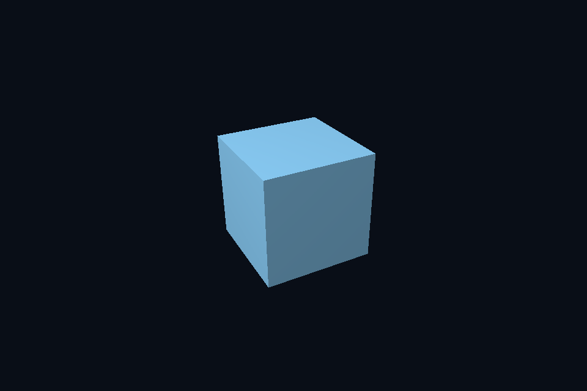

# 第 29 课 · 描述符布局与资源接口声明 · DirectX 12

[54 课目录](../../COURSE.md) · [对照精讲](../../../docs/compare/05_binding_constants.md) · [上一课](../28_uniform_layout/README.md) · [下一课](../30_descriptor_instances/README.md)

## 本课目标与先修

学习目标：解释“描述符布局与资源接口声明”解决的问题，找到实际对象和参数，运行对应实验并用数据/画面证明。先完成前一课，并能说明它交付的对象与完成条件；本课在该依赖上增加新契约。

## 为什么需要这一层

接口声明说明需要哪些资源、在哪个阶段、数量和类型；实际绑定说明此刻引用哪一份内容。布局通常可复用，资源引用会变化，数据字节又按自己的频率更新。

## DirectX 12 的对象、参数与执行推导

root signature 组合 root constants、root descriptor 和 descriptor table。parameter 2 可以指 t0，register space 又是独立维度。显式说明接口约定，才能检查 shader 与调用是否兼容。

## 对照 Vulkan 原生：相同问题的另一种分工

DescriptorSetLayoutBinding 连接 shader binding 与资源类型/阶段；PipelineLayout 组合 set layout 和 push range。它不是 descriptor pool，也不拥有 buffer。绑定错误不能通过只更新 buffer 内容修复。

## 关键参数与可检查不变量

| 检查项 | Vulkan 表达 | DX12 表达 | 不变量 / 证据 |
| --- | --- | --- | --- |
| 接口形状 | set layout / pipeline layout | root signature | 不会复制资源内容 |
| 实际引用 | allocated descriptor set | root descriptor / table | 绑定选择与数据更新分开 |
| 更新频率 | 帧 / 材质 / 对象分组 | 同样按频率分组 | 不每 draw 重建全部长期对象 |

先为每项指出源码中的创建/绑定位置，以及证明它成立的实际日志、字节或图像。数值中的设备限制以查询为准；固定实验尺寸不当作所有设备的上限。

## nvpro_core2 框架对照

SceneVk 使用原生 layout/set；Context 与 Application 不自动推导自定义 shader 的资源接口。

这部分是原生 Vulkan 各课的框架对照，框架可运行入口仍为原有六课。如果本节需要新接入工作，会按正文说明；不把原生实验当作已完成的框架实现。

## 运行与实际检查

| 路线 | 实际实验 |
| --- | --- |
| DirectX 12 | [dx05_indexed_cbv](../../lessons/dx05_indexed_cbv/README.md) |
| DirectX 12 | [dx16_push_constants](../../lessons/dx16_push_constants/README.md) |
| Vulkan 原生 | [vk05_indexed_uniform](../../../Vulkan/native/lessons/vk05_indexed_uniform/README.md) |
| Vulkan 原生 | [vk16_push_constants](../../../Vulkan/native/lessons/vk16_push_constants/README.md) |

从合集根目录执行；普通图形程序 Esc 退出，设备/计算/诊断程序输出结果后结束。从“开始学习.cmd”进入本页时，表格可直接点击运行。

```powershell
cmake --preset dx12
cmake --build --preset dx12-debug --target dx05_indexed_cbv --parallel 4
.\DirectX12\build\bin\Debug\dx05_indexed_cbv.exe
ctest --preset dx12-debug -R "^dx05_indexed_cbv$" --output-on-failure
```

检查三个层次：创建/绑定/提交的接口约束；数据读回或目标画面；资源使用结束后的回收。诊断实验用合法信息或查询证明渠道可用，不故意保留 API 错误。图形 smoke 的像素检查与数值实验的逐项检查不同，具体实现见源码。

## 关键实现：从当前源码定位

来自 [DirectX12/common/dx12_course.hpp](../../common/dx12_course.hpp#L345)，第 345—388 行。下列是当前仓库的局部切片，可能在函数中间结束；完整上下文请打开文件，切片不作为单独可编译程序。

```cpp
        D3D12_ROOT_PARAMETER params[3]{};
        params[0].ParameterType = D3D12_ROOT_PARAMETER_TYPE_CBV;
        params[0].Descriptor.ShaderRegister = 0;
        params[0].ShaderVisibility = D3D12_SHADER_VISIBILITY_VERTEX;
        params[1].ParameterType = D3D12_ROOT_PARAMETER_TYPE_32BIT_CONSTANTS;
        params[1].Constants = {1, 0, 20};
        params[1].ShaderVisibility = D3D12_SHADER_VISIBILITY_ALL;
        D3D12_DESCRIPTOR_RANGE range{};
        range.RangeType = D3D12_DESCRIPTOR_RANGE_TYPE_SRV;
        range.NumDescriptors = 1;
        range.BaseShaderRegister = 0;
        range.OffsetInDescriptorsFromTableStart = D3D12_DESCRIPTOR_RANGE_OFFSET_APPEND;
        params[2].ParameterType = D3D12_ROOT_PARAMETER_TYPE_DESCRIPTOR_TABLE;
        params[2].DescriptorTable = {1, &range};
        params[2].ShaderVisibility = D3D12_SHADER_VISIBILITY_PIXEL;
        D3D12_STATIC_SAMPLER_DESC sampler{};
        sampler.Filter = D3D12_FILTER_MIN_MAG_MIP_LINEAR;
        sampler.AddressU = sampler.AddressV = sampler.AddressW =
            clampSampler ? D3D12_TEXTURE_ADDRESS_MODE_CLAMP : D3D12_TEXTURE_ADDRESS_MODE_WRAP;
        sampler.MaxLOD = D3D12_FLOAT32_MAX;
        sampler.ComparisonFunc = D3D12_COMPARISON_FUNC_ALWAYS;
        sampler.ShaderVisibility = D3D12_SHADER_VISIBILITY_PIXEL;
        D3D12_ROOT_SIGNATURE_DESC root{};
        root.NumParameters = 3;
        root.pParameters = params;
        root.NumStaticSamplers = 1;
        root.pStaticSamplers = &sampler;
        root.Flags = D3D12_ROOT_SIGNATURE_FLAG_ALLOW_INPUT_ASSEMBLER_INPUT_LAYOUT;
        signature = rootSignature(c, root);
        auto vs = compileHlsl(mode == 3 ? "TriangleMain" : "VertexMain", "vs_5_1"),
             ps = compileHlsl("PixelMain", "ps_5_1");
        D3D12_INPUT_ELEMENT_DESC elements[] = {{"POSITION",
                                                0,
                                                DXGI_FORMAT_R32G32B32_FLOAT,
                                                0,
                                                0,
                                                D3D12_INPUT_CLASSIFICATION_PER_VERTEX_DATA,
                                                0},
                                               {"NORMAL",
                                                0,
                                                DXGI_FORMAT_R32G32B32_FLOAT,
                                                0,
                                                12,
                                                D3D12_INPUT_CLASSIFICATION_PER_VERTEX_DATA,
```

阅读时按“前置对象 → 参数/布局 → 录制/调用 → 完成/可见性 → 释放”五步标注。共享 helper 减少重复代码，但不会取消每课的 API 契约。

## 受控修改实验

为一个每帧相机、每材质纹理、每对象 model 的场景设计更新频率划分。

先记录预测，再只改一个因素；保留基线与修改后的输出。不要同时改变 shader、资源范围和同步，这样即使结果变好也无法归因。

### 参考推导与通过标准

按帧更新 Frame，按材质选择纹理引用，按 draw 更新 model 小常量。不要每 draw 重建全部布局，也不把大型场景数据塞进 push/root constants。

## 常见失败与排查顺序

把 binding location、root parameter、HLSL register 和 heap offset 当成同一个整数系统，会产生看似相近却错误的绑定。

先看第一条错误和当前执行路径，再看实际数据/绑定，最后看 shader 与画面。需要 GPU 证据时抓取正常交互帧；仅四帧的 smoke 适合自动检查，不适合手动抓帧。

## 自测与本课交付

能否不看源码回答：为一个每帧相机、每材质纹理、每对象 model 的场景设计更新频率划分。

提交一份简短记录：输入与假设、唯一修改、预期、实际证据、原因、是否恢复基线。如果只能复述函数名而说不清何时允许访问/释放，先回到本课的数据流。

## 官方阅读位置与当前工程差异

[指定 Vulkan 教程对应位置](https://docs.vulkan.net.cn/tutorial/latest/05_Uniform_buffers/00_Descriptor_set_layout_and_buffer.html)。DX12 路线按同一概念顺序建立映射，其对象与约束以 Microsoft 文档和本后端代码为准。49—54 课包含在基础/compute 之后加入的工程扩展。

[版本与资料说明](../../../docs/REFERENCES.md) · [调试](../../../docs/DEBUGGING.md) · [功能完成度](../../../docs/FEATURE_MATRIX.md)

## 固定输入的实际 GPU 读回


