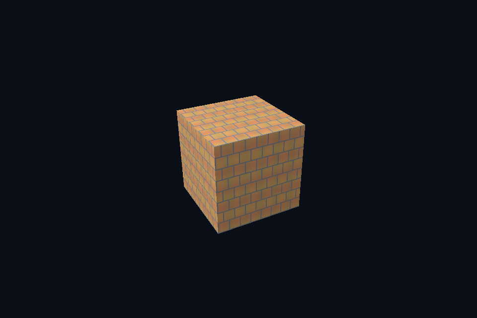

# 第 33 课 · 真实图片、通道与资产路径 · DirectX 12

[54 课目录](../../COURSE.md) · [对照精讲](../../../docs/compare/06_textures_color.md) · [上一课](../32_per_draw_constants/README.md) · [下一课](../34_image_upload/README.md)

## 本课目标与先修

学习目标：解释“真实图片、通道与资产路径”解决的问题，找到实际对象和参数，运行对应实验并用数据/画面证明。先完成前一课，并能说明它交付的对象与完成条件；本课在该依赖上增加新契约。

## 为什么需要这一层

图片文件不是 GPU 纹理。先解码为明确的 width/height/channel 字节，再选择 GPU 格式和上传策略。本课程固定输出 RGBA8，资源路径相对 executable，避免工作目录和原图通道数影响实验。

## DirectX 12 的对象、参数与执行推导

解码结果按 footprint 行距复制进 UPLOAD buffer，再用 CopyTextureRegion 写入 texture。GPU 资源格式与字节布局要匹配；需要四通道时不能按原图三通道长度拷贝。

## 对照 Vulkan 原生：相同问题的另一种分工

stb_image 解码后写入 staging，最终 image 使用 optimal tiling。这里只展示普通 2D 图片，压缩 GPU 格式、流式加载和完整材质导入是进一步工作，不因 PNG 成功就宣称全部资产格式已支持。

## 关键参数与可检查不变量

| 检查项 | Vulkan 表达 | DX12 表达 | 不变量 / 证据 |
| --- | --- | --- | --- |
| 解码输出 | RGBA8 连续像素 | 相同 CPU 结果 | width*height*4 字节 |
| 相对路径 | exe/assets/... | exe/assets/... | 不依赖 IDE 工作目录 |
| 用途分类 | 颜色/数据格式另选 | 颜色/数据 view 另选 | PNG 扩展名不决定 sRGB |

先为每项指出源码中的创建/绑定位置，以及证明它成立的实际日志、字节或图像。数值中的设备限制以查询为准；固定实验尺寸不当作所有设备的上限。

## nvpro_core2 框架对照

框架可提供额外资产工具，但本教程的原生图片路径独立于框架；对照时分开查看解码和 GPU 上传两层。

这部分是原生 Vulkan 各课的框架对照，框架可运行入口仍为原有六课。如果本节需要新接入工作，会按正文说明；不把原生实验当作已完成的框架实现。

## 本章独立工程与关键注释

[main.cpp](main.cpp) · [本地辅助实现](support/) · [本章着色器](shaders/) · [CMakeLists.txt](CMakeLists.txt)

完整源码就在本目录，关键步骤含中文注释。只复用 GLFW/GLM/Assimp 等第三方库，不包含或链接其他章节的课程实现。单独复制本章文件夹也可配置构建；初始化或纯计算章节不需要图形阶段。

```powershell
cmake -S . -B build -A x64
cmake --build build --config Debug --parallel 4
ctest --test-dir build -C Debug --output-on-failure
```

## 运行与实际检查

| 路线 | 实际实验 |
| --- | --- |
| DirectX 12 | [dx17_image_file](../../lessons/dx17_image_file/README.md) |
| Vulkan 原生 | [vk17_image_file](../../../Vulkan/native/lessons/vk17_image_file/README.md) |

从合集根目录执行；普通图形程序 Esc 退出，设备/计算/诊断程序输出结果后结束。从“开始学习.cmd”进入本页时，表格可直接点击运行。

```powershell
cmake --preset dx12
cmake --build --preset dx12-debug --target dx33_ch_image_decode --parallel 4
.\DirectX12\build\bin\Debug\dx33_ch_image_decode.exe
ctest --preset dx12-debug -R "^dx33_ch_image_decode$" --output-on-failure
```

检查三个层次：创建/绑定/提交的接口约束；数据读回或目标画面；资源使用结束后的回收。诊断实验用合法信息或查询证明渠道可用，不故意保留 API 错误。图形 smoke 的像素检查与数值实验的逐项检查不同，具体实现见源码。

## 关键实现：从当前源码定位

来自 [DirectX12/chapters/33_image_decode/main.cpp](main.cpp#L296)，第 296—309 行。下列是当前仓库的局部切片，可能在函数中间结束；完整上下文请打开文件，切片不作为单独可编译程序。

```cpp
int runChapter(int argc, char** argv) {
    auto options = labOptions(argc, argv, 17);
    {
        return graphicsLab(argc, argv, options);
    }
}
} // namespace course

int main(int argc, char** argv) try {
    return course::runChapter(argc, argv);
} catch (const std::exception& error) {
    std::cerr << "ERROR: " << error.what() << '\n';
    return 1;
}
```

阅读时按“前置对象 → 参数/布局 → 录制/调用 → 完成/可见性 → 释放”五步标注。辅助实现与着色器是本章自己的文件；修改不会影响其他章。

## 受控修改实验

把图片换成带透明通道的四象限测试图，先检查方向与字节数，再讨论混合。

先记录预测，再只改一个因素；保留基线与修改后的输出。不要同时改变 shader、资源范围和同步，这样即使结果变好也无法归因。

### 参考推导与通过标准

图像 RGBA 内容正确与 blending 状态正确是两件事。透明字节上传成功不代表自动启用了透明渲染。

## 常见失败与排查顺序

读取失败先看路径与解码；周期错行先看通道/row pitch；整体明暗再看 sRGB，不用同一个“翻转图片”操作解决所有问题。

先看第一条错误和当前执行路径，再看实际数据/绑定，最后看 shader 与画面。需要 GPU 证据时抓取正常交互帧；仅四帧的 smoke 适合自动检查，不适合手动抓帧。

## 自测与本课交付

能否不看源码回答：把图片换成带透明通道的四象限测试图，先检查方向与字节数，再讨论混合。

提交一份简短记录：输入与假设、唯一修改、预期、实际证据、原因、是否恢复基线。如果只能复述函数名而说不清何时允许访问/释放，先回到本课的数据流。

## 官方阅读位置与当前工程差异

[指定 Vulkan 教程对应位置](https://docs.vulkan.net.cn/tutorial/latest/06_Texture_mapping/00_Images.html)。DX12 路线按同一概念顺序建立映射，其对象与约束以 Microsoft 文档和本后端代码为准。49—54 课包含在基础/compute 之后加入的工程扩展。

[版本与资料说明](../../../docs/REFERENCES.md) · [调试](../../../docs/DEBUGGING.md) · [功能完成度](../../../docs/FEATURE_MATRIX.md)

## 固定输入的实际 GPU 读回


