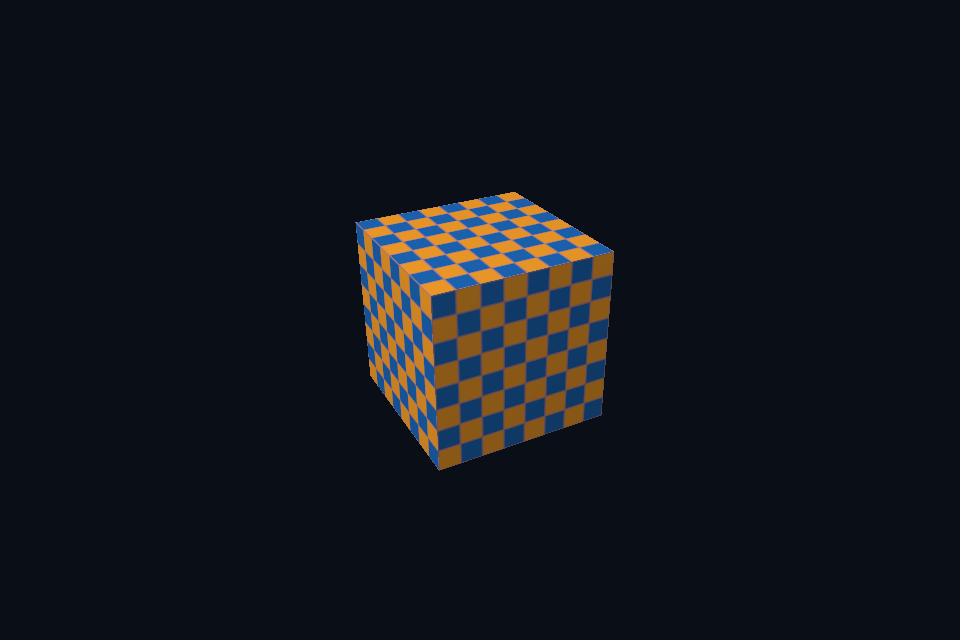

# 第 37 课 · 图像、采样器与 Shader 资源连接 · DirectX 12

[54 课目录](../../COURSE.md) · [对照精讲](../../../docs/compare/06_textures_color.md) · [上一课](../36_samplers/README.md) · [下一课](../38_color_space/README.md)

## 本课目标与先修

学习目标：解释“图像、采样器与 Shader 资源连接”解决的问题，找到实际对象和参数，运行对应实验并用数据/画面证明。先完成前一课，并能说明它交付的对象与完成条件；本课在该依赖上增加新契约。

## 为什么需要这一层

完成上传只是准备了内容，还要把访问方式连接到 shader。核对资源、view、sampler、接口编号、实际绑定与消费者阶段，才能解释一次纹理读取。名称相似不代表它们存放同样的内容。

## DirectX 12 的对象、参数与执行推导

SRV 在 shader-visible heap 中描述纹理，SetDescriptorHeaps 后用 GPU handle 设置 root descriptor table；static sampler 对应 s0。CPU handle 用于写 descriptor，GPU handle 用于绑定，不能互换或按指针算像素地址。

## 对照 Vulkan 原生：相同问题的另一种分工

组合 image sampler descriptor 引用 imageView、sampler 和约定 imageLayout；layout binding 1 与 GLSL 一致。vkUpdateDescriptorSets 更新引用，不录制布局转换，也不复制 texel。set/pool 和图像各有生命周期。

## 关键参数与可检查不变量

| 检查项 | Vulkan 表达 | DX12 表达 | 不变量 / 证据 |
| --- | --- | --- | --- |
| 读取资源 | combined image sampler | SRV table + static sampler | 图像/采样器都与 shader 一致 |
| 绑定编号 | binding 1 | t0 / s0 与 root table | 不同编号系统不可混同 |
| 写入视图 | update set 引用 | CPU handle 写 SRV | 不复制 texel、不建立同步 |

先为每项指出源码中的创建/绑定位置，以及证明它成立的实际日志、字节或图像。数值中的设备限制以查询为准；固定实验尺寸不当作所有设备的上限。

## nvpro_core2 框架对照

SceneVk 管理自定义材质 descriptor，ImTexture 管理 UI 显示引用。两套绑定服务不同 shader，不因指向同一图像就可以任意替换。

这部分是原生 Vulkan 各课的框架对照，框架可运行入口仍为原有六课。如果本节需要新接入工作，会按正文说明；不把原生实验当作已完成的框架实现。

## 运行与实际检查

| 路线 | 实际实验 |
| --- | --- |
| DirectX 12 | [dx06_texture_srv](../../lessons/dx06_texture_srv/README.md) |
| Vulkan 原生 | [vk06_texture_descriptor](../../../Vulkan/native/lessons/vk06_texture_descriptor/README.md) |

从合集根目录执行；普通图形程序 Esc 退出，设备/计算/诊断程序输出结果后结束。从“开始学习.cmd”进入本页时，表格可直接点击运行。

```powershell
cmake --preset dx12
cmake --build --preset dx12-debug --target dx06_texture_srv --parallel 4
.\DirectX12\build\bin\Debug\dx06_texture_srv.exe
ctest --preset dx12-debug -R "^dx06_texture_srv$" --output-on-failure
```

检查三个层次：创建/绑定/提交的接口约束；数据读回或目标画面；资源使用结束后的回收。诊断实验用合法信息或查询证明渠道可用，不故意保留 API 错误。图形 smoke 的像素检查与数值实验的逐项检查不同，具体实现见源码。

## 关键实现：从当前源码定位

来自 [DirectX12/common/dx12_course.hpp](../../common/dx12_course.hpp#L301)，第 301—344 行。下列是当前仓库的局部切片，可能在函数中间结束；完整上下文请打开文件，切片不作为单独可编译程序。

```cpp
        D3D12_PLACED_SUBRESOURCE_FOOTPRINT footprint;
        UINT rows;
        UINT64 rowBytes, total;

        // 纹理上传不能假定行数据紧密排列；按 footprint 的对齐行距逐行复制。
        c.device->GetCopyableFootprints(&image, 0, 1, 0, &footprint, &rows, &rowBytes, &total);
        auto upload = c.buffer(total, D3D12_HEAP_TYPE_UPLOAD, D3D12_RESOURCE_STATE_GENERIC_READ);
        void* mapped;
        D3D12_RANGE empty{0, 0};
        dxCheck(upload->Map(0, &empty, &mapped));
        auto data = checker();
        for (UINT y = 0; y < rows; ++y)
            std::memcpy(static_cast<uint8_t*>(mapped) + footprint.Offset +
                            size_t(y) * footprint.Footprint.RowPitch,
                        data.data() + size_t(y) * 64 * 4,
                        64 * 4);
        upload->Unmap(0, nullptr);
        c.begin();
        D3D12_TEXTURE_COPY_LOCATION source{}, destination{};
        source.pResource = upload.Get();
        source.Type = D3D12_TEXTURE_COPY_TYPE_PLACED_FOOTPRINT;
        source.PlacedFootprint = footprint;
        destination.pResource = texture.Get();
        destination.Type = D3D12_TEXTURE_COPY_TYPE_SUBRESOURCE_INDEX;
        c.cmd->CopyTextureRegion(&destination, 0, 0, 0, &source, nullptr);
        auto b = transition(texture.Get(),
                            D3D12_RESOURCE_STATE_COPY_DEST,
                            D3D12_RESOURCE_STATE_PIXEL_SHADER_RESOURCE);
        c.cmd->ResourceBarrier(1, &b);
        c.submit();
        D3D12_DESCRIPTOR_HEAP_DESC heap{};
        heap.Type = D3D12_DESCRIPTOR_HEAP_TYPE_CBV_SRV_UAV;
        heap.NumDescriptors = 1;
        heap.Flags = D3D12_DESCRIPTOR_HEAP_FLAG_SHADER_VISIBLE;
        dxCheck(c.device->CreateDescriptorHeap(&heap, IID_PPV_ARGS(&srvHeap)));
        D3D12_SHADER_RESOURCE_VIEW_DESC srv{};
        srv.Format = image.Format;
        srv.ViewDimension = D3D12_SRV_DIMENSION_TEXTURE2D;
        srv.Shader4ComponentMapping = D3D12_DEFAULT_SHADER_4_COMPONENT_MAPPING;
        srv.Texture2D.MipLevels = 1;
        c.device->CreateShaderResourceView(
            texture.Get(), &srv, srvHeap->GetCPUDescriptorHandleForHeapStart());

        // root signature 约定 b0 为帧矩阵、b1 为每绘制常量，t0 经 descriptor table 绑定纹理。
```

阅读时按“前置对象 → 参数/布局 → 录制/调用 → 完成/可见性 → 释放”五步标注。共享 helper 减少重复代码，但不会取消每课的 API 契约。

## 受控修改实验

为什么 descriptor/SRV 看起来正确，纹理仍然可能全黑？

先记录预测，再只改一个因素；保留基线与修改后的输出。不要同时改变 shader、资源范围和同步，这样即使结果变好也无法归因。

### 参考推导与通过标准

内容未上传、错误子资源、布局/状态或同步错误、UV/颜色空间错误都可能存在。先查看资源 texel，再看绑定与 shader 结果。

## 常见失败与排查顺序

只查 C++ 成员句柄而不查实际 draw 的 GPU 绑定，会错过被后续命令覆盖的 table/set。

先看第一条错误和当前执行路径，再看实际数据/绑定，最后看 shader 与画面。需要 GPU 证据时抓取正常交互帧；仅四帧的 smoke 适合自动检查，不适合手动抓帧。

## 自测与本课交付

能否不看源码回答：为什么 descriptor/SRV 看起来正确，纹理仍然可能全黑？

提交一份简短记录：输入与假设、唯一修改、预期、实际证据、原因、是否恢复基线。如果只能复述函数名而说不清何时允许访问/释放，先回到本课的数据流。

## 官方阅读位置与当前工程差异

[指定 Vulkan 教程对应位置](https://docs.vulkan.net.cn/tutorial/latest/06_Texture_mapping/02_Combined_image_sampler.html)。DX12 路线按同一概念顺序建立映射，其对象与约束以 Microsoft 文档和本后端代码为准。49—54 课包含在基础/compute 之后加入的工程扩展。

[版本与资料说明](../../../docs/REFERENCES.md) · [调试](../../../docs/DEBUGGING.md) · [功能完成度](../../../docs/FEATURE_MATRIX.md)

## 固定输入的实际 GPU 读回


