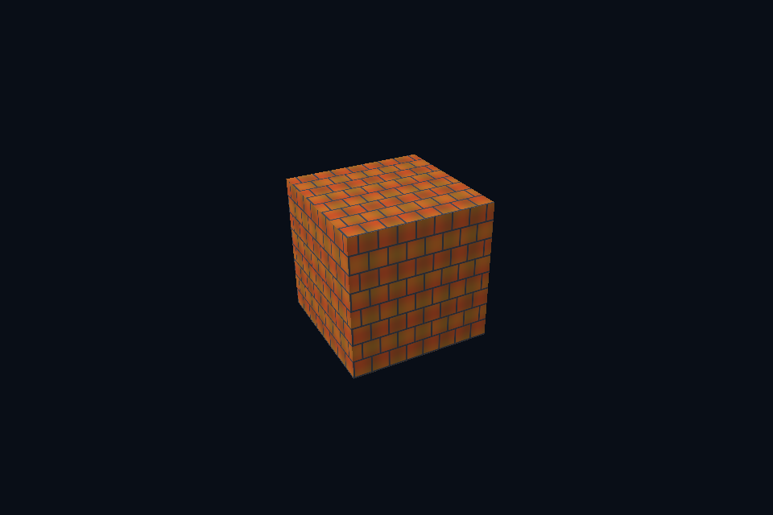

# 第 38 课 · sRGB、线性光照与显示编码 · DirectX 12

[54 课目录](../../COURSE.md) · [对照精讲](../../../docs/compare/06_textures_color.md) · [上一课](../37_texture_binding/README.md) · [下一课](../39_depth_formats/README.md)

## 本课目标与先修

学习目标：解释“sRGB、线性光照与显示编码”解决的问题，找到实际对象和参数，运行对应实验并用数据/画面证明。先完成前一课，并能说明它交付的对象与完成条件；本课在该依赖上增加新契约。

## 为什么需要这一层

颜色编码是整个数据链路的约定。albedo 通常从 sRGB 解码到线性参与光照，normal/roughness/metallic/AO 是线性数据；最终显示再编码一次。文件扩展名不决定纹理用途。

## DirectX 12 的对象、参数与执行推导

需要合法的 typeless resource/typed view 组合才能解释同一格式族；本课 sRGB SRV 与普通 UNORM 是不同读取约定。sRGB mip 的 CPU 参考先解码、平均再编码，不能直接平均已编码 RGB；alpha 仍是线性数据。

## 对照 Vulkan 原生：相同问题的另一种分工

对比相同图片的 UNORM 与 SRGB image view/format 路径，shader 参与线性计算后手动显示编码。GPU blit 对 sRGB 格式的颜色处理也应与规范和参考值一致；数值 mip 实验使用 UNORM 以便逐 texel 对照。

## 关键参数与可检查不变量

| 检查项 | Vulkan 表达 | DX12 表达 | 不变量 / 证据 |
| --- | --- | --- | --- |
| albedo | SRGB 解码 | SRGB SRV 解码 | 在线性空间光照 |
| 数据贴图 | UNORM/float 线性 | UNORM/float 线性 | normal/MR/AO 不做颜色 gamma |
| mip 颜色 | 按格式正确处理 | sRGB CPU 先解码再编码 | alpha 不跟 RGB 做同一 gamma |

先为每项指出源码中的创建/绑定位置，以及证明它成立的实际日志、字节或图像。数值中的设备限制以查询为准；固定实验尺寸不当作所有设备的上限。

## nvpro_core2 框架对照

框架的 UI 显示与场景输出可能各有编码假设。比对时先固定目标格式和最终编码，避免场景先 gamma、UI 又 gamma。

这部分是原生 Vulkan 各课的框架对照，框架可运行入口仍为原有六课。如果本节需要新接入工作，会按正文说明；不把原生实验当作已完成的框架实现。

## 运行与实际检查

| 路线 | 实际实验 |
| --- | --- |
| DirectX 12 | [dx35_srgb_view](../../lessons/dx35_srgb_view/README.md) |
| DirectX 12 | [dx17_image_file](../../lessons/dx17_image_file/README.md) |
| Vulkan 原生 | [vk35_srgb_view](../../../Vulkan/native/lessons/vk35_srgb_view/README.md) |
| Vulkan 原生 | [vk17_image_file](../../../Vulkan/native/lessons/vk17_image_file/README.md) |

从合集根目录执行；普通图形程序 Esc 退出，设备/计算/诊断程序输出结果后结束。从“开始学习.cmd”进入本页时，表格可直接点击运行。

```powershell
cmake --preset dx12
cmake --build --preset dx12-debug --target dx35_srgb_view --parallel 4
.\DirectX12\build\bin\Debug\dx35_srgb_view.exe
ctest --preset dx12-debug -R "^dx35_srgb_view$" --output-on-failure
```

检查三个层次：创建/绑定/提交的接口约束；数据读回或目标画面；资源使用结束后的回收。诊断实验用合法信息或查询证明渠道可用，不故意保留 API 错误。图形 smoke 的像素检查与数值实验的逐项检查不同，具体实现见源码。

## 关键实现：从当前源码定位

来自 [DirectX12/common/advanced_labs.cpp](../../common/advanced_labs.cpp#L237)，第 237—280 行。下列是当前仓库的局部切片，可能在函数中间结束；完整上下文请打开文件，切片不作为单独可编译程序。

```cpp
struct GpuTexture {
    DxDevice& c;
    ComPtr<ID3D12Resource> texture;
    std::vector<Pixels> reference;
    DXGI_FORMAT viewFormat;
    GpuTexture(
        DxDevice& context, const LabOptions& options, Pixels pixels, bool mips, bool srgb = false)
        : c(context) {
        reference = mips ? mipReference(pixels, srgb) : std::vector<Pixels>{pixels};
        const UINT levels = UINT(reference.size());
        const bool gpuMips = mips && !srgb;
        viewFormat = srgb ? DXGI_FORMAT_R8G8B8A8_UNORM_SRGB : DXGI_FORMAT_R8G8B8A8_UNORM;
        D3D12_RESOURCE_DESC desc{};
        desc.Dimension = D3D12_RESOURCE_DIMENSION_TEXTURE2D;
        desc.Width = pixels.width;
        desc.Height = pixels.height;
        desc.DepthOrArraySize = 1;
        desc.MipLevels = UINT16(levels);
        desc.Format = srgb ? DXGI_FORMAT_R8G8B8A8_TYPELESS : DXGI_FORMAT_R8G8B8A8_UNORM;
        desc.SampleDesc.Count = 1;
        if (gpuMips)
            desc.Flags = D3D12_RESOURCE_FLAG_ALLOW_UNORDERED_ACCESS;
        D3D12_HEAP_PROPERTIES hp{};
        hp.Type = D3D12_HEAP_TYPE_DEFAULT;
        dxCheck(c.device->CreateCommittedResource(&hp,
                                                  D3D12_HEAP_FLAG_NONE,
                                                  &desc,
                                                  D3D12_RESOURCE_STATE_COPY_DEST,
                                                  nullptr,
                                                  IID_PPV_ARGS(&texture)));
        std::vector<D3D12_PLACED_SUBRESOURCE_FOOTPRINT> footprints(levels);
        std::vector<UINT> rows(levels);
        std::vector<UINT64> rowBytes(levels);
        UINT64 total{};
        c.device->GetCopyableFootprints(
            &desc, 0, levels, 0, footprints.data(), rows.data(), rowBytes.data(), &total);
        auto upload = c.buffer(total, D3D12_HEAP_TYPE_UPLOAD, D3D12_RESOURCE_STATE_GENERIC_READ);
        std::vector<uint8_t> packed(static_cast<size_t>(total));
        UINT copied = gpuMips ? 1 : levels;
        for (UINT level = 0; level < copied; ++level)
            for (UINT y = 0; y < reference[level].height; ++y)
                std::memcpy(packed.data() + footprints[level].Offset +
                                size_t(y) * footprints[level].Footprint.RowPitch,
                            reference[level].rgba.data() + size_t(y) * reference[level].width * 4,
```

阅读时按“前置对象 → 参数/布局 → 录制/调用 → 完成/可见性 → 释放”五步标注。共享 helper 减少重复代码，但不会取消每课的 API 契约。

## 受控修改实验

给粗糙度贴图使用 sRGB 读取，能否靠 normalize 或调曝光恢复正确粗糙度？

先记录预测，再只改一个因素；保留基线与修改后的输出。不要同时改变 shader、资源范围和同步，这样即使结果变好也无法归因。

### 参考推导与通过标准

不能。输入标量被非线性改写，曝光只改变输出，不能还原材质参数。先纠正数据格式与用途。

## 常见失败与排查顺序

把所有 PNG 都当颜色、对 HDR 中间结果提前 tone-map，或最终重复编码，会让跨 API 亮度比较失去意义。

先看第一条错误和当前执行路径，再看实际数据/绑定，最后看 shader 与画面。需要 GPU 证据时抓取正常交互帧；仅四帧的 smoke 适合自动检查，不适合手动抓帧。

## 自测与本课交付

能否不看源码回答：给粗糙度贴图使用 sRGB 读取，能否靠 normalize 或调曝光恢复正确粗糙度？

提交一份简短记录：输入与假设、唯一修改、预期、实际证据、原因、是否恢复基线。如果只能复述函数名而说不清何时允许访问/释放，先回到本课的数据流。

## 官方阅读位置与当前工程差异

[指定 Vulkan 教程对应位置](https://docs.vulkan.net.cn/tutorial/latest/06_Texture_mapping/02_Combined_image_sampler.html)。DX12 路线按同一概念顺序建立映射，其对象与约束以 Microsoft 文档和本后端代码为准。49—54 课包含在基础/compute 之后加入的工程扩展。

[版本与资料说明](../../../docs/REFERENCES.md) · [调试](../../../docs/DEBUGGING.md) · [功能完成度](../../../docs/FEATURE_MATRIX.md)

## 固定输入的实际 GPU 读回


