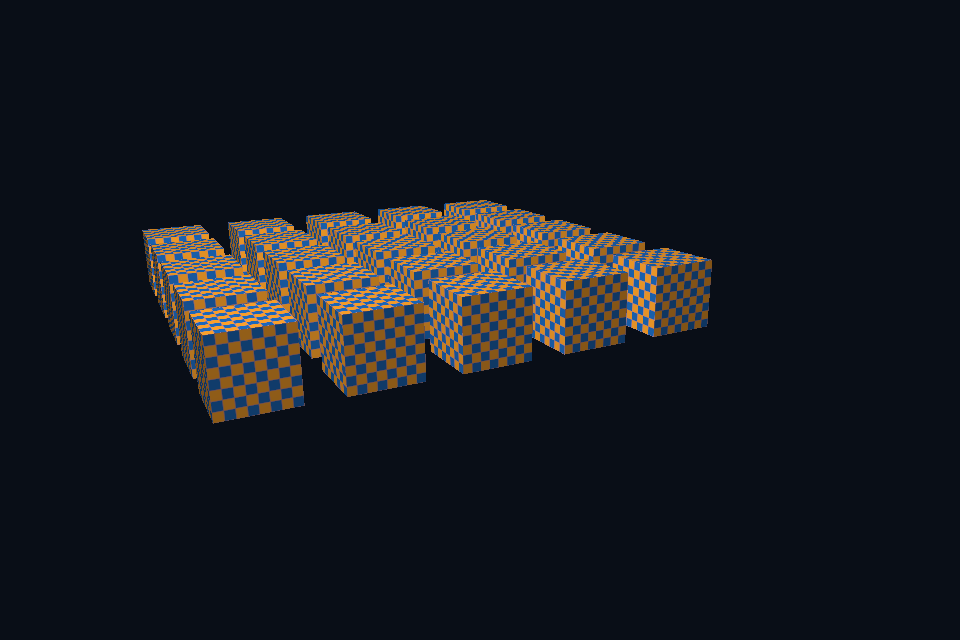

# 第 40 课 · 遮挡、清除、比较与写入 · DirectX 12

[54 课目录](../../COURSE.md) · [对照精讲](../../../docs/compare/07_targets_depth_msaa.md) · [上一课](../39_depth_formats/README.md) · [下一课](../41_obj_models/README.md)

## 本课目标与先修

学习目标：解释“遮挡、清除、比较与写入”解决的问题，找到实际对象和参数，运行对应实验并用数据/画面证明。先完成前一课，并能说明它交付的对象与完成条件；本课在该依赖上增加新契约。

## 为什么需要这一层

深度正确需要存储、测试启用、比较函数、写入策略和清除值同时匹配投影。当前普通 0..1 深度使用 clear=1、LESS；reversed-Z 则要一起改变整套约定，不能只换一个比较枚举。

## DirectX 12 的对象、参数与执行推导

PSO DepthEnable/DepthWriteMask/DepthFunc 配合 DSV 与 ClearDepthStencilView。关闭写但保留测可以服务某些透明路径，却不适合不加区分地替换所有不透明绘制。

## 对照 Vulkan 原生：相同问题的另一种分工

深度附件转到合适布局，早/晚深度阶段的写访问与后续用途建立依赖。实例化场景帮助观察 draw 顺序与几何遮挡分工；深度附件不由 vertex buffer 自动产生。

## 关键参数与可检查不变量

| 检查项 | Vulkan 表达 | DX12 表达 | 不变量 / 证据 |
| --- | --- | --- | --- |
| 普通投影 | 0..1 深度 | 0..1 深度 | 当前 clear=1 / LESS |
| 写入与测试 | 独立 depthWrite/test | 独立 write mask / enable | 保留测试不等于会写深度 |
| 历史清理 | 每帧初始化 depth | ClearDepthStencilView | 不依赖上一帧残留 |

先为每项指出源码中的创建/绑定位置，以及证明它成立的实际日志、字节或图像。数值中的设备限制以查询为准；固定实验尺寸不当作所有设备的上限。

## nvpro_core2 框架对照

视口 target 的 depth 与颜色尺寸共同变化。UI 能显示纹理不证明场景内部深度状态正确，应查看离屏 depth 或对应事件。

这部分是原生 Vulkan 各课的框架对照，框架可运行入口仍为原有六课。如果本节需要新接入工作，会按正文说明；不把原生实验当作已完成的框架实现。

## 本章独立工程与关键注释

[main.cpp](main.cpp) · [本地辅助实现](support/) · [本章着色器](shaders/) · [CMakeLists.txt](CMakeLists.txt)

完整源码就在本目录，关键步骤含中文注释。只复用 GLFW/GLM/Assimp 等第三方库，不包含或链接其他章节的课程实现。单独复制本章文件夹也可配置构建；初始化或纯计算章节不需要图形阶段。

```powershell
cmake -S . -B build -A x64
cmake --build build --config Debug --parallel 4
ctest --test-dir build -C Debug --output-on-failure
```

## 运行与实际检查

| 路线 | 实际实验 |
| --- | --- |
| DirectX 12 | [dx07_depth_instancing](../../lessons/dx07_depth_instancing/README.md) |
| Vulkan 原生 | [vk07_depth_instancing](../../../Vulkan/native/lessons/vk07_depth_instancing/README.md) |

从合集根目录执行；普通图形程序 Esc 退出，设备/计算/诊断程序输出结果后结束。从“开始学习.cmd”进入本页时，表格可直接点击运行。

```powershell
cmake --preset dx12
cmake --build --preset dx12-debug --target dx40_ch_depth_test --parallel 4
.\DirectX12\build\bin\Debug\dx40_ch_depth_test.exe
ctest --preset dx12-debug -R "^dx40_ch_depth_test$" --output-on-failure
```

检查三个层次：创建/绑定/提交的接口约束；数据读回或目标画面；资源使用结束后的回收。诊断实验用合法信息或查询证明渠道可用，不故意保留 API 错误。图形 smoke 的像素检查与数值实验的逐项检查不同，具体实现见源码。

## 关键实现：从当前源码定位

来自 [DirectX12/chapters/40_depth_test/main.cpp](main.cpp#L9)，第 9—62 行。下列是当前仓库的局部切片，可能在函数中间结束；完整上下文请打开文件，切片不作为单独可编译程序。

```cpp
int runChapter(int argc, char** argv) {
    DxRenderOptions options;

    dxShaderFile = std::filesystem::absolute(argv[0]).parent_path() / COURSE_RUNTIME_NAME /
                   "shaders" / "scene.hlsl";
    bool smoke = false, warp = false;
    for (int i = 1; i < argc; ++i) {
        smoke |= std::strcmp(argv[i], "--smoke") == 0;
        warp |= std::strcmp(argv[i], "--warp") == 0;
    }
    if (!glfwInit())
        throw std::runtime_error("GLFW failed");
    glfwWindowHint(GLFW_CLIENT_API, GLFW_NO_API);
    if (smoke)
        glfwWindowHint(GLFW_VISIBLE, GLFW_FALSE);
    auto window = glfwCreateWindow(960, 640, "DirectX 12 Course", nullptr, nullptr);
    if (!window)
        throw std::runtime_error("Window creation failed");
    {
        DxWindow app(window, 7, warp, options);
        int frame = 0;
        auto output = std::filesystem::path(argv[0]).parent_path() /
                      (options.captureStem.empty() ? "dx12_" + std::to_string(7) + ".ppm"
                                                   : options.captureStem + ".ppm");
        while (!glfwWindowShouldClose(window) && (!smoke || frame < 4)) {
            glfwPollEvents();
            if (glfwGetKey(window, GLFW_KEY_ESCAPE) == GLFW_PRESS)
                break;
            int w, h;
            glfwGetFramebufferSize(window, &w, &h);
            if (!w || !h) {
                glfwWaitEvents();
                continue;
            }
            app.resize(w, h);
            float time = smoke ? 1.f : float(glfwGetTime());
            if (app.scene && options.beforeFrame)
                options.beforeFrame(*app.scene, time);
            app.render(time, smoke && frame == 3 ? &output : nullptr);
            ++frame;
        }
    }
    glfwDestroyWindow(window);
    glfwTerminate();
    return 0;
}
} // namespace course

int main(int argc, char** argv) try {
    return course::runChapter(argc, argv);
} catch (const std::exception& error) {
    std::cerr << "ERROR: " << error.what() << '\n';
    return 1;
}
```

阅读时按“前置对象 → 参数/布局 → 录制/调用 → 完成/可见性 → 释放”五步标注。辅助实现与着色器是本章自己的文件；修改不会影响其他章。

## 受控修改实验

固定几何和相机，只把 clear 改为零而继续 LESS，预测结果。

先记录预测，再只改一个因素；保留基线与修改后的输出。不要同时改变 shader、资源范围和同步，这样即使结果变好也无法归因。

### 参考推导与通过标准

大部分普通非负深度不小于零，会被拒绝。若要反向深度，应连同投影、比较和其他深度公式一起设计。

## 常见失败与排查顺序

前一遍关闭 depth write 后未恢复，或忘记每帧清除，可能让问题随帧累积，看起来像随机闪烁。

先看第一条错误和当前执行路径，再看实际数据/绑定，最后看 shader 与画面。需要 GPU 证据时抓取正常交互帧；仅四帧的 smoke 适合自动检查，不适合手动抓帧。

## 自测与本课交付

能否不看源码回答：固定几何和相机，只把 clear 改为零而继续 LESS，预测结果。

提交一份简短记录：输入与假设、唯一修改、预期、实际证据、原因、是否恢复基线。如果只能复述函数名而说不清何时允许访问/释放，先回到本课的数据流。

## 官方阅读位置与当前工程差异

[指定 Vulkan 教程对应位置](https://docs.vulkan.net.cn/tutorial/latest/07_Depth_buffering.html)。DX12 路线按同一概念顺序建立映射，其对象与约束以 Microsoft 文档和本后端代码为准。49—54 课包含在基础/compute 之后加入的工程扩展。

[版本与资料说明](../../../docs/REFERENCES.md) · [调试](../../../docs/DEBUGGING.md) · [功能完成度](../../../docs/FEATURE_MATRIX.md)

## 固定输入的实际 GPU 读回


