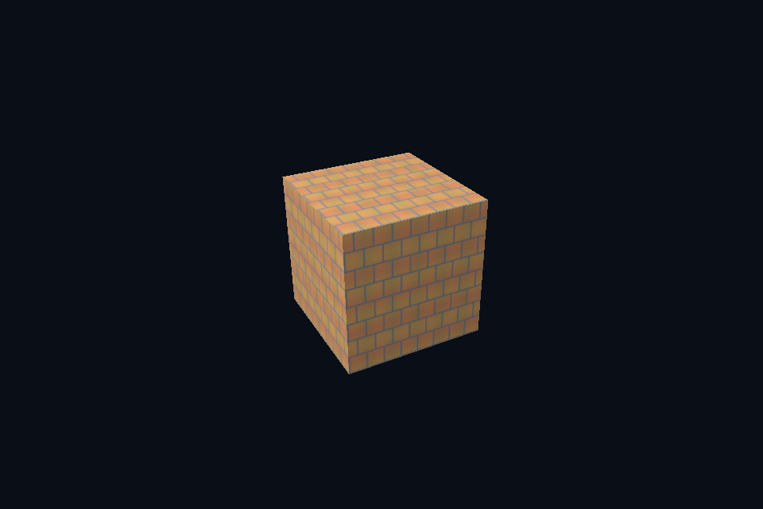

# 第 44 课 · LOD、子资源视图与三线性过滤 · DirectX 12

[54 课目录](../../COURSE.md) · [对照精讲](../../../docs/compare/06_textures_color.md) · [上一课](../43_mip_generation/README.md) · [下一课](../45_msaa/README.md)

## 本课目标与先修

学习目标：解释“LOD、子资源视图与三线性过滤”解决的问题，找到实际对象和参数，运行对应实验并用数据/画面证明。先完成前一课，并能说明它交付的对象与完成条件；本课在该依赖上增加新契约。

## 为什么需要这一层

生成 mip 与选择 mip 是两件事。采样器根据梯度/LOD 及 view 范围决定读取，三线性过滤在相邻级别之间插值。最高级别不等于一定被使用，必须选择能激活缩小采样的场景。

## DirectX 12 的对象、参数与执行推导

SRV 的 MostDetailedMip/MipLevels 与 static sampler 的 LOD 范围共同生效。descriptor 不生成图像；正确 GPU mip 链的上传/生成结果仍需先验证。

## 对照 Vulkan 原生：相同问题的另一种分工

ImageView 覆盖完整级数、sampler mipmapMode=LINEAR 且 maxLod 合法。另一个实验只暴露最后一级 view，明确展示 view 范围改变而资源存储不变。

## 关键参数与可检查不变量

| 检查项 | Vulkan 表达 | DX12 表达 | 不变量 / 证据 |
| --- | --- | --- | --- |
| View 范围 | 完整 mip 或限定末级 | 完整 SRV 或末级 SRV | 相对 LOD 在可见级数内 |
| 过滤 | LINEAR mipmap mode | MIN_MAG_MIP_LINEAR | 不会补出未生成级别 |
| 可见输入 | 缩小采样/末级 view | 相同实验 | 区分范围限制与过滤效果 |

先为每项指出源码中的创建/绑定位置，以及证明它成立的实际日志、字节或图像。数值中的设备限制以查询为准；固定实验尺寸不当作所有设备的上限。

## nvpro_core2 框架对照

ImGui 展示纹理时的采样方式不等于三维场景的导数和 LOD；要在 SceneVk 材质 draw 中检查实际 shader 读取。

这部分是原生 Vulkan 各课的框架对照，框架可运行入口仍为原有六课。如果本节需要新接入工作，会按正文说明；不把原生实验当作已完成的框架实现。

## 本章独立工程与关键注释

[main.cpp](main.cpp) · [本地辅助实现](support/) · [本章着色器](shaders/) · [CMakeLists.txt](CMakeLists.txt)

完整源码就在本目录，关键步骤含中文注释。只复用 GLFW/GLM/Assimp 等第三方库，不包含或链接其他章节的课程实现。单独复制本章文件夹也可配置构建；初始化或纯计算章节不需要图形阶段。

```powershell
cmake -S . -B build -A x64
cmake --build build --config Debug --parallel 4
ctest --test-dir build -C Debug --output-on-failure
```

## 运行与实际检查

| 路线 | 实际实验 |
| --- | --- |
| DirectX 12 | [dx19_texture_lod](../../lessons/dx19_texture_lod/README.md) |
| DirectX 12 | [dx41_subresource_view](../../lessons/dx41_subresource_view/README.md) |
| Vulkan 原生 | [vk19_texture_lod](../../../Vulkan/native/lessons/vk19_texture_lod/README.md) |
| Vulkan 原生 | [vk41_subresource_view](../../../Vulkan/native/lessons/vk41_subresource_view/README.md) |

从合集根目录执行；普通图形程序 Esc 退出，设备/计算/诊断程序输出结果后结束。从“开始学习.cmd”进入本页时，表格可直接点击运行。

```powershell
cmake --preset dx12
cmake --build --preset dx12-debug --target dx44_ch_mip_sampling --parallel 4
.\DirectX12\build\bin\Debug\dx44_ch_mip_sampling.exe
ctest --preset dx12-debug -R "^dx44_ch_mip_sampling$" --output-on-failure
```

检查三个层次：创建/绑定/提交的接口约束；数据读回或目标画面；资源使用结束后的回收。诊断实验用合法信息或查询证明渠道可用，不故意保留 API 错误。图形 smoke 的像素检查与数值实验的逐项检查不同，具体实现见源码。

## 关键实现：从当前源码定位

来自 [DirectX12/chapters/44_mip_sampling/main.cpp](main.cpp#L296)，第 296—309 行。下列是当前仓库的局部切片，可能在函数中间结束；完整上下文请打开文件，切片不作为单独可编译程序。

```cpp
int runChapter(int argc, char** argv) {
    auto options = labOptions(argc, argv, 19);
    {
        return graphicsLab(argc, argv, options);
    }
}
} // namespace course

int main(int argc, char** argv) try {
    return course::runChapter(argc, argv);
} catch (const std::exception& error) {
    std::cerr << "ERROR: " << error.what() << '\n';
    return 1;
}
```

阅读时按“前置对象 → 参数/布局 → 录制/调用 → 完成/可见性 → 释放”五步标注。辅助实现与着色器是本章自己的文件；修改不会影响其他章。

## 受控修改实验

固定相机观察远处小物体，比较单级、完整 mip 与末级 view，并记录哪些差异来自范围、哪些来自过滤。

先记录预测，再只改一个因素；保留基线与修改后的输出。不要同时改变 shader、资源范围和同步，这样即使结果变好也无法归因。

### 参考推导与通过标准

末级 view 强制只见低分辨率平均图；完整 mip 按采样尺度选择；单级可能高频闪烁。不能把三者都解释为“纹理没加载”。

## 常见失败与排查顺序

UV 从不缩小或 sampler 仍限制在 level 0 时，增加 mip 不一定有可见效果；实验输入要能触发目标机制。

先看第一条错误和当前执行路径，再看实际数据/绑定，最后看 shader 与画面。需要 GPU 证据时抓取正常交互帧；仅四帧的 smoke 适合自动检查，不适合手动抓帧。

## 自测与本课交付

能否不看源码回答：固定相机观察远处小物体，比较单级、完整 mip 与末级 view，并记录哪些差异来自范围、哪些来自过滤。

提交一份简短记录：输入与假设、唯一修改、预期、实际证据、原因、是否恢复基线。如果只能复述函数名而说不清何时允许访问/释放，先回到本课的数据流。

## 官方阅读位置与当前工程差异

[指定 Vulkan 教程对应位置](https://docs.vulkan.net.cn/tutorial/latest/09_Generating_Mipmaps.html)。DX12 路线按同一概念顺序建立映射，其对象与约束以 Microsoft 文档和本后端代码为准。49—54 课包含在基础/compute 之后加入的工程扩展。

[版本与资料说明](../../../docs/REFERENCES.md) · [调试](../../../docs/DEBUGGING.md) · [功能完成度](../../../docs/FEATURE_MATRIX.md)

## 固定输入的实际 GPU 读回


