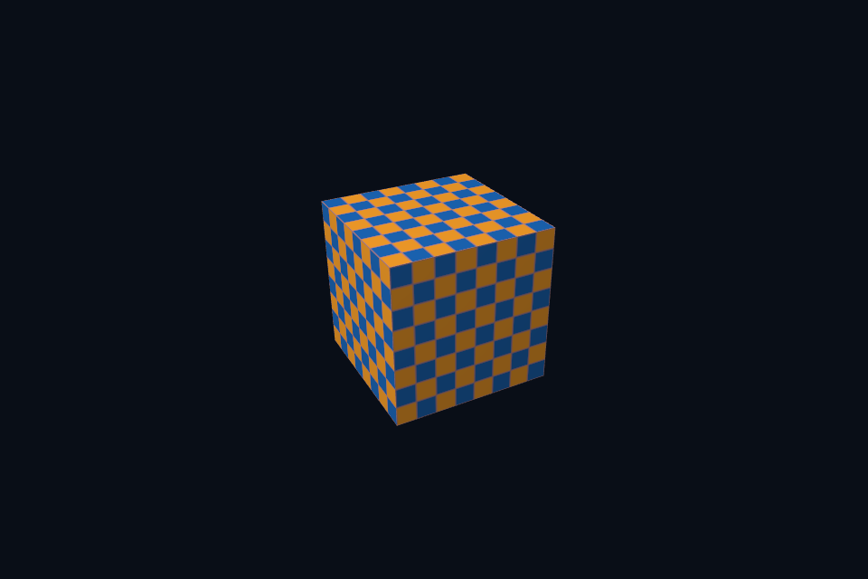

# 第 45 课 · 多重采样、匹配附件与 Resolve · DirectX 12

[54 课目录](../../COURSE.md) · [对照精讲](../../../docs/compare/07_targets_depth_msaa.md) · [上一课](../44_mip_sampling/README.md) · [下一课](../46_compute/README.md)

## 本课目标与先修

学习目标：解释“多重采样、匹配附件与 Resolve”解决的问题，找到实际对象和参数，运行对应实验并用数据/画面证明。先完成前一课，并能说明它交付的对象与完成条件；本课在该依赖上增加新契约。

## 为什么需要这一层

MSAA 增加覆盖采样而非把全部 shader 计算自动变成更高分辨率。先检查颜色/深度格式共同支持，再创建匹配目标与管线，最终 resolve 到可呈现的单样本图像。

## DirectX 12 的对象、参数与执行推导

PSO SampleDesc、深度与颜色目标保持一致，ResolveSubresource 前把 MSAA 源转 RESOLVE_SOURCE、back buffer 转 RESOLVE_DEST，再恢复各自后续状态。普通 CopyResource 不能替代多样本 resolve。

## 对照 Vulkan 原生：相同问题的另一种分工

多样本颜色和深度为 4x，graphics pipeline sample count 同样 4x；dynamic rendering 的 resolve attachment 写单样本交换链目标。输入与输出的用途和布局均要正确。

## 关键参数与可检查不变量

| 检查项 | Vulkan 表达 | DX12 表达 | 不变量 / 证据 |
| --- | --- | --- | --- |
| 样本数 | 4x color/depth/pipeline | 4x color/depth/PSO | 三者必须一致 |
| 目标转换 | dynamic resolve 到单样本 | RESOLVE_SOURCE→DEST | 不是普通 image/resource copy |
| 质量边界 | 覆盖边缘抗锯齿 | 覆盖边缘抗锯齿 | 不自动消除纹理/材质高频 |

先为每项指出源码中的创建/绑定位置，以及证明它成立的实际日志、字节或图像。数值中的设备限制以查询为准；固定实验尺寸不当作所有设备的上限。

## nvpro_core2 框架对照

RenderTarget 的样本管理需与自定义 pipeline 和最终 UI 可采样目标匹配。框架对照着重列出这些依赖，不声称现有 nv03 默认已经开启 4x。

这部分是原生 Vulkan 各课的框架对照，框架可运行入口仍为原有六课。如果本节需要新接入工作，会按正文说明；不把原生实验当作已完成的框架实现。

## 运行与实际检查

| 路线 | 实际实验 |
| --- | --- |
| DirectX 12 | [dx20_msaa_resolve](../../lessons/dx20_msaa_resolve/README.md) |
| Vulkan 原生 | [vk20_msaa_resolve](../../../Vulkan/native/lessons/vk20_msaa_resolve/README.md) |

从合集根目录执行；普通图形程序 Esc 退出，设备/计算/诊断程序输出结果后结束。从“开始学习.cmd”进入本页时，表格可直接点击运行。

```powershell
cmake --preset dx12
cmake --build --preset dx12-debug --target dx20_msaa_resolve --parallel 4
.\DirectX12\build\bin\Debug\dx20_msaa_resolve.exe
ctest --preset dx12-debug -R "^dx20_msaa_resolve$" --output-on-failure
```

检查三个层次：创建/绑定/提交的接口约束；数据读回或目标画面；资源使用结束后的回收。诊断实验用合法信息或查询证明渠道可用，不故意保留 API 错误。图形 smoke 的像素检查与数值实验的逐项检查不同，具体实现见源码。

## 关键实现：从当前源码定位

来自 [DirectX12/common/dx12_course.hpp](../../common/dx12_course.hpp#L643)，第 643—686 行。下列是当前仓库的局部切片，可能在函数中间结束；完整上下文请打开文件，切片不作为单独可编译程序。

```cpp
            c.cmd->ResolveSubresource(
                back.Get(), 0, multisample.Get(), 0, DXGI_FORMAT_R8G8B8A8_UNORM);
            auto restore = transition(multisample.Get(),
                                      D3D12_RESOURCE_STATE_RESOLVE_SOURCE,
                                      D3D12_RESOURCE_STATE_RENDER_TARGET);
            c.cmd->ResourceBarrier(1, &restore);
            old = D3D12_RESOURCE_STATE_RESOLVE_DEST;
        }
        ComPtr<ID3D12Resource> readback;
        D3D12_PLACED_SUBRESOURCE_FOOTPRINT footprint{};
        if (capturePath) {
            auto b = transition(back.Get(), old, D3D12_RESOURCE_STATE_COPY_SOURCE);
            c.cmd->ResourceBarrier(1, &b);
            auto desc = back->GetDesc();
            UINT rows;
            UINT64 bytes, total;
            c.device->GetCopyableFootprints(&desc, 0, 1, 0, &footprint, &rows, &bytes, &total);
            readback = c.buffer(total, D3D12_HEAP_TYPE_READBACK, D3D12_RESOURCE_STATE_COPY_DEST);
            D3D12_TEXTURE_COPY_LOCATION src{}, dst{};
            src.pResource = back.Get();
            src.Type = D3D12_TEXTURE_COPY_TYPE_SUBRESOURCE_INDEX;
            dst.pResource = readback.Get();
            dst.Type = D3D12_TEXTURE_COPY_TYPE_PLACED_FOOTPRINT;
            dst.PlacedFootprint = footprint;
            c.cmd->CopyTextureRegion(&dst, 0, 0, 0, &src, nullptr);
            old = D3D12_RESOURCE_STATE_COPY_SOURCE;
        }

        // 呈现前把 back buffer 恢复到 PRESENT；CPU 读回则在 GPU 拷贝及 fence 完成后进行。
        auto present = transition(back.Get(), old, D3D12_RESOURCE_STATE_PRESENT);
        c.cmd->ResourceBarrier(1, &present);
        c.submit();
        dxCheck(swap->Present(1, 0));
        c.wait();
        if (capturePath) {
            void* p;
            D3D12_RANGE range{0, SIZE_T(readback->GetDesc().Width)};
            dxCheck(readback->Map(0, &range, &p));
            std::vector<uint8_t> packed(size_t(width) * height * 4);
            for (int y = 0; y < height; ++y)
                std::memcpy(packed.data() + size_t(y) * width * 4,
                            static_cast<uint8_t*>(p) + footprint.Offset +
                                size_t(y) * footprint.Footprint.RowPitch,
                            size_t(width) * 4);
```

阅读时按“前置对象 → 参数/布局 → 录制/调用 → 完成/可见性 → 释放”五步标注。共享 helper 减少重复代码，但不会取消每课的 API 契约。

## 受控修改实验

在斜边放大观察单样本与 4x，同时说明为什么纹理莫尔纹仍可能存在。

先记录预测，再只改一个因素；保留基线与修改后的输出。不要同时改变 shader、资源范围和同步，这样即使结果变好也无法归因。

### 参考推导与通过标准

MSAA 主要改善几何覆盖边缘；纹理缩小和 shader 高频还需要 mip、过滤或其他策略。不要把所有走样归为同一个环节。

## 常见失败与排查顺序

颜色 4x、深度 1x、PSO/pipeline 1x 的任一混搭都不满足目标契约，先修正一致性再讨论视觉效果。

先看第一条错误和当前执行路径，再看实际数据/绑定，最后看 shader 与画面。需要 GPU 证据时抓取正常交互帧；仅四帧的 smoke 适合自动检查，不适合手动抓帧。

## 自测与本课交付

能否不看源码回答：在斜边放大观察单样本与 4x，同时说明为什么纹理莫尔纹仍可能存在。

提交一份简短记录：输入与假设、唯一修改、预期、实际证据、原因、是否恢复基线。如果只能复述函数名而说不清何时允许访问/释放，先回到本课的数据流。

## 官方阅读位置与当前工程差异

[指定 Vulkan 教程对应位置](https://docs.vulkan.net.cn/tutorial/latest/10_Multisampling.html)。DX12 路线按同一概念顺序建立映射，其对象与约束以 Microsoft 文档和本后端代码为准。49—54 课包含在基础/compute 之后加入的工程扩展。

[版本与资料说明](../../../docs/REFERENCES.md) · [调试](../../../docs/DEBUGGING.md) · [功能完成度](../../../docs/FEATURE_MATRIX.md)

## 固定输入的实际 GPU 读回


