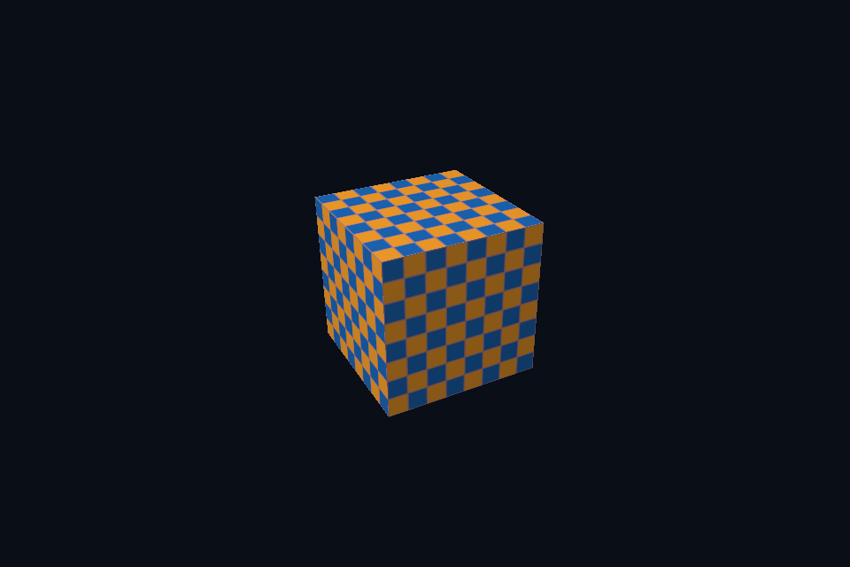

# dx06_texture_srv · 纹理上传、SRV 与描述符堆

[路线首页](../../README.md) · [上一课](../dx05_indexed_cbv/README.md) · [下一课](../dx07_depth_instancing/README.md)

## 构建和运行

从仓库根目录执行，完成配置后后续只需 build：

```powershell
cmake --preset dx12
cmake --build --preset dx12-debug --target dx06_texture_srv --parallel 4
.\DirectX12\build\bin\Debug\dx06_texture_srv.exe
```

也可以通过根目录“开始学习.cmd”打开页面后点击“运行本课”。01/08 是控制台计算/设备检查示例，点击后可用“查看运行输出”阅读结果。其余示例 Esc 退出，拖动窗口可测试尺寸重建。

预期结果：棋盘纹理立方体。

## 先读哪些代码

Texture Footprint / SRV / Descriptor Table

本目录 [main.cpp](main.cpp) 选择本课的执行路径。完整 API 实现在 `common/dx12_course.hpp`（相对路线根目录），数学和网格在仓库 shared/scene.hpp。每课都是独立程序；共享代码避免把相同资源生命周期错误复制十遍，也会为后续课预先初始化部分公共状态。首次阅读只沿本课列出的调用路径展开。

## 原理和实现

SRV heap 使用 SHADER_VISIBLE，并通过 descriptor table 绑定 t0。sampler 以 static sampler 声明。上传纹理使用 GetCopyableFootprints，遵守 row pitch/offset 对齐后 CopyTextureRegion；不能把紧密 RGBA 行大小当成任意尺寸都适用的上传跨度。

本课使用与 Vulkan 相同的几何和验证目标，比较资源绑定与同步的不同表达。CPU 创建的数据、GPU 资源和用于访问它的 view/descriptor 是不同层次；用调试层与抓帧工具分别核对接口约定和实际内容。命令异步执行，示例显式等待 fence 后才重用单份上传资源与 command allocator。

HLSL 使用 column_major 与 mul(M,v)，保持与共享 GLM 数据相同的内存和乘法约定。调整窗口大小时必须更新尺寸相关的目标与投影；map、创建视图或改变 CPU 变量都不会替代已经提交给 GPU 的工作。

## 修改练习

改纹理宽度为非 64 倍数，并继续使用 GetCopyableFootprints。

修改 shader 后重新构建，再运行。Vulkan GLSL 会被编译并复制到 exe 旁的 shaders；DX12 的 HLSL 副本也随构建更新，运行时再编译。应修改源目录而不是运行副本。

## 自测

为什么不能假设上传 row pitch 永远等于 width*4？

参考：D3D12 copy footprint 对行跨度和偏移有额外对齐约束。


## 验证和调试

运行 `dx06_texture_srv.exe --smoke` 执行四帧（或设备/计算检查）并退出；颜色课会从 GPU 读回 PPM，计算课验证 256 个数。参见仓库 [调试指南](../../../docs/DEBUGGING.md)。这些基础例子按帧串行等待，重点是可追踪的生命周期；多帧重叠不能仅删除 wait，需要同时改成帧资源环。


## 实测画面

固定时间的 GPU 读回图像（nvpro 为 headless Viewport 输出）。




## 深入学习：数据、接口与执行

GetCopyableFootprints 提供上传行距，逐行填入后 CopyTextureRegion，再转换为像素 shader 可读。SRV 是访问描述，不拥有单独一份像素。

配套精讲：[三 API 对照 · 纹理、Mip 与颜色空间](../../../docs/compare/06_textures_color.md)。先读概念与参数选择，再返回本课实现核对，不必一次展开所有公共类。

### 本课的真实源码切片

来自 [DirectX12/common/dx12_course.hpp](../../common/dx12_course.hpp#L301)，第 301—330 行；这是现有实现的局部摘录，末尾可能处于函数中间，不是可单独编译的完整程序。

```cpp
        D3D12_PLACED_SUBRESOURCE_FOOTPRINT footprint;
        UINT rows;
        UINT64 rowBytes, total;

        // 纹理上传不能假定行数据紧密排列；按 footprint 的对齐行距逐行复制。
        c.device->GetCopyableFootprints(&image, 0, 1, 0, &footprint, &rows, &rowBytes, &total);
        auto upload = c.buffer(total, D3D12_HEAP_TYPE_UPLOAD, D3D12_RESOURCE_STATE_GENERIC_READ);
        void* mapped;
        D3D12_RANGE empty{0, 0};
        dxCheck(upload->Map(0, &empty, &mapped));
        auto data = checker();
        for (UINT y = 0; y < rows; ++y)
            std::memcpy(static_cast<uint8_t*>(mapped) + footprint.Offset +
                            size_t(y) * footprint.Footprint.RowPitch,
                        data.data() + size_t(y) * 64 * 4,
                        64 * 4);
        upload->Unmap(0, nullptr);
        c.begin();
        D3D12_TEXTURE_COPY_LOCATION source{}, destination{};
        source.pResource = upload.Get();
        source.Type = D3D12_TEXTURE_COPY_TYPE_PLACED_FOOTPRINT;
        source.PlacedFootprint = footprint;
        destination.pResource = texture.Get();
        destination.Type = D3D12_TEXTURE_COPY_TYPE_SUBRESOURCE_INDEX;
        c.cmd->CopyTextureRegion(&destination, 0, 0, 0, &source, nullptr);
        auto b = transition(texture.Get(),
                            D3D12_RESOURCE_STATE_COPY_DEST,
                            D3D12_RESOURCE_STATE_PIXEL_SHADER_RESOURCE);
        c.cmd->ResourceBarrier(1, &b);
        c.submit();
```

### 同主题跨 API 导航

以下是同主题参考；场景、功能完成度和版本基线可能不同，具体边界见对照章节。

| 路线 | 可运行参照 / 当前范围 |
| --- | --- |
| OpenGL | [05_texture](../../../OpenGL/lessons/05_texture/README.md) |
| Vulkan 原生 | [vk06_texture_descriptor](../../../Vulkan/native/lessons/vk06_texture_descriptor/README.md) |
| Vulkan / nvpro_core2 | [nv04_vma_staging_texture](../../../Vulkan/nvpro/lessons/nv04_vma_staging_texture/README.md) |
| DirectX 12 | [dx06_texture_srv](README.md) |

### 先预测，再验证

纹理出现周期性错行，首先检查哪里？

参考推导：核对 CPU 行字节数、footprint Offset/RowPitch、资源格式和 copy location；不要先用 linear filter 模糊错误。

在一次实验中只改一个因素，记录预测、实际画面/日志和原因。检查已有 smoke 是否仍通过；图形调试器里再核对本次 draw 的实际输入/输出，不能仅凭进程正常退出下结论。
