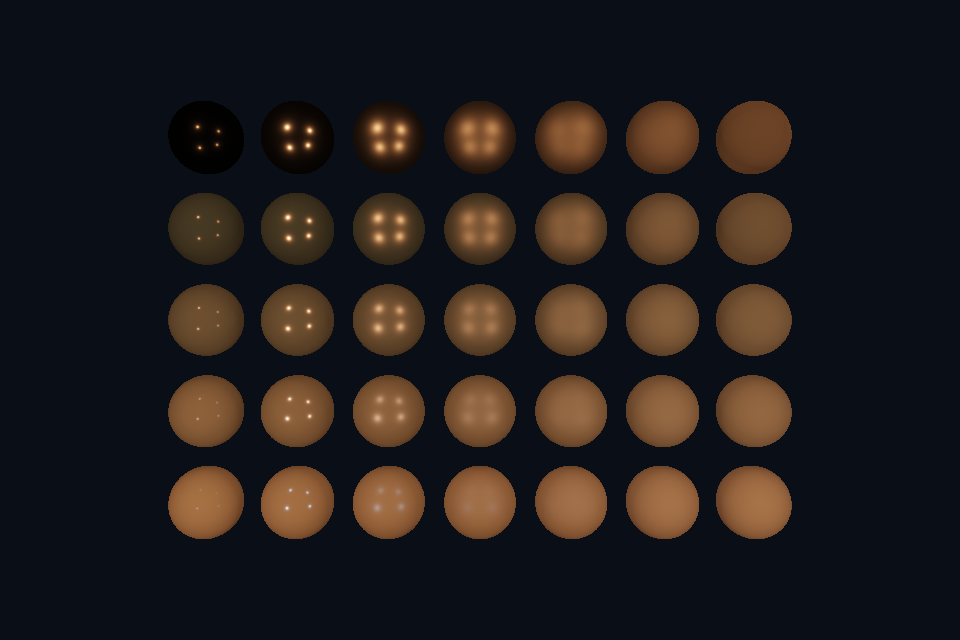

# dx09_pbr · HLSL 直接光 PBR

[路线首页](../../README.md) · [上一课](../dx08_compute_uav/README.md) · [下一课](../dx10_offscreen/README.md)

## 构建和运行

从仓库根目录执行，完成配置后后续只需 build：

```powershell
cmake --preset dx12
cmake --build --preset dx12-debug --target dx09_pbr --parallel 4
.\DirectX12\build\bin\Debug\dx09_pbr.exe
```

也可以通过根目录“开始学习.cmd”打开页面后点击“运行本课”。01/08 是控制台计算/设备检查示例，点击后可用“查看运行输出”阅读结果。其余示例 Esc 退出，拖动窗口可测试尺寸重建。

预期结果：5×7 球阵：横向粗糙度，纵向金属度。

## 先读哪些代码

HLSL Cook-Torrance / CBV / PSO

本目录 [main.cpp](main.cpp) 选择本课的执行路径。完整 API 实现在 `common/dx12_course.hpp`（相对路线根目录），数学和网格在仓库 shared/scene.hpp。每课都是独立程序；共享代码避免把相同资源生命周期错误复制十遍，也会为后续课预先初始化部分公共状态。首次阅读只沿本课列出的调用路径展开。

## 原理和实现

同一套 sphere 与材质网格，使用 HLSL 表达 GGX/Fresnel/geometry 项。该课是直接光 PBR，未包含 DXR/IBL/模型导入。shader 运行时由 D3DCompileFromFile 编译到 SM5.1，Debug 含调试信息；它不是 DXC/SM6 的示例。

本课使用与 Vulkan 相同的几何和验证目标，比较资源绑定与同步的不同表达。CPU 创建的数据、GPU 资源和用于访问它的 view/descriptor 是不同层次；用调试层与抓帧工具分别核对接口约定和实际内容。命令异步执行，示例显式等待 fence 后才重用单份上传资源与 command allocator。

HLSL 使用 column_major 与 mul(M,v)，保持与共享 GLM 数据相同的内存和乘法约定。调整窗口大小时必须更新尺寸相关的目标与投影；map、创建视图或改变 CPU 变量都不会替代已经提交给 GPU 的工作。

## 修改练习

把 metallic 固定为 0/1；修改灯强与粗糙度，观察高光分布。

修改 shader 后重新构建，再运行。Vulkan GLSL 会被编译并复制到 exe 旁的 shaders；DX12 的 HLSL 副本也随构建更新，运行时再编译。应修改源目录而不是运行副本。

## 自测

金属的基础颜色主要影响哪个分量？

参考：在该金属度模型中影响有色镜面 F0，金属漫反射关闭。


## 验证和调试

运行 `dx09_pbr.exe --smoke` 执行四帧（或设备/计算检查）并退出；颜色课会从 GPU 读回 PPM，计算课验证 256 个数。参见仓库 [调试指南](../../../docs/DEBUGGING.md)。这些基础例子按帧串行等待，重点是可追踪的生命周期；多帧重叠不能仅删除 wait，需要同时改成帧资源环。


## 实测画面

固定时间的 GPU 读回图像（nvpro 为 headless Viewport 输出）。




## 深入学习：数据、接口与执行

HLSL 与 GLSL 使用相同直接光参数和球阵列。当前法线处理依赖旋转/均匀缩放；移植非均匀缩放前要补逆转置，而不是靠粗糙度调节修正高光。

配套精讲：[三 API 对照 · 直接光 PBR 与 IBL](../../../docs/compare/12_lighting_pbr_ibl.md)。先读概念与参数选择，再返回本课实现核对，不必一次展开所有公共类。

### 本课的真实源码切片

来自 [DirectX12/shaders/scene.hlsl](../../shaders/scene.hlsl#L52)，第 52—79 行；这是现有实现的局部摘录，末尾可能处于函数中间，不是可单独编译的完整程序。

```hlsl
float3 PBR(float3 N, float3 V, float3 P, float metal, float r) {
    const float PI = 3.14159265359;
    float3 albedo = float3(.8, .25, .07), sum = .02 * albedo * (1 - metal),
           f0 = lerp(.04.xxx, albedo, metal);
    for (int i = 0; i < 4; ++i) {
        float3 lp = float3(i % 2 == 0 ? -6 : 6, i < 2 ? 6 : -4, 8);
        float3 delta = lp - P, L = normalize(delta), H = normalize(V + L);
        float NoV = max(dot(N, V), .001), NoL = max(dot(N, L), 0), NoH = max(dot(N, H), 0);
        float a = r * r, a2 = a * a, d = NoH * NoH * (a2 - 1) + 1,
              D = a2 / max(PI * d * d, .000001);
        float k = (r + 1) * (r + 1) / 8;
        float G = NoV / (NoV * (1 - k) + k) * NoL / (NoL * (1 - k) + k);
        float3 F = f0 + (1 - f0) * pow(1 - max(dot(V, H), 0), 5);
        sum += ((1 - F) * (1 - metal) * albedo / PI + D * G * F / max(4 * NoV * NoL, .001)) * 90 /
               dot(delta, delta) * NoL;
    }
    return sum;
}

// 区分调试颜色、纹理光照和 PBR 分支，最后执行 tone mapping/gamma。
float4 PixelMain(Pixel p) : SV_Target {
    int mode = (int)settings.x;
    float3 N = normalize(p.normal), c;
    if (mode <= 4)
        c = saturate(p.normal);
    else if (mode >= 9)
        c = PBR(N, normalize(float3(0, 0, 14) - p.world), p.world, settings.y, settings.z);
    else {
```

### 同主题跨 API 导航

以下是同主题参考；场景、功能完成度和版本基线可能不同，具体边界见对照章节。

| 路线 | 可运行参照 / 当前范围 |
| --- | --- |
| OpenGL | [25_ibl](../../../OpenGL/lessons/25_ibl/README.md) |
| Vulkan 原生 | [vk09_pbr](../../../Vulkan/native/lessons/vk09_pbr/README.md) |
| Vulkan / nvpro_core2 | [nv06_pbr_viewport](../../../Vulkan/nvpro/lessons/nv06_pbr_viewport/README.md) |
| DirectX 12 | [dx09_pbr](README.md) |

### 先预测，再验证

整体亮度不同但法线一致，下一步查什么？

参考推导：查光强、衰减、metal/roughness、tone mapping 和 gamma，再比较公式；不能用随意曝光掩盖输入差异。

在一次实验中只改一个因素，记录预测、实际画面/日志和原因。检查已有 smoke 是否仍通过；图形调试器里再核对本次 draw 的实际输入/输出，不能仅凭进程正常退出下结论。
