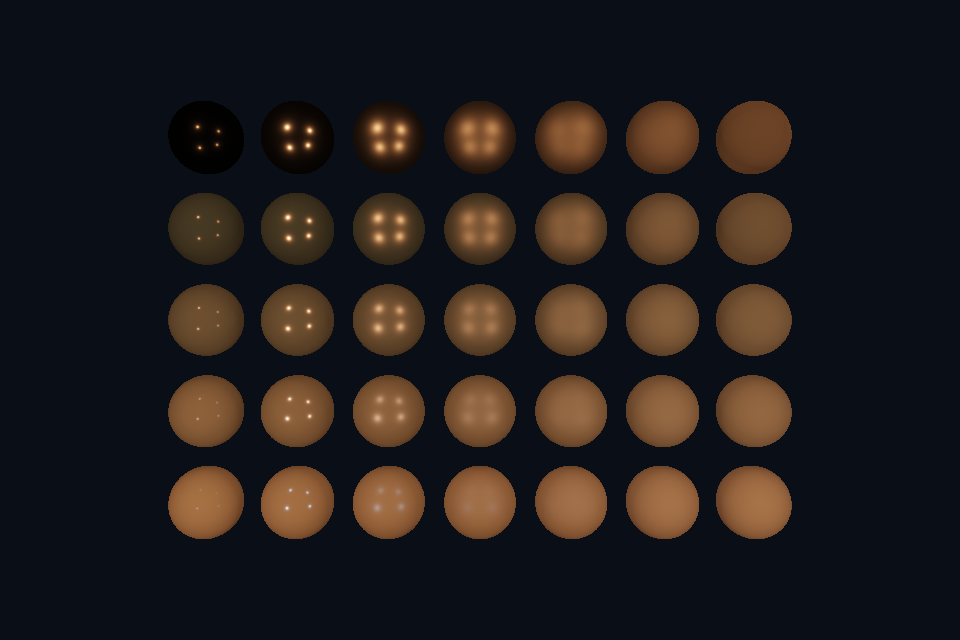

# dx10_offscreen · 离屏 RTV 与 CopyResource

## 本课独立工程与关键注释

[main.cpp](main.cpp) · [本地辅助实现](support/) · [本课着色器](shaders/) · [CMakeLists.txt](CMakeLists.txt)

本目录拥有完整课程源码、资源与依赖配方。关键步骤含中文注释，不链接其他课的课程实现。可将整个目录复制到其他位置，用以下命令单独构建和检查；第三方依赖首次配置需要联网或提供缓存。

```powershell
cmake -S . -B build -A x64
cmake --build build --config Debug --parallel 4
ctest --test-dir build -C Debug --output-on-failure
```

[路线首页](../../README.md) · [上一课](../dx09_pbr/README.md) · [下一课](../../README.md)

## 构建和运行

从仓库根目录执行，完成配置后后续只需 build：

```powershell
cmake --preset dx12
cmake --build --preset dx12-debug --target dx10_offscreen --parallel 4
.\DirectX12\build\bin\Debug\dx10_offscreen.exe
```

也可以通过根目录“开始学习.cmd”打开页面后点击“运行本课”。01/08 是控制台计算/设备检查示例，点击后可用“查看运行输出”阅读结果。其余示例 Esc 退出，拖动窗口可测试尺寸重建。

预期结果：PBR 先画进离屏 RGBA8 目标，再通过 CopyResource 传到交换链。

## 先读哪些代码

Offscreen RTV / CopyResource / Readback

本目录 [main.cpp](main.cpp) 选择本课的执行路径。完整 API 实现在 `common/dx12_course.hpp`（相对路线根目录），数学和网格在仓库 shared/scene.hpp。每课都是独立程序；共享代码避免把相同资源生命周期错误复制十遍，也会为后续课预先初始化部分公共状态。首次阅读只沿本课列出的调用路径展开。

## 原理和实现

独立离屏目标与 backbuffer 同格式同尺寸，用 CopyResource 传入交换链。离屏目标 RT→COPY_SOURCE，backbuffer PRESENT→COPY_DEST，复制后分别恢复。它是可部署的离屏传输演示，没有伪称完成 HDR 或 Bloom。

本课使用与 Vulkan 相同的几何和验证目标，比较资源绑定与同步的不同表达。CPU 创建的数据、GPU 资源和用于访问它的 view/descriptor 是不同层次；用调试层与抓帧工具分别核对接口约定和实际内容。命令异步执行，示例显式等待 fence 后才重用单份上传资源与 command allocator。

HLSL 使用 column_major 与 mul(M,v)，保持与共享 GLM 数据相同的内存和乘法约定。调整窗口大小时必须更新尺寸相关的目标与投影；map、创建视图或改变 CPU 变量都不会替代已经提交给 GPU 的工作。

## 修改练习

改变离屏大小，再思考 CopyResource 的尺寸要求与全屏采样替代方案。

修改 shader 后重新构建，再运行。Vulkan GLSL 会被编译并复制到 exe 旁的 shaders；DX12 的 HLSL 副本也随构建更新，运行时再编译。应修改源目录而不是运行副本。

## 自测

CopyResource 能直接当作任意缩放操作吗？

参考：不能，资源类型/格式/尺寸必须满足复制兼容性，缩放应另做采样或适当流程。


## 验证和调试

运行 `dx10_offscreen.exe --smoke` 执行四帧（或设备/计算检查）并退出；颜色课会从 GPU 读回 PPM，计算课验证 256 个数。参见仓库 [调试指南](../../../docs/DEBUGGING.md)。这些基础例子按帧串行等待，重点是可追踪的生命周期；多帧重叠不能仅删除 wait，需要同时改成帧资源环。


## 实测画面

固定时间的 GPU 读回图像（nvpro 为 headless Viewport 输出）。




## 深入学习：数据、接口与执行

本课先画独立资源，再 CopyResource 到 back buffer；两端需匹配拷贝要求并处于正确状态。拷贝后恢复离屏为下次渲染、back buffer 为 PRESENT。

配套精讲：[三 API 对照 · 阴影、SSAO 与后处理](../../../docs/compare/13_multipass_effects.md)。先读概念与参数选择，再返回本课实现核对，不必一次展开所有公共类。

### 本课的真实源码切片

来自 [DirectX12/lessons/dx10_offscreen/main.cpp](main.cpp#L9)，第 9—62 行；这是现有实现的局部摘录，末尾可能处于函数中间，不是可单独编译的完整程序。

```cpp
int runChapter(int argc, char** argv) {
    DxRenderOptions options;

    dxShaderFile = std::filesystem::absolute(argv[0]).parent_path() / COURSE_RUNTIME_NAME /
                   "shaders" / "scene.hlsl";
    bool smoke = false, warp = false;
    for (int i = 1; i < argc; ++i) {
        smoke |= std::strcmp(argv[i], "--smoke") == 0;
        warp |= std::strcmp(argv[i], "--warp") == 0;
    }
    if (!glfwInit())
        throw std::runtime_error("GLFW failed");
    glfwWindowHint(GLFW_CLIENT_API, GLFW_NO_API);
    if (smoke)
        glfwWindowHint(GLFW_VISIBLE, GLFW_FALSE);
    auto window = glfwCreateWindow(960, 640, "DirectX 12 Course", nullptr, nullptr);
    if (!window)
        throw std::runtime_error("Window creation failed");
    {
        DxWindow app(window, 10, warp, options);
        int frame = 0;
        auto output = std::filesystem::path(argv[0]).parent_path() /
                      (options.captureStem.empty() ? "dx12_" + std::to_string(10) + ".ppm"
                                                   : options.captureStem + ".ppm");
        while (!glfwWindowShouldClose(window) && (!smoke || frame < 4)) {
            glfwPollEvents();
            if (glfwGetKey(window, GLFW_KEY_ESCAPE) == GLFW_PRESS)
                break;
            int w, h;
            glfwGetFramebufferSize(window, &w, &h);
            if (!w || !h) {
                glfwWaitEvents();
                continue;
            }
            app.resize(w, h);
            float time = smoke ? 1.f : float(glfwGetTime());
            if (app.scene && options.beforeFrame)
                options.beforeFrame(*app.scene, time);
            app.render(time, smoke && frame == 3 ? &output : nullptr);
            ++frame;
        }
    }
    glfwDestroyWindow(window);
    glfwTerminate();
    return 0;
}
} // namespace course

int main(int argc, char** argv) try {
    return course::runChapter(argc, argv);
} catch (const std::exception& error) {
    std::cerr << "ERROR: " << error.what() << '\n';
    return 1;
}
```

### 同主题跨 API 导航

以下是同主题参考；场景、功能完成度和版本基线可能不同，具体边界见对照章节。

| 路线 | 可运行参照 / 当前范围 |
| --- | --- |
| OpenGL | [27_ssao](../../../OpenGL/lessons/27_ssao/README.md) |
| Vulkan 原生 | 迁移设计：vk10 已有离屏/blit；完整 Bloom/SSAO 仍需资源、采样管线及逐遍依赖。 |
| Vulkan / nvpro_core2 | 迁移设计：RenderTarget 与 ImGui 仅是接入点；新增多遍效果仍要自己描述写后读。 |
| DirectX 12 | [dx10_offscreen](README.md) |

### 先预测，再验证

要改变输出分辨率或任意处理颜色，CopyResource 足够吗？

参考推导：不够。它不是缩放/着色器处理；应选择合适 resolve/copy 条件或新增采样渲染 pass，并设计对应状态。

在一次实验中只改一个因素，记录预测、实际画面/日志和原因。检查已有 smoke 是否仍通过；图形调试器里再核对本次 draw 的实际输入/输出，不能仅凭进程正常退出下结论。
