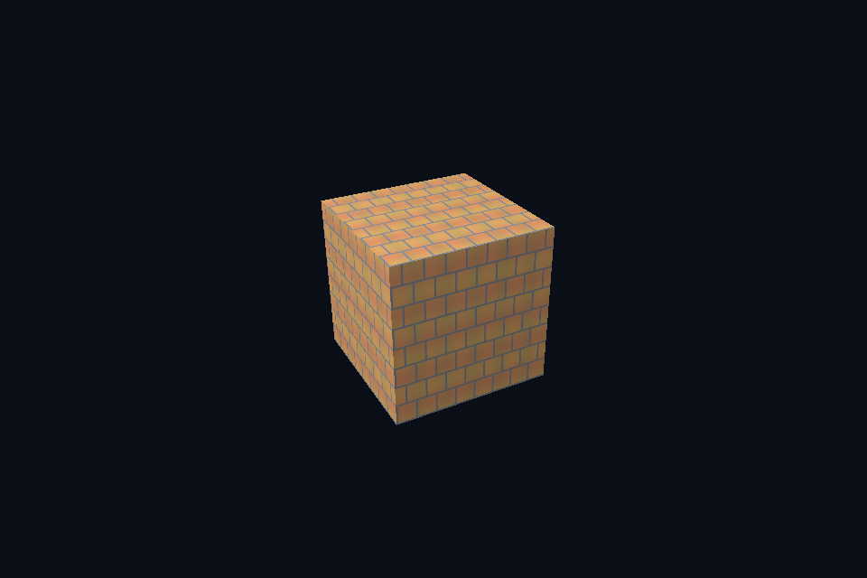

# dx17_image_file · 真实图片上传

[54 课目录](../../COURSE.md)

## 本课独立工程与关键注释

[main.cpp](main.cpp) · [本地辅助实现](support/) · [本课着色器](shaders/) · [CMakeLists.txt](CMakeLists.txt)

本目录包含独立课程源码，关键位置有中文注释。单独复制整个文件夹后可用 `cmake -S . -B build -A x64` 配置、`cmake --build build --config Debug` 构建；不需要其他章节源码。

## 目的与实际执行

解码结果按 footprint 行距复制进 UPLOAD buffer，再用 CopyTextureRegion 写入 texture。GPU 资源格式与字节布局要匹配；需要四通道时不能按原图三通道长度拷贝。

GetCopyableFootprints 返回 Offset、RowPitch 和各行信息，逐行填充后录制 CopyTextureRegion。texture resource 的宽高不是 upload buffer 的紧密内存布局；mip/array 各自是子资源。

需要合法的 typeless resource/typed view 组合才能解释同一格式族；本课 sRGB SRV 与普通 UNORM 是不同读取约定。sRGB mip 的 CPU 参考先解码、平均再编码，不能直接平均已编码 RGB；alpha 仍是线性数据。

本程序的 C++、辅助实现、着色器和构建脚本均位于本目录，关键步骤含中文注释。设备/API 检查、数值 compute 与图形渲染采用不同证据；不是每个程序都会弹出窗口。

## 构建和运行

```powershell
cmake --preset dx12
cmake --build --preset dx12-debug --target dx17_image_file --parallel 4
.\DirectX12\build\bin\Debug\dx17_image_file.exe
```

## 深入学习：数据、接口与执行

- [第 33 课：真实图片、通道与资产路径](../../chapters/33_image_decode/README.md)
- [第 34 课：图像存储、Footprint 与拷贝](../../chapters/34_image_upload/README.md)
- [第 38 课：sRGB、线性光照与显示编码](../../chapters/38_color_space/README.md)

### 本课的真实源码切片

来自 [DirectX12/lessons/dx17_image_file/main.cpp](main.cpp#L296)，第 296—309 行；这是现有实现的局部摘录，末尾可能处于函数中间，不是可单独编译的完整程序。

```cpp
int runChapter(int argc, char** argv) {
    auto options = labOptions(argc, argv, 17);
    {
        return graphicsLab(argc, argv, options);
    }
}
} // namespace course

int main(int argc, char** argv) try {
    return course::runChapter(argc, argv);
} catch (const std::exception& error) {
    std::cerr << "ERROR: " << error.what() << '\n';
    return 1;
}
```

### 同主题跨 API 导航

| 路线 | 程序 |
| --- | --- |
| DirectX 12 | [dx17_image_file](README.md) |
| 对照后端 | [vk17_image_file](../../../Vulkan/native/lessons/vk17_image_file/README.md) |

### 先预测，再验证

把图片换成带透明通道的四象限测试图，先检查方向与字节数，再讨论混合。

参考推导：图像 RGBA 内容正确与 blending 状态正确是两件事。透明字节上传成功不代表自动启用了透明渲染。

解释一次 memcpy(width*height*4) 为什么不总能正确填 texture upload。

参考推导：API 可能要求更大的对齐行距或子资源起点。正确内容应逐行写到 footprint 的 Offset+y*RowPitch，再按有效宽度复制。

给粗糙度贴图使用 sRGB 读取，能否靠 normalize 或调曝光恢复正确粗糙度？

参考推导：不能。输入标量被非线性改写，曝光只改变输出，不能还原材质参数。先纠正数据格式与用途。

## 验证与边界

运行 `--smoke` 执行有限自动检查。数值实验读取实际 GPU 结果，图形实验检查非空图像并可查看读回。交互重建与性能还需额外证据；窗口 renderer 当前保留串行等待，双槽计算实验不会被描述为完整多帧呈现引擎。

## 实际画面


