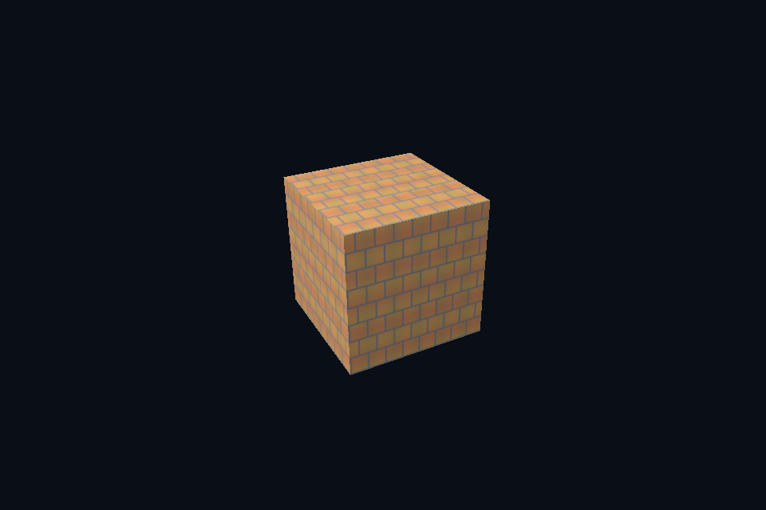

# dx19_texture_lod · 多级纹理采样

[54 课目录](../../COURSE.md)

## 本课独立工程与关键注释

[main.cpp](main.cpp) · [本地辅助实现](support/) · [本课着色器](shaders/) · [CMakeLists.txt](CMakeLists.txt)

本目录包含独立课程源码，关键位置有中文注释。单独复制整个文件夹后可用 `cmake -S . -B build -A x64` 配置、`cmake --build build --config Debug` 构建；不需要其他章节源码。

## 目的与实际执行

SRV 的 MostDetailedMip/MipLevels 与 static sampler 的 LOD 范围共同生效。descriptor 不生成图像；正确 GPU mip 链的上传/生成结果仍需先验证。

本程序的 C++、辅助实现、着色器和构建脚本均位于本目录，关键步骤含中文注释。设备/API 检查、数值 compute 与图形渲染采用不同证据；不是每个程序都会弹出窗口。

## 构建和运行

```powershell
cmake --preset dx12
cmake --build --preset dx12-debug --target dx19_texture_lod --parallel 4
.\DirectX12\build\bin\Debug\dx19_texture_lod.exe
```

## 深入学习：数据、接口与执行

- [第 44 课：LOD、子资源视图与三线性过滤](../../chapters/44_mip_sampling/README.md)

### 本课的真实源码切片

来自 [DirectX12/lessons/dx19_texture_lod/main.cpp](main.cpp#L296)，第 296—309 行；这是现有实现的局部摘录，末尾可能处于函数中间，不是可单独编译的完整程序。

```cpp
int runChapter(int argc, char** argv) {
    auto options = labOptions(argc, argv, 19);
    {
        return graphicsLab(argc, argv, options);
    }
}
} // namespace course

int main(int argc, char** argv) try {
    return course::runChapter(argc, argv);
} catch (const std::exception& error) {
    std::cerr << "ERROR: " << error.what() << '\n';
    return 1;
}
```

### 同主题跨 API 导航

| 路线 | 程序 |
| --- | --- |
| DirectX 12 | [dx19_texture_lod](README.md) |
| 对照后端 | [vk19_texture_lod](../../../Vulkan/native/lessons/vk19_texture_lod/README.md) |

### 先预测，再验证

固定相机观察远处小物体，比较单级、完整 mip 与末级 view，并记录哪些差异来自范围、哪些来自过滤。

参考推导：末级 view 强制只见低分辨率平均图；完整 mip 按采样尺度选择；单级可能高频闪烁。不能把三者都解释为“纹理没加载”。

## 验证与边界

运行 `--smoke` 执行有限自动检查。数值实验读取实际 GPU 结果，图形实验检查非空图像并可查看读回。交互重建与性能还需额外证据；窗口 renderer 当前保留串行等待，双槽计算实验不会被描述为完整多帧呈现引擎。

## 实际画面


