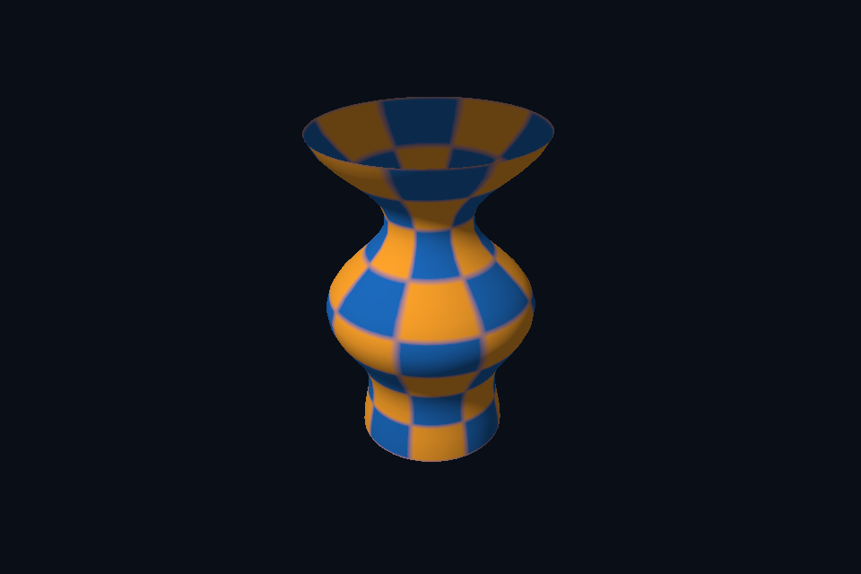

# dx21_obj_model · OBJ 静态模型

[54 课目录](../../COURSE.md)

## 目的与实际执行

同一 Geometry 进入 DxScene 的 VBV/IBV 与 input layout。归一化 bbox 便于固定相机观察，但它改变资产单位，不能在工程中无记录地用于物理、灯光或动画尺度。

本程序有独立实验选择与验证路径，公共实现集中在 advanced_labs.cpp。设备/API 检查、数值 compute 与图形渲染采用不同证据；不是每个程序都会弹出窗口。

## 构建和运行

```powershell
cmake --preset dx12
cmake --build --preset dx12-debug --target dx21_obj_model --parallel 4
.\DirectX12\build\bin\Debug\dx21_obj_model.exe
```

## 深入学习：数据、接口与执行

- [第 41 课：OBJ 导入、索引与几何归一化](../../chapters/41_obj_models/README.md)

### 本课的真实源码切片

来自 [shared/advanced.hpp](../../../shared/advanced.hpp#L92)，第 92—135 行；这是现有实现的局部摘录，末尾可能处于函数中间，不是可单独编译的完整程序。

```cpp
inline Geometry staticAsset(const std::filesystem::path& path) {
    Assimp::Importer importer;
    const auto* scene =
        importer.ReadFile(path.string(),
                          aiProcess_Triangulate | aiProcess_GenSmoothNormals |
                              aiProcess_JoinIdenticalVertices | aiProcess_ValidateDataStructure);
    require(scene && scene->mRootNode, "Assimp could not load course model");
    Geometry result;
    unsigned nodes = 0;
    std::function<void(const aiNode*, glm::mat4)> visit = [&](const aiNode* node,
                                                              glm::mat4 parent) {
        ++nodes;
        glm::mat4 transform = parent * assimpMatrix(node->mTransformation);
        glm::mat3 normalMatrix = glm::transpose(glm::inverse(glm::mat3(transform)));
        for (unsigned m = 0; m < node->mNumMeshes; ++m) {
            const auto* mesh = scene->mMeshes[node->mMeshes[m]];
            uint32_t base = uint32_t(result.vertices.size());
            for (unsigned i = 0; i < mesh->mNumVertices; ++i) {
                const auto& p = mesh->mVertices[i];
                auto n = mesh->HasNormals() ? mesh->mNormals[i] : aiVector3D(0, 1, 0);
                auto uv = mesh->HasTextureCoords(0) ? mesh->mTextureCoords[0][i] : aiVector3D();
                result.vertices.push_back({glm::vec3(transform * glm::vec4(p.x, p.y, p.z, 1)),
                                           glm::normalize(normalMatrix * glm::vec3(n.x, n.y, n.z)),
                                           {uv.x, uv.y}});
            }
            for (unsigned f = 0; f < mesh->mNumFaces; ++f) {
                require(mesh->mFaces[f].mNumIndices == 3, "Non-triangle after triangulation");
                for (unsigned k = 0; k < 3; ++k)
                    result.indices.push_back(base + mesh->mFaces[f].mIndices[k]);
            }
        }
        for (unsigned i = 0; i < node->mNumChildren; ++i)
            visit(node->mChildren[i], transform);
    };
    visit(scene->mRootNode, glm::mat4(1));
    require(!result.vertices.empty() && !result.indices.empty(), "Empty imported model");
    glm::vec3 lo(std::numeric_limits<float>::max()), hi(-std::numeric_limits<float>::max());
    for (const auto& v : result.vertices) {
        lo = glm::min(lo, v.position);
        hi = glm::max(hi, v.position);
    }
    auto extent = hi - lo;
    float scale = 2.f / std::max({extent.x, extent.y, extent.z, .0001f});
    for (auto& v : result.vertices)
```

### 同主题跨 API 导航

| 路线 | 程序 |
| --- | --- |
| DirectX 12 | [dx21_obj_model](README.md) |
| 对照后端 | [vk21_obj_model](../../../Vulkan/native/lessons/vk21_obj_model/README.md) |

### 先预测，再验证

只加载模型位置并用固定色画出，再分阶段恢复 normal/UV，说明这种顺序的作用。

参考推导：它把解析/索引/相机问题与材质问题分开。轮廓都不正确时，先不要调灯光或寻找缺失贴图。

## 验证与边界

运行 `--smoke` 执行有限自动检查。数值实验读取实际 GPU 结果，图形实验检查非空图像并可查看读回。交互重建与性能还需额外证据；窗口 renderer 当前保留串行等待，双槽计算实验不会被描述为完整多帧呈现引擎。

## 实际画面


