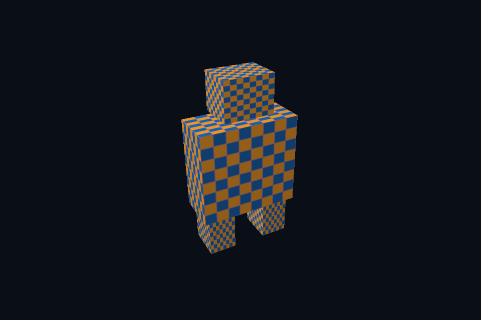

# dx22_gltf_scene · glTF 节点层级

[54 课目录](../../COURSE.md)

## 本课独立工程与关键注释

[main.cpp](main.cpp) · [本地辅助实现](support/) · [本课着色器](shaders/) · [CMakeLists.txt](CMakeLists.txt)

本目录包含独立课程源码，关键位置有中文注释。单独复制整个文件夹后可用 `cmake -S . -B build -A x64` 配置、`cmake --build build --config Debug` 构建；不需要其他章节源码。

## 目的与实际执行

使用相同 CPU 场景结果，后端差异集中于资源与管线。这里使用教学纹理/光照，不宣称完整还原 glTF 的每个材质扩展、透明模式或动画插值。

本程序的 C++、辅助实现、着色器和构建脚本均位于本目录，关键步骤含中文注释。设备/API 检查、数值 compute 与图形渲染采用不同证据；不是每个程序都会弹出窗口。

## 构建和运行

```powershell
cmake --preset dx12
cmake --build --preset dx12-debug --target dx22_gltf_scene --parallel 4
.\DirectX12\build\bin\Debug\dx22_gltf_scene.exe
```

## 深入学习：数据、接口与执行

- [第 42 课：glTF 节点层级、法线与静态姿态](../../chapters/42_gltf_nodes/README.md)

### 本课的真实源码切片

来自 [DirectX12/lessons/dx22_gltf_scene/main.cpp](main.cpp#L36)，第 36—49 行；这是现有实现的局部摘录，末尾可能处于函数中间，不是可单独编译的完整程序。

```cpp
int runChapter(int argc, char** argv) {
    auto options = labOptions(argc, argv, 22);
    {
        return graphicsLab(argc, argv, options);
    }
}
} // namespace course

int main(int argc, char** argv) try {
    return course::runChapter(argc, argv);
} catch (const std::exception& error) {
    std::cerr << "ERROR: " << error.what() << '\n';
    return 1;
}
```

### 同主题跨 API 导航

| 路线 | 程序 |
| --- | --- |
| DirectX 12 | [dx22_gltf_scene](README.md) |
| 对照后端 | [vk22_gltf_scene](../../../Vulkan/native/lessons/vk22_gltf_scene/README.md) |

### 先预测，再验证

给 glTF 的父节点增加平移，预测所有后代是否一起移动，并说明法线如何处理非均匀缩放。

参考推导：后代 global 包含父变换，因此一起移动；法线使用线性部分的逆转置。单纯把 mesh 放原点会破坏层级关系。

## 验证与边界

运行 `--smoke` 执行有限自动检查。数值实验读取实际 GPU 结果，图形实验检查非空图像并可查看读回。交互重建与性能还需额外证据；窗口 renderer 当前保留串行等待，双槽计算实验不会被描述为完整多帧呈现引擎。

## 实际画面


