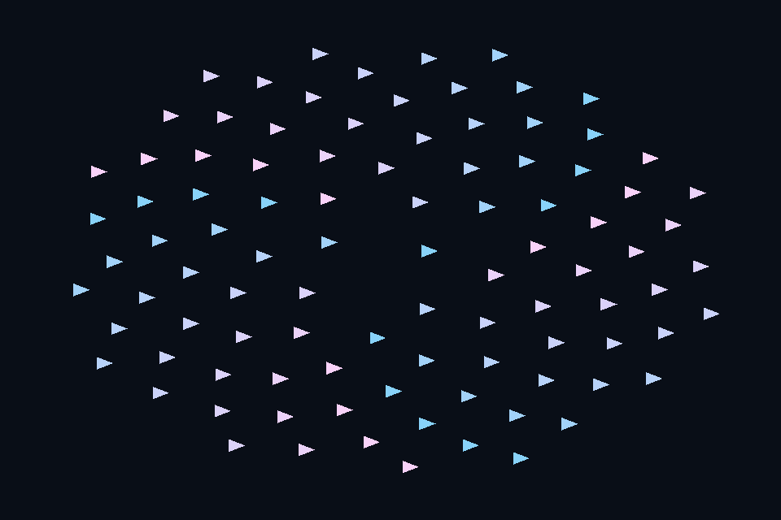

# dx29_gpu_particles · GPU 生成顶点与绘制

[54 课目录](../../COURSE.md)

## 本课独立工程与关键注释

[main.cpp](main.cpp) · [本地辅助实现](support/) · [本课着色器](shaders/) · [CMakeLists.txt](CMakeLists.txt)

本目录包含独立课程源码，关键位置有中文注释。单独复制整个文件夹后可用 `cmake -S . -B build -A x64` 配置、`cmake --build build --config Debug` 构建；不需要其他章节源码。

## 目的与实际执行

同一 DEFAULT resource 允许 UAV，计算后转 VERTEX_AND_CONSTANT_BUFFER，VBV 直接引用其地址。计算提交在窗口 renderer 重置 allocator 前完成，当前路径显式等待，未宣称已做异步 compute 重叠。

本程序的 C++、辅助实现、着色器和构建脚本均位于本目录，关键步骤含中文注释。设备/API 检查、数值 compute 与图形渲染采用不同证据；不是每个程序都会弹出窗口。

## 构建和运行

```powershell
cmake --preset dx12
cmake --build --preset dx12-debug --target dx29_gpu_particles --parallel 4
.\DirectX12\build\bin\Debug\dx29_gpu_particles.exe
```

## 深入学习：数据、接口与执行

- [第 48 课：计算生成顶点并直接绘制](../../chapters/48_compute_graphics/README.md)

### 本课的真实源码切片

来自 [DirectX12/lessons/dx29_gpu_particles/main.cpp](main.cpp#L132)，第 132—145 行；这是现有实现的局部摘录，末尾可能处于函数中间，不是可单独编译的完整程序。

```cpp
int runChapter(int argc, char** argv) {
    auto options = labOptions(argc, argv, 29);
    {
        return graphicsLab(argc, argv, options);
    }
}
} // namespace course

int main(int argc, char** argv) try {
    return course::runChapter(argc, argv);
} catch (const std::exception& error) {
    std::cerr << "ERROR: " << error.what() << '\n';
    return 1;
}
```

### 同主题跨 API 导航

| 路线 | 程序 |
| --- | --- |
| DirectX 12 | [dx29_gpu_particles](README.md) |
| 对照后端 | [vk29_gpu_particles](../../../Vulkan/native/lessons/vk29_gpu_particles/README.md) |

### 先预测，再验证

把粒子数改为 97，需要检查哪些容量与 dispatch/guard？

参考推导：顶点数变为 291，GPU buffer 与 CPU 侧 draw count 元数据都要扩大；组数向上取整，shader 以 count*3 为上界。位置仍由 GPU 生成。

## 验证与边界

运行 `--smoke` 执行有限自动检查。数值实验读取实际 GPU 结果，图形实验检查非空图像并可查看读回。交互重建与性能还需额外证据；窗口 renderer 当前保留串行等待，双槽计算实验不会被描述为完整多帧呈现引擎。

## 实际画面


