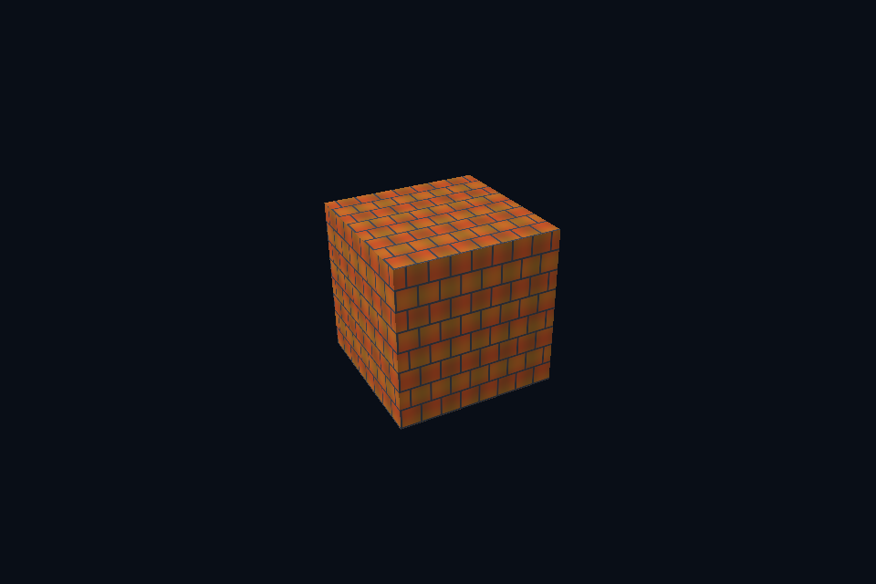

# dx35_srgb_view · sRGB 颜色视图

[54 课目录](../../COURSE.md)

## 目的与实际执行

需要合法的 typeless resource/typed view 组合才能解释同一格式族；本课 sRGB SRV 与普通 UNORM 是不同读取约定。sRGB mip 的 CPU 参考先解码、平均再编码，不能直接平均已编码 RGB；alpha 仍是线性数据。

本程序有独立实验选择与验证路径，公共实现集中在 advanced_labs.cpp。设备/API 检查、数值 compute 与图形渲染采用不同证据；不是每个程序都会弹出窗口。

## 构建和运行

```powershell
cmake --preset dx12
cmake --build --preset dx12-debug --target dx35_srgb_view --parallel 4
.\DirectX12\build\bin\Debug\dx35_srgb_view.exe
```

## 深入学习：数据、接口与执行

- [第 38 课：sRGB、线性光照与显示编码](../../chapters/38_color_space/README.md)

### 本课的真实源码切片

来自 [DirectX12/common/advanced_labs.cpp](../../common/advanced_labs.cpp#L237)，第 237—280 行；这是现有实现的局部摘录，末尾可能处于函数中间，不是可单独编译的完整程序。

```cpp
struct GpuTexture {
    DxDevice& c;
    ComPtr<ID3D12Resource> texture;
    std::vector<Pixels> reference;
    DXGI_FORMAT viewFormat;
    GpuTexture(
        DxDevice& context, const LabOptions& options, Pixels pixels, bool mips, bool srgb = false)
        : c(context) {
        reference = mips ? mipReference(pixels, srgb) : std::vector<Pixels>{pixels};
        const UINT levels = UINT(reference.size());
        const bool gpuMips = mips && !srgb;
        viewFormat = srgb ? DXGI_FORMAT_R8G8B8A8_UNORM_SRGB : DXGI_FORMAT_R8G8B8A8_UNORM;
        D3D12_RESOURCE_DESC desc{};
        desc.Dimension = D3D12_RESOURCE_DIMENSION_TEXTURE2D;
        desc.Width = pixels.width;
        desc.Height = pixels.height;
        desc.DepthOrArraySize = 1;
        desc.MipLevels = UINT16(levels);
        desc.Format = srgb ? DXGI_FORMAT_R8G8B8A8_TYPELESS : DXGI_FORMAT_R8G8B8A8_UNORM;
        desc.SampleDesc.Count = 1;
        if (gpuMips)
            desc.Flags = D3D12_RESOURCE_FLAG_ALLOW_UNORDERED_ACCESS;
        D3D12_HEAP_PROPERTIES hp{};
        hp.Type = D3D12_HEAP_TYPE_DEFAULT;
        dxCheck(c.device->CreateCommittedResource(&hp,
                                                  D3D12_HEAP_FLAG_NONE,
                                                  &desc,
                                                  D3D12_RESOURCE_STATE_COPY_DEST,
                                                  nullptr,
                                                  IID_PPV_ARGS(&texture)));
        std::vector<D3D12_PLACED_SUBRESOURCE_FOOTPRINT> footprints(levels);
        std::vector<UINT> rows(levels);
        std::vector<UINT64> rowBytes(levels);
        UINT64 total{};
        c.device->GetCopyableFootprints(
            &desc, 0, levels, 0, footprints.data(), rows.data(), rowBytes.data(), &total);
        auto upload = c.buffer(total, D3D12_HEAP_TYPE_UPLOAD, D3D12_RESOURCE_STATE_GENERIC_READ);
        std::vector<uint8_t> packed(static_cast<size_t>(total));
        UINT copied = gpuMips ? 1 : levels;
        for (UINT level = 0; level < copied; ++level)
            for (UINT y = 0; y < reference[level].height; ++y)
                std::memcpy(packed.data() + footprints[level].Offset +
                                size_t(y) * footprints[level].Footprint.RowPitch,
                            reference[level].rgba.data() + size_t(y) * reference[level].width * 4,
```

### 同主题跨 API 导航

| 路线 | 程序 |
| --- | --- |
| DirectX 12 | [dx35_srgb_view](README.md) |
| 对照后端 | [vk35_srgb_view](../../../Vulkan/native/lessons/vk35_srgb_view/README.md) |

### 先预测，再验证

给粗糙度贴图使用 sRGB 读取，能否靠 normalize 或调曝光恢复正确粗糙度？

参考推导：不能。输入标量被非线性改写，曝光只改变输出，不能还原材质参数。先纠正数据格式与用途。

## 验证与边界

运行 `--smoke` 执行有限自动检查。数值实验读取实际 GPU 结果，图形实验检查非空图像并可查看读回。交互重建与性能还需额外证据；窗口 renderer 当前保留串行等待，双槽计算实验不会被描述为完整多帧呈现引擎。

## 实际画面


