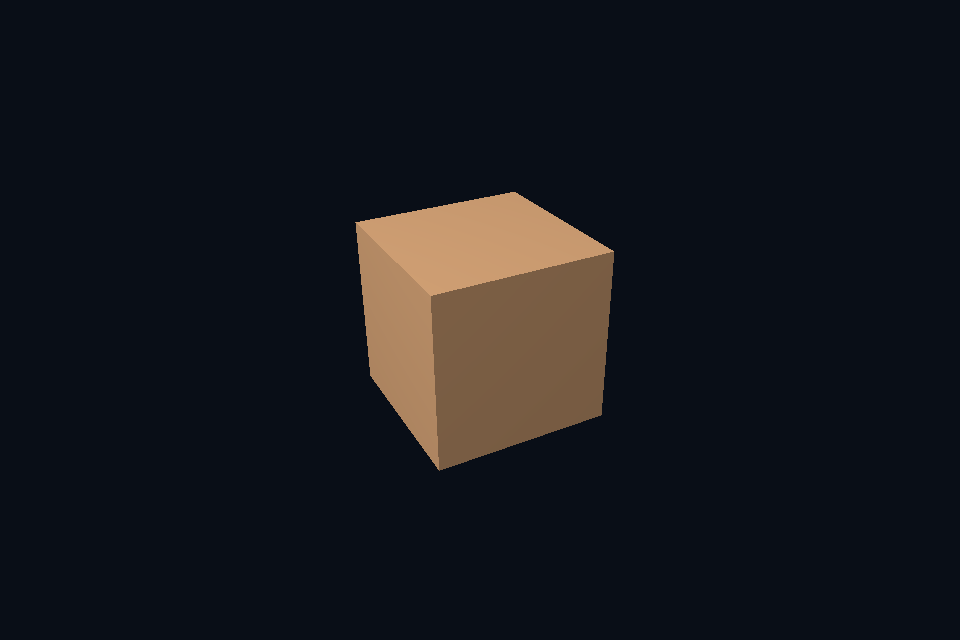

# dx41_subresource_view · 限定子资源视图

[54 课目录](../../COURSE.md)

## 目的与实际执行

SRV 写入 descriptor heap，描述 MostDetailedMip、MipLevels 与格式。相同 resource 可有不同合法 view；本课程通过限定末级 mip 验证这个区别。RTV/DSV 则服务输出用途，不直接等同于 shader-visible SRV。

SRV 的 MostDetailedMip/MipLevels 与 static sampler 的 LOD 范围共同生效。descriptor 不生成图像；正确 GPU mip 链的上传/生成结果仍需先验证。

本程序有独立实验选择与验证路径，公共实现集中在 advanced_labs.cpp。设备/API 检查、数值 compute 与图形渲染采用不同证据；不是每个程序都会弹出窗口。

## 构建和运行

```powershell
cmake --preset dx12
cmake --build --preset dx12-debug --target dx41_subresource_view --parallel 4
.\DirectX12\build\bin\Debug\dx41_subresource_view.exe
```

## 深入学习：数据、接口与执行

- [第 11 课：图像与 View：限定子资源访问](../../chapters/11_image_views/README.md)
- [第 44 课：LOD、子资源视图与三线性过滤](../../chapters/44_mip_sampling/README.md)

### 本课的真实源码切片

来自 [DirectX12/common/advanced_labs.cpp](../../common/advanced_labs.cpp#L391)，第 391—434 行；这是现有实现的局部摘录，末尾可能处于函数中间，不是可单独编译的完整程序。

```cpp
    void attach(DxScene& scene, bool lastMip = false) {
        D3D12_SHADER_RESOURCE_VIEW_DESC srv{};
        srv.Format = viewFormat;
        srv.ViewDimension = D3D12_SRV_DIMENSION_TEXTURE2D;
        srv.Shader4ComponentMapping = D3D12_DEFAULT_SHADER_4_COMPONENT_MAPPING;
        srv.Texture2D.MostDetailedMip = lastMip ? UINT(reference.size() - 1) : 0;
        srv.Texture2D.MipLevels = lastMip ? 1 : UINT(reference.size());
        c.device->CreateShaderResourceView(
            texture.Get(), &srv, scene.srvHeap->GetCPUDescriptorHandleForHeapStart());
    }
    void verify() {
        auto desc = texture->GetDesc();
        UINT levels = UINT(reference.size());
        std::vector<D3D12_PLACED_SUBRESOURCE_FOOTPRINT> footprints(levels);
        UINT64 total{};
        c.device->GetCopyableFootprints(
            &desc, 0, levels, 0, footprints.data(), nullptr, nullptr, &total);
        auto readback = c.buffer(total, D3D12_HEAP_TYPE_READBACK, D3D12_RESOURCE_STATE_COPY_DEST);
        c.begin();
        auto b = transition(texture.Get(),
                            D3D12_RESOURCE_STATE_PIXEL_SHADER_RESOURCE,
                            D3D12_RESOURCE_STATE_COPY_SOURCE);
        c.cmd->ResourceBarrier(1, &b);
        for (UINT level = 0; level < levels; ++level) {
            D3D12_TEXTURE_COPY_LOCATION src{}, dst{};
            src.pResource = texture.Get();
            src.Type = D3D12_TEXTURE_COPY_TYPE_SUBRESOURCE_INDEX;
            src.SubresourceIndex = level;
            dst.pResource = readback.Get();
            dst.Type = D3D12_TEXTURE_COPY_TYPE_PLACED_FOOTPRINT;
            dst.PlacedFootprint = footprints[level];
            c.cmd->CopyTextureRegion(&dst, 0, 0, 0, &src, nullptr);
        }
        b = transition(texture.Get(),
                       D3D12_RESOURCE_STATE_COPY_SOURCE,
                       D3D12_RESOURCE_STATE_PIXEL_SHADER_RESOURCE);
        c.cmd->ResourceBarrier(1, &b);
        c.submit();
        void* p{};
        D3D12_RANGE range{0, SIZE_T(total)};
        dxCheck(readback->Map(0, &range, &p));
        for (UINT level = 0; level < levels; ++level)
            for (UINT y = 0; y < reference[level].height; ++y) {
                auto* row = static_cast<uint8_t*>(p) + footprints[level].Offset +
```

### 同主题跨 API 导航

| 路线 | 程序 |
| --- | --- |
| DirectX 12 | [dx41_subresource_view](README.md) |
| 对照后端 | [vk41_subresource_view](../../../Vulkan/native/lessons/vk41_subresource_view/README.md) |

### 先预测，再验证

只把 view 的 mip 范围缩到最后一级，为什么资源的总分配大小没有随之缩小？

参考推导：view 不拥有存储。原始纹理仍有完整 mip 链，只是当前接口暴露其中一段。

固定相机观察远处小物体，比较单级、完整 mip 与末级 view，并记录哪些差异来自范围、哪些来自过滤。

参考推导：末级 view 强制只见低分辨率平均图；完整 mip 按采样尺度选择；单级可能高频闪烁。不能把三者都解释为“纹理没加载”。

## 验证与边界

运行 `--smoke` 执行有限自动检查。数值实验读取实际 GPU 结果，图形实验检查非空图像并可查看读回。交互重建与性能还需额外证据；窗口 renderer 当前保留串行等待，双槽计算实验不会被描述为完整多帧呈现引擎。

## 实际画面


