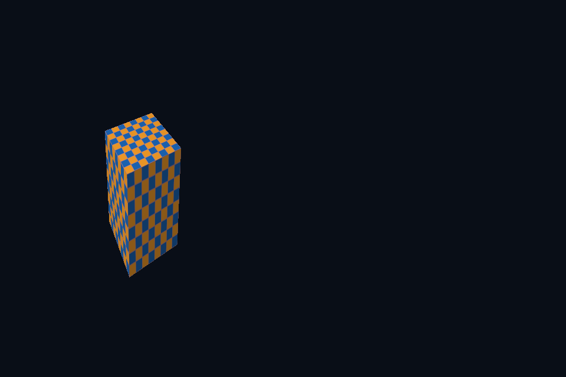

# dx49_viewport_mapping · 视口映射

[54 课目录](../../COURSE.md)

## 目的与实际执行

RSSetViewports 与 RSSetScissorRects 负责动态矩形，RasterizerState.CullMode 和 RenderTargetWriteMask 在 PSO 内。缩窄 viewport 会改变映射比例；缩窄 scissor 则只遮住原画面的一部分。 本例使用 FrontCounterClockwise=TRUE 识别模型外表面；FALSE 会把本应可见的外面剔除，看到立方体内部。

本程序有独立实验选择与验证路径，公共实现集中在 advanced_labs.cpp。设备/API 检查、数值 compute 与图形渲染采用不同证据；不是每个程序都会弹出窗口。

## 构建和运行

```powershell
cmake --preset dx12
cmake --build --preset dx12-debug --target dx49_viewport_mapping --parallel 4
.\DirectX12\build\bin\Debug\dx49_viewport_mapping.exe
```

## 深入学习：数据、接口与执行

- [第 14 课：固定功能、颜色掩码、视口与剔除](../../chapters/14_fixed_function/README.md)

### 本课的真实源码切片

来自 [DirectX12/common/dx12_course.hpp](../../common/dx12_course.hpp#L600)，第 600—643 行；这是现有实现的局部摘录，末尾可能处于函数中间，不是可单独编译的完整程序。

```cpp
        auto color = rtv(options.samples > 1 ? 3
                         : mode == 10        ? 2
                                             : swap->GetCurrentBackBufferIndex()),
             ds = dsvHeap->GetCPUDescriptorHandleForHeapStart();
        float clear[] = {.035f, .055f, .09f, 1};
        c.cmd->ClearRenderTargetView(color, clear, 0, nullptr);
        c.cmd->ClearDepthStencilView(ds, D3D12_CLEAR_FLAG_DEPTH, 1, 0, 0, nullptr);
        c.cmd->OMSetRenderTargets(1, &color, FALSE, &ds);
        D3D12_VIEWPORT viewport{
            0, 0, float(width) / (scene && scene->halfViewport ? 2 : 1), float(height), 0, 1};
        D3D12_RECT scissor{0, 0, scene && scene->halfScissor ? width / 2 : width, height};
        c.cmd->RSSetViewports(1, &viewport);
        c.cmd->RSSetScissorRects(1, &scissor);
        if (scene) {
            if (options.update)
                options.update(*scene, time);
            scene->render(width, height, time);
        }

        // 离屏课先画独立纹理，再把它作为 COPY_SOURCE 拷贝到交换链图像。
        if (mode == 10) {
            D3D12_RESOURCE_BARRIER b[] = {transition(offscreen.Get(),
                                                     D3D12_RESOURCE_STATE_RENDER_TARGET,
                                                     D3D12_RESOURCE_STATE_COPY_SOURCE),
                                          transition(back.Get(),
                                                     D3D12_RESOURCE_STATE_PRESENT,
                                                     D3D12_RESOURCE_STATE_COPY_DEST)};
            c.cmd->ResourceBarrier(2, b);
            c.cmd->CopyResource(back.Get(), offscreen.Get());
            auto restore = transition(offscreen.Get(),
                                      D3D12_RESOURCE_STATE_COPY_SOURCE,
                                      D3D12_RESOURCE_STATE_RENDER_TARGET);
            c.cmd->ResourceBarrier(1, &restore);
        }
        auto old = mode == 10 ? D3D12_RESOURCE_STATE_COPY_DEST : D3D12_RESOURCE_STATE_RENDER_TARGET;
        if (options.samples > 1) {
            D3D12_RESOURCE_BARRIER barriers[] = {transition(multisample.Get(),
                                                            D3D12_RESOURCE_STATE_RENDER_TARGET,
                                                            D3D12_RESOURCE_STATE_RESOLVE_SOURCE),
                                                 transition(back.Get(),
                                                            D3D12_RESOURCE_STATE_RENDER_TARGET,
                                                            D3D12_RESOURCE_STATE_RESOLVE_DEST)};
            c.cmd->ResourceBarrier(2, barriers);
            c.cmd->ResolveSubresource(
```

### 同主题跨 API 导航

| 路线 | 程序 |
| --- | --- |
| DirectX 12 | [dx49_viewport_mapping](README.md) |
| 对照后端 | [vk49_viewport_mapping](../../../Vulkan/native/lessons/vk49_viewport_mapping/README.md) |

### 先预测，再验证

先预测半视口与半裁剪的区别，再分别运行对应实验，检查模型宽高和可见区域。

参考推导：半视口把整幅几何压进较窄映射，半裁剪保留原映射但屏蔽右侧。它们可能显示相同面积，却不是相同几何变换。

## 验证与边界

运行 `--smoke` 执行有限自动检查。数值实验读取实际 GPU 结果，图形实验检查非空图像并可查看读回。交互重建与性能还需额外证据；窗口 renderer 当前保留串行等待，双槽计算实验不会被描述为完整多帧呈现引擎。

## 实际画面


