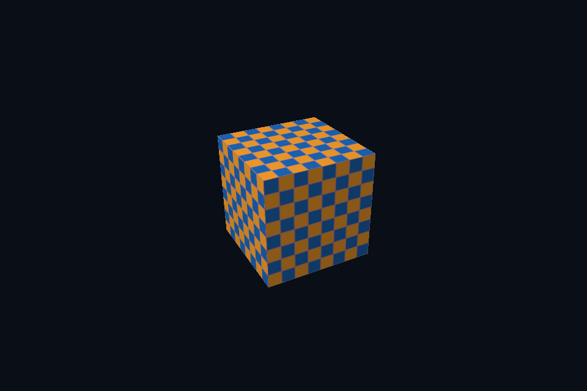

# dx50_backface_culling · 背面剔除

[54 课目录](../../COURSE.md)

## 目的与实际执行

RSSetViewports 与 RSSetScissorRects 负责动态矩形，RasterizerState.CullMode 和 RenderTargetWriteMask 在 PSO 内。缩窄 viewport 会改变映射比例；缩窄 scissor 则只遮住原画面的一部分。 本例使用 FrontCounterClockwise=TRUE 识别模型外表面；FALSE 会把本应可见的外面剔除，看到立方体内部。

本程序有独立实验选择与验证路径，公共实现集中在 advanced_labs.cpp。设备/API 检查、数值 compute 与图形渲染采用不同证据；不是每个程序都会弹出窗口。

## 构建和运行

```powershell
cmake --preset dx12
cmake --build --preset dx12-debug --target dx50_backface_culling --parallel 4
.\DirectX12\build\bin\Debug\dx50_backface_culling.exe
```

## 深入学习：数据、接口与执行

- [第 14 课：固定功能、颜色掩码、视口与剔除](../../chapters/14_fixed_function/README.md)

### 本课的真实源码切片

来自 [DirectX12/common/dx12_course.hpp](../../common/dx12_course.hpp#L398)，第 398—441 行；这是现有实现的局部摘录，末尾可能处于函数中间，不是可单独编译的完整程序。

```cpp
        pso.pRootSignature = signature.Get();
        pso.VS = {vs->GetBufferPointer(), vs->GetBufferSize()};
        pso.PS = {ps->GetBufferPointer(), ps->GetBufferSize()};
        pso.BlendState.RenderTarget[0].RenderTargetWriteMask =
            redOnly ? D3D12_COLOR_WRITE_ENABLE_RED | D3D12_COLOR_WRITE_ENABLE_ALPHA
                    : D3D12_COLOR_WRITE_ENABLE_ALL;
        pso.SampleMask = UINT_MAX;
        pso.RasterizerState.FillMode = D3D12_FILL_MODE_SOLID;
        pso.RasterizerState.CullMode = cull;
        // 共用模型按外表面逆时针排列；明确指定正面，避免剔除后只剩内部。
        pso.RasterizerState.FrontCounterClockwise = TRUE;
        pso.RasterizerState.DepthClipEnable = TRUE;
        pso.DepthStencilState.DepthEnable = mode >= 5;
        pso.DepthStencilState.DepthWriteMask =
            mode >= 5 ? D3D12_DEPTH_WRITE_MASK_ALL : D3D12_DEPTH_WRITE_MASK_ZERO;
        pso.DepthStencilState.DepthFunc = D3D12_COMPARISON_FUNC_LESS;
        pso.DepthStencilState.StencilReadMask = pso.DepthStencilState.StencilWriteMask = 0xFF;
        if (mode >= 4)
            pso.InputLayout = {elements, 3};
        pso.PrimitiveTopologyType = D3D12_PRIMITIVE_TOPOLOGY_TYPE_TRIANGLE;
        pso.NumRenderTargets = 1;
        pso.RTVFormats[0] = DXGI_FORMAT_R8G8B8A8_UNORM;
        pso.DSVFormat = DXGI_FORMAT_D32_FLOAT;
        pso.SampleDesc.Count = samples;
        dxCheck(c.device->CreateGraphicsPipelineState(&pso, IID_PPV_ARGS(&pipeline)));
    }

    // 绑定 PSO、root signature、descriptor heap 和顶点输入，再逐对象更新 root constants。
    void render(int w, int h, float time) {
        Frame f = overrideFrame.value_or(frame(mode, float(w) / h, false));
        if (frameProvider)
            f = frameProvider(float(w) / h, time, false);
        void* mapped;
        D3D12_RANGE empty{0, 0};
        dxCheck(uniform->Map(0, &empty, &mapped));
        std::memcpy(mapped, &f, sizeof(f));
        uniform->Unmap(0, nullptr);
        auto cmd = c.cmd.Get();
        cmd->SetPipelineState(pipeline.Get());
        cmd->SetGraphicsRootSignature(signature.Get());
        ID3D12DescriptorHeap* heaps[] = {srvHeap.Get()};
        cmd->SetDescriptorHeaps(1, heaps);
        cmd->SetGraphicsRootConstantBufferView(0, uniform->GetGPUVirtualAddress());
        cmd->SetGraphicsRootDescriptorTable(2, srvHeap->GetGPUDescriptorHandleForHeapStart());
```

### 同主题跨 API 导航

| 路线 | 程序 |
| --- | --- |
| DirectX 12 | [dx50_backface_culling](README.md) |
| 对照后端 | [vk50_backface_culling](../../../Vulkan/native/lessons/vk50_backface_culling/README.md) |

### 先预测，再验证

先预测半视口与半裁剪的区别，再分别运行对应实验，检查模型宽高和可见区域。

参考推导：半视口把整幅几何压进较窄映射，半裁剪保留原映射但屏蔽右侧。它们可能显示相同面积，却不是相同几何变换。

## 验证与边界

运行 `--smoke` 执行有限自动检查。数值实验读取实际 GPU 结果，图形实验检查非空图像并可查看读回。交互重建与性能还需额外证据；窗口 renderer 当前保留串行等待，双槽计算实验不会被描述为完整多帧呈现引擎。

## 实际画面


