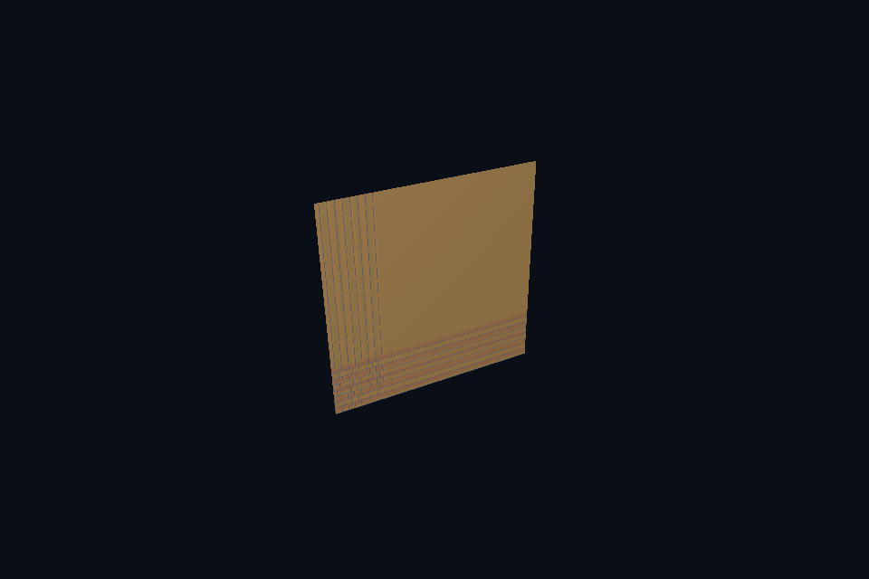

# dx52_sampler_addressing · 纹理寻址

[54 课目录](../../COURSE.md)

## 本课独立工程与关键注释

[main.cpp](main.cpp) · [本地辅助实现](support/) · [本课着色器](shaders/) · [CMakeLists.txt](CMakeLists.txt)

本目录包含独立课程源码，关键位置有中文注释。单独复制整个文件夹后可用 `cmake -S . -B build -A x64` 配置、`cmake --build build --config Debug` 构建；不需要其他章节源码。

## 目的与实际执行

当前图形 root signature 使用 static sampler，寻址策略是创建接口的一部分。改变它通常涉及相应 root signature/PSO 组合；若需要频繁变化，可设计独立 sampler heap/table，而不是随意改纹理字节。

本程序的 C++、辅助实现、着色器和构建脚本均位于本目录，关键步骤含中文注释。设备/API 检查、数值 compute 与图形渲染采用不同证据；不是每个程序都会弹出窗口。

## 构建和运行

```powershell
cmake --preset dx12
cmake --build --preset dx12-debug --target dx52_sampler_addressing --parallel 4
.\DirectX12\build\bin\Debug\dx52_sampler_addressing.exe
```

## 深入学习：数据、接口与执行

- [第 36 课：采样器、过滤、寻址与 UV](../../chapters/36_samplers/README.md)

### 本课的真实源码切片

来自 [DirectX12/lessons/dx52_sampler_addressing/main.cpp](main.cpp#L307)，第 307—320 行；这是现有实现的局部摘录，末尾可能处于函数中间，不是可单独编译的完整程序。

```cpp
int runChapter(int argc, char** argv) {
    auto options = labOptions(argc, argv, 52);
    {
        return graphicsLab(argc, argv, options);
    }
}
} // namespace course

int main(int argc, char** argv) try {
    return course::runChapter(argc, argv);
} catch (const std::exception& error) {
    std::cerr << "ERROR: " << error.what() << '\n';
    return 1;
}
```

### 同主题跨 API 导航

| 路线 | 程序 |
| --- | --- |
| DirectX 12 | [dx52_sampler_addressing](README.md) |
| 对照后端 | [vk52_sampler_addressing](../../../Vulkan/native/lessons/vk52_sampler_addressing/README.md) |

### 先预测，再验证

在 UV=0..4 的测试几何上比较 clamp 与 repeat，解释边缘拉伸来自哪里。

参考推导：clamp 将越界坐标限制到边缘 texel，repeat 周期折回。两者都读取同一内容，区别来自寻址规则而非模型解析。

## 验证与边界

运行 `--smoke` 执行有限自动检查。数值实验读取实际 GPU 结果，图形实验检查非空图像并可查看读回。交互重建与性能还需额外证据；窗口 renderer 当前保留串行等待，双槽计算实验不会被描述为完整多帧呈现引擎。

## 实际画面


