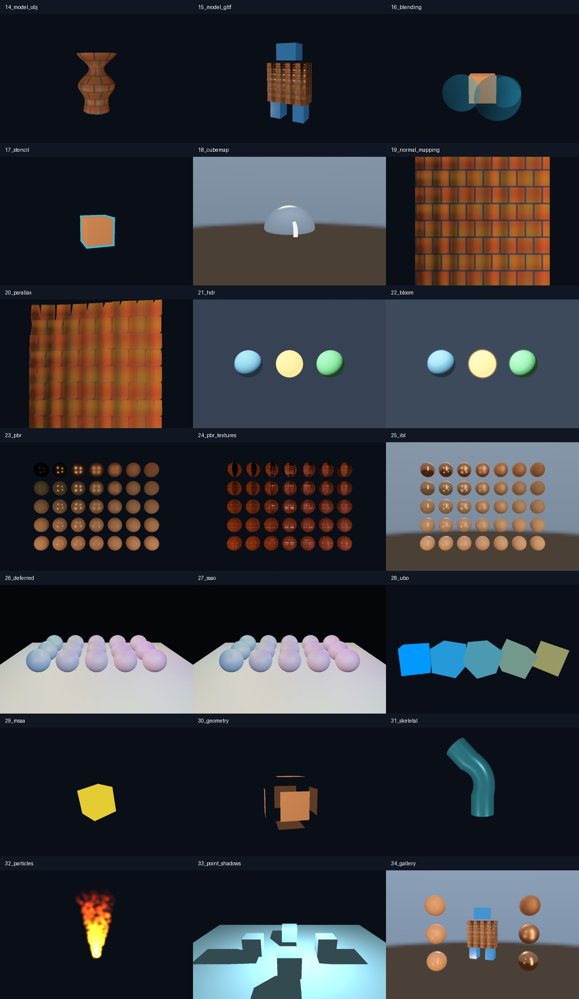

# 扩充版部署与验证

2026-11-03，最终目录 **OpenGL**。从原 13 课扩充到 **34 课，新增 21 个独立程序**，01–13 的 main.cpp 保持原样。

## 本机结果

- Visual Studio 2022 / MSVC x64 / C++17 / CMake 4.2.1。
- NVIDIA GeForce RTX 3060；真实上下文报告 OpenGL 3.3.0 NVIDIA 610.88。
- 在最终目录重新配置和编译 Debug，34 个程序构建成功。
- `ctest --test-dir OpenGL\build -C Debug --output-on-failure`：**34/34 通过**，总耗时 20.82 秒。
- 对新增 21 课分别执行固定时间抓图；11 组效果开启/关闭比较全部通过。
- 每个程序检查 GLSL/文件加载、GL 错误、非背景像素、画面动态范围。视觉对比检查某一技术开关是否真正改变画面；不将单纯“无错误”当成视觉效果正确的证明。

## 效果对比

正常状态和 `--smoke --variant` 对应的新课空格状态作差。差异阈值为像素任一通道变化大于 2/255；全图通道差的平均值仅供了解效果范围，不是渲染质量评分。

| 程序 | 改变像素数 | 通道平均绝对差 |
| --- | --- | --- |
| 19_normal_mapping | 381839 | 5.57604 |
| 20_parallax | 422212 | 12.38807 |
| 21_hdr | 39346 | 1.96325 |
| 22_bloom | 602596 | 7.12604 |
| 24_pbr_textures | 97543 | 1.38219 |
| 25_ibl | 146815 | 9.26998 |
| 27_ssao | 874 | 0.03476 |
| 29_msaa | 413 | 0.03778 |
| 31_skeletal | 45378 | 4.19448 |
| 33_point_shadows | 58410 | 13.73878 |
| 34_gallery | 4762 | 0.07398 |

原始数据在 [effect-comparisons.json](previews/effect-comparisons.json)。SSAO 和 MSAA 只改变接触区/几何边缘，差异像素较少是正常现象；AO 本身可按 1 查看，不能以总亮度越大认定效果越好。

## 图像核查

已人工查看新增示例总览、模型、PBR/IBL、蒙皮与粒子，检查几何/材质和预期效果。每课说明也有单独截图，截图时间固定为 1 秒。

## 日志与备份

配置、构建、测试日志在 docs/logs/；运行中的原始 CTest 日志仍在 build/Testing/Temporary/LastTest.log。此次被替换的原文件已备份到 `OpenGL\backups\before-expansion-20261103-140944`，部署清单在 docs/扩充部署清单.json。没有清空或删除原工程目录。

## 验证范围

已测本机 Windows Debug、课程自带 OBJ/glTF/PNG/HDR 资产、四帧实际渲染和效果对照。未声明 Release、其他系统、所有外部模型及长时间交互都已验证。模型渲染层的功能范围见导入指南，PBR/IBL 的采样质量与近似见对应课程；它们是可修改的教学实现。
