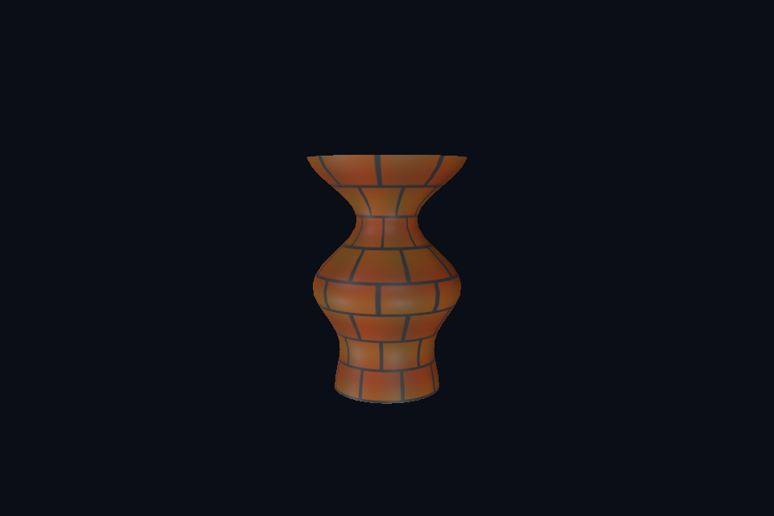

# 第 14 课：Assimp 与 OBJ 模型

## 本课独立工程与关键注释

[main.cpp](main.cpp) · [本地辅助实现](support/) · [本课着色器](shaders/) · [CMakeLists.txt](CMakeLists.txt)

本目录拥有完整课程源码、资源与依赖配方。关键步骤含中文注释，不链接其他课的课程实现。可将整个目录复制到其他位置，用以下命令单独构建和检查；第三方依赖首次配置需要联网或提供缓存。

```powershell
cmake -S . -B build -A x64
cmake --build build --config Debug --parallel 4
ctest --test-dir build -C Debug --output-on-failure
```

[课程首页](../../README.md) · [上一课](../13_shadows/README.md) · [下一课](../15_model_gltf/README.md)

## 目标与运行

```powershell
cmake --preset opengl
cmake --build --preset opengl-debug --target 14_model_obj --parallel 4
.\OpenGL\build\bin\Debug\14_model_obj.exe
```

预期画面：带有真实贴图的车削花瓶，可移动相机查看轮廓和材质。

相机：W/A/S/D 移动，Q/E 升降，按住右键转向，Esc 退出。

## 代码阅读顺序

14_model_obj/main.cpp → common/model.hpp → assets/models/vase.obj、vase.mtl → shaders/model.vert、pbr.frag

从本课 [main.cpp](main.cpp) 进入；公共工具在 [common](../../common)，GLSL 在 [shaders](../../shaders)。先画出每一遍读什么、写什么，再逐个展开辅助类。

## 原理与实现

硬编码立方体只是几何的起点。OBJ 文件存位置 v、纹理坐标 vt、法线 vn 和面 f，MTL 文件存材质及纹理路径。位置、UV、法线可以有不同索引，不能把 OBJ 的位置索引直接当成完整 GPU 顶点索引。Assimp 将这些差异整理为统一的 aiMesh。

Model 使用 Assimp::Importer::ReadFile，开启三角化、平滑法线生成、切线计算、合并相同完整顶点与数据校验。车削花瓶是实际读取的 OBJ 文件，不是运行时偷偷用另一份程序几何替代。构造后控制台打印网格、材质、动画数，加载失败则显示 Assimp 错误并退出。

aiScene 的数据归 Importer 所有，所以 Importer 必须活到复制完数据或使用场景结束。这里把 Importer 存在 Model 里；GPU 网格以 unique_ptr 管理，避免复制句柄造成二次释放。递归遍历 aiNode，收集它引用的 mesh，并保留节点层级变换。不要使用 PreTransformVertices 把之后需要动画的层级烘焙掉。

材质图片路径相对模型目录解析，而非当前终端目录。缓存键包含路径与色彩用途，避免同一图片既作颜色又作数据时错误共享 sRGB 格式。缺贴图使用 1×1 默认纹理，有明确路径但文件丢失则报错。白色基础贴图保留材质颜色，不应使用黑色默认图。

教程编译启用 OBJ 和 GLTF 导入器，其他格式没有编进来。可修改根 CMakeLists.txt 中的 ASSIMP_BUILD_*_IMPORTER 开关后重配；源代码已包含全部导入器，但不代表当前程序能直接打开 FBX。参见 [Assimp 官方用法](https://github.com/assimp/assimp-docs/blob/master/source/usage/use_the_lib.rst)。

## 修改练习

把 vase.mtl 的颜色改为银灰；把花瓶复制成两个节点/对象，观察 mesh 和材质日志。

修改后重新执行 `cmake --build --preset opengl-debug --target 14_model_obj --parallel 4`。GLSL、模型、图片会复制到程序旁的 shaders/assets 目录。源文件应修改教程根目录下的版本，运行目录的副本会被下一次构建覆盖。

## 自测与参考答案

把 OBJ 位置数直接当 GPU 顶点数可靠吗？

不可靠。UV 接缝和法线硬边会让相同位置对应多个完整顶点。

## 检查与排错

运行 `14_model_obj.exe --smoke` 可执行确定时间的四帧渲染检查。重要技术开关还可用 `--smoke --variant --capture` 与默认抓图对比。共享工具会检查 GL 错误、非背景像素和图像动态范围，但这不能代替人工核对技术含义。参见 [进阶排错](../../docs/11_进阶排错与性能.md)。


## 参考截图

以下为课程自带素材、固定时间 1 秒时的实际渲染；你的相机与操作改变后画面会不同。




## 深入学习：数据、接口与执行

OBJ 导入后可能有多个 mesh 和 material，不能只取第一个数组。Assimp 统一拓扑后仍需上传顶点/索引并应用所属节点变换，材质图片路径相对模型目录解析。

配套精讲：[三 API 对照 · 模型、节点与骨骼迁移](../../../docs/compare/11_models_animation.md)。先读概念与参数选择，再返回本课实现核对，不必一次展开所有公共类。

### 本课的真实源码切片

来自 [OpenGL/lessons/14_model_obj/main.cpp](main.cpp#L7)，第 7—32 行；这是现有实现的局部摘录，末尾可能处于函数中间，不是可单独编译的完整程序。

```cpp
int main(int argc, char** argv) try {
    // 先创建上下文；它必须比 shader、纹理和网格活得更久。
    App app(argc, argv, "14_model_obj - OpenGL Course");
    auto modelPath = asset(app, "models/vase.obj");
    for (int k = 1; k + 1 < argc; ++k)
        if (std::string(argv[k]) == "--model")
            modelPath = std::filesystem::absolute(argv[++k]);
    // 模型持有自己的网格/材质；加载完成不代表自动绑定到当前 shader。
    Model model(modelPath);
    // shader 路径指向本课自己的文件；属性、uniform 与下方 C++ 设置对应。
    Shader shader(app, "model.vert", "pbr.frag");
    Camera camera;
    camera.pos = glm::vec3(3, 1.0f, 6);
    camera.pitch = -7;
    camera.yaw = -116.565f;
    glEnable(GL_DEPTH_TEST);
    // 每帧处理输入并绘制；GPU 对象在退出循环后按 C++ 作用域逆序释放。
    while (app.begin()) {
        camera.update(app);
        app.clear();
        shader.use();
        pbrDefaults(shader);
        cameraUniforms(shader, app, camera);
        // 空格按下时暂停在 bind pose，便于对照骨骼形变。
        model.update(app.key(GLFW_KEY_SPACE) == GLFW_PRESS ? 0.f : app.time());
        model.draw(shader);
```

### 同主题跨 API 导航

以下是同主题参考；场景、功能完成度和版本基线可能不同，具体边界见对照章节。

| 路线 | 可运行参照 / 当前范围 |
| --- | --- |
| OpenGL | [14_model_obj](README.md) |
| Vulkan 原生 | 迁移设计：设计：CPU MeshData → VkBuffer；骨骼 UBO/SSBO；节点/材质解析可共享。 |
| Vulkan / nvpro_core2 | 迁移设计：框架有资产相关辅助，但本课程未接入完整 glTF/skin；需要单独实现并验收。 |
| DirectX 12 | 迁移设计：设计：扩展 VBV/input layout 加 joints/weights，骨骼经 CBV/SRV 提供。 |

### 先预测，再验证

模型有轮廓但贴图丢失，应把问题定位在哪些层？

参考推导：先检查材质索引、图片路径/解码、sRGB 用途和纹理绑定；几何可见说明无需首先重写窗口或相机。

在一次实验中只改一个因素，记录预测、实际画面/日志和原因。检查已有 smoke 是否仍通过；图形调试器里再核对本次 draw 的实际输入/输出，不能仅凭进程正常退出下结论。
