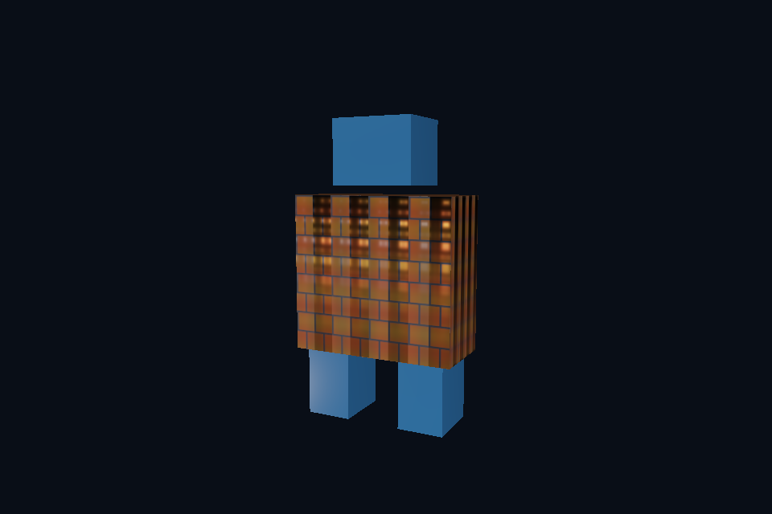

# 第 15 课：glTF 场景与 PBR 材质

[课程首页](../../README.md) · [上一课](../14_model_obj/README.md) · [下一课](../16_blending/README.md)

## 目标与运行

```powershell
cd OpenGL
.\scripts\run.ps1 -Lesson 15_model_gltf
```

预期画面：机器人模型由多块网格组成；不同材质、贴图和层级位置正确。

相机：W/A/S/D 移动，Q/E 升降，按住右键转向，Esc 退出。

## 代码阅读顺序

15_model_gltf/main.cpp → common/model.hpp 的 materials、gather、visit、draw → assets/models/robot.gltf

从本课 [main.cpp](main.cpp) 进入；公共工具在 [common](../../common)，GLSL 在 [shaders](../../shaders)。先画出每一遍读什么、写什么，再逐个展开辅助类。

## 原理与实现

glTF 2.0 为运行时资产传输设计：JSON 描述场景、节点、网格、材质，bufferView/accessor 描述二进制数据。当前 robot.gltf 与 robot.bin 是自制素材；打开 JSON 能看见 Body、Head、LeftFoot、RightFoot。节点对同一 mesh 的引用可以复用资源，节点变换递归累乘，world=parent*local。

Assimp 的 aiMatrix4x4 与 GLM 的构造方式不同，convert 显式转置行列布局。忘记处理矩阵布局通常表现为部件位置、旋转或缩放异常。Model::draw 对每块网格设置 rootTransform*nodeGlobal，而不是对所有部件使用同一个单位矩阵。

材质使用 metallic-roughness 工作流，基础颜色包含 factor×贴图；基础颜色纹理使用 sRGB 格式，让 GPU 自动解码为线性值。金属度/粗糙度贴图保持线性，绿色 G 是 roughness，蓝色 B 是 metallic。材质因子继续与纹理值相乘。法线贴图解码到 [-1,1]，随后归一化。

导入器支持外部图片与 Assimp 提供的压缩/未压缩内嵌图片。本教学渲染层只实现 UV0、基础颜色、法线、金属粗糙度、AO 等核心通路；未完整实现 glTF 的 alphaMode、doubleSided、emissive、纹理变换、扩展材质与全部动画插值。能被 Assimp 解析不代表所有视觉功能都已实现。更完整的兼容范围见导入指南。

glTF 的 UV 原点与图片约定需要作为一套系统处理。这里使用自制 glTF 与不翻转的 stbi 解码，不全局开启 FlipUVs；换来源时先用 UV 测试图诊断，不要同时翻图片和 UV。规范依据见 [Khronos glTF 2.0](https://registry.khronos.org/glTF/specs/2.0/glTF-2.0.html)。

## 修改练习

修改某一节点 translation；修改材质 metallicFactor 与 roughnessFactor，对比 factor=0 和 1。

修改后重新执行 `cmake --build build --config Debug --target 15_model_gltf --parallel`。GLSL、模型、图片会复制到程序旁的 shaders/assets 目录。源文件应修改教程根目录下的版本，运行目录的副本会被下一次构建覆盖。

## 自测与参考答案

粗糙度贴图能使用 GL_SRGB8 吗？

不能。它是数值数据，sRGB 解码会改变粗糙度含义。

## 检查与排错

运行 `15_model_gltf.exe --smoke` 可执行确定时间的四帧渲染检查。重要技术开关还可用 `--smoke --variant --capture` 与默认抓图对比。共享工具会检查 GL 错误、非背景像素和图像动态范围，但这不能代替人工核对技术含义。参见 [进阶排错](../../docs/11_进阶排错与性能.md)。


## 参考截图

以下为课程自带素材、固定时间 1 秒时的实际渲染；你的相机与操作改变后画面会不同。


