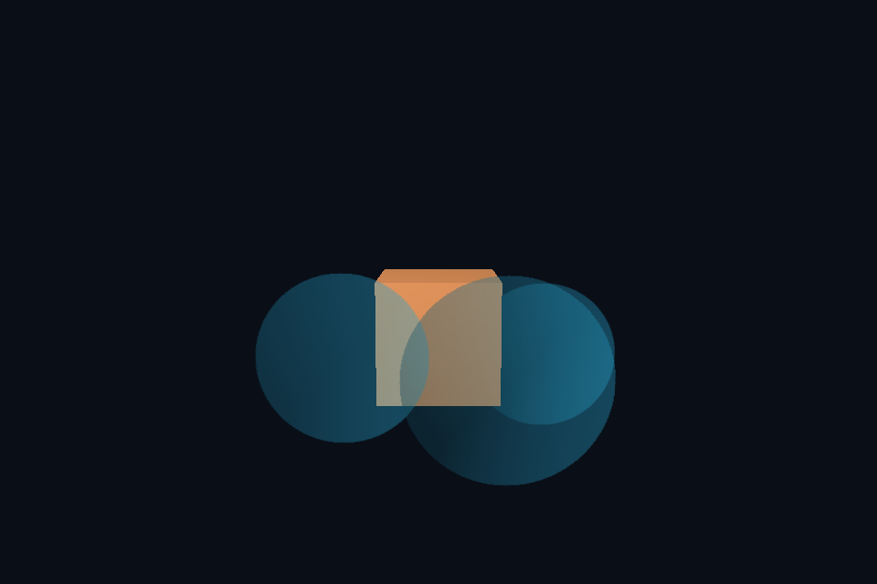

# 第 16 课：透明混合与排序

## 本课独立工程与关键注释

[main.cpp](main.cpp) · [本地辅助实现](support/) · [本课着色器](shaders/) · [CMakeLists.txt](CMakeLists.txt)

本目录拥有完整课程源码、资源与依赖配方。关键步骤含中文注释，不链接其他课的课程实现。可将整个目录复制到其他位置，用以下命令单独构建和检查；第三方依赖首次配置需要联网或提供缓存。

```powershell
cmake -S . -B build -A x64
cmake --build build --config Debug --parallel 4
ctest --test-dir build -C Debug --output-on-failure
```

[课程首页](../../README.md) · [上一课](../15_model_gltf/README.md) · [下一课](../17_stencil/README.md)

## 目标与运行

```powershell
cmake --preset opengl
cmake --build --preset opengl-debug --target 16_blending --parallel 4
.\OpenGL\build\bin\Debug\16_blending.exe
```

预期画面：立方体前面有三张半透明圆片，重叠处颜色正确混合。

相机：W/A/S/D 移动，Q/E 升降，按住右键转向，Esc 退出。

## 代码阅读顺序

main.cpp 的 ordered 排序 → GL_BLEND/DepthMask → shaders/surface.frag

从本课 [main.cpp](main.cpp) 进入；公共工具在 [common](../../common)，GLSL 在 [shaders](../../shaders)。先画出每一遍读什么、写什么，再逐个展开辅助类。

## 原理与实现

标准非预乘 Alpha 混合为 C结果=源颜色*源Alpha+目标颜色*(1-源Alpha)。glBlendFunc(GL_SRC_ALPHA,GL_ONE_MINUS_SRC_ALPHA) 设置这两个因子，输出的 RGB 不应再提前乘一次 Alpha。基础颜色 PNG 使用 sRGB 解码，但此入门 surface shader 已进行显示编码，混合不是严格线性工作流；产品渲染应先在线性 HDR FBO 内混合，再统一编码。

先画不透明物体并写深度，再画透明物体。透明阶段保留深度测试，以便被墙挡住；glDepthMask(GL_FALSE) 禁止透明片自己写深度，避免提前阻挡后续片。最后必须恢复为 GL_TRUE。glClear 的深度清除同样受深度写掩码影响，不能在关闭写入后直接开始下一帧清深度。

当前对透明物体中心按到相机的距离从远到近排序。排序后的 vector 保留相同距离的物体，不使用以距离为唯一键的 map，避免同距离元素被覆盖。中心排序是有限近似，交叉透明面或很大的物体可能需要拆面或顺序无关透明方案。

图片边界 alpha=0 的片段用 discard 裁掉，相当于 cutout 的简单形式；真正半透明区域仍依赖混合。透明阶段若关闭深度测试，圆片就会穿过立方体错误显示。

## 修改练习

取消排序并从前后两个方向观察；将 Alpha 改为 1 与 0；尝试预乘 Alpha 并同步修改混合因子。

修改后重新执行 `cmake --build --preset opengl-debug --target 16_blending --parallel 4`。GLSL、模型、图片会复制到程序旁的 shaders/assets 目录。源文件应修改教程根目录下的版本，运行目录的副本会被下一次构建覆盖。

## 自测与参考答案

DepthMask(false) 会关闭深度测试吗？

不会。它只禁止写深度，测试仍由 GL_DEPTH_TEST 控制。

## 检查与排错

运行 `16_blending.exe --smoke` 可执行确定时间的四帧渲染检查。重要技术开关还可用 `--smoke --variant --capture` 与默认抓图对比。共享工具会检查 GL 错误、非背景像素和图像动态范围，但这不能代替人工核对技术含义。参见 [进阶排错](../../docs/11_进阶排错与性能.md)。


## 参考截图

以下为课程自带素材、固定时间 1 秒时的实际渲染；你的相机与操作改变后画面会不同。




## 深入学习：数据、接口与执行

不透明物体先写颜色和深度，透明面从远到近绘制并关闭深度写入；保留深度测试避免透明物穿过前景。排序基于物体中心，是本例简化。

配套精讲：[三 API 对照 · 目标、深度与 MSAA](../../../docs/compare/07_targets_depth_msaa.md)。先读概念与参数选择，再返回本课实现核对，不必一次展开所有公共类。

### 本课的真实源码切片

来自 [OpenGL/lessons/16_blending/main.cpp](main.cpp#L7)，第 7—32 行；这是现有实现的局部摘录，末尾可能处于函数中间，不是可单独编译的完整程序。

```cpp
int main(int argc, char** argv) try {
    // 先创建上下文；它必须比 shader、纹理和网格活得更久。
    App app(argc, argv, "16_blending - OpenGL Course");
    // shader 路径指向本课自己的文件；属性、uniform 与下方 C++ 设置对应。
    Shader shader(app, "advanced.vert", "surface.frag");
    Mesh box(cube()), plane(quad(), quadIndices());
    Camera camera;
    ImageTexture glass(asset(app, "textures/glass.png"), true);
    glEnable(GL_DEPTH_TEST);
    std::vector<glm::vec3> panes = {{-.7f, 0, 1}, {.4f, .1f, 2}, {.9f, -.2f, 0}};
    // 每帧处理输入并绘制；GPU 对象在退出循环后按 C++ 作用域逆序释放。
    while (app.begin()) {
        camera.update(app);
        app.clear();
        shader.use();
        surfaceDefaults(shader);
        cameraUniforms(shader, app, camera);
        shader.set("model", glm::mat4(1));
        box.draw();
        auto ordered = panes;
        std::sort(ordered.begin(), ordered.end(), [&](auto a, auto b) {
            return glm::dot(camera.pos - a, camera.pos - a) >
                   glm::dot(camera.pos - b, camera.pos - b);
        });
        glEnable(GL_BLEND);
        glBlendFunc(GL_SRC_ALPHA, GL_ONE_MINUS_SRC_ALPHA);
```

### 同主题跨 API 导航

以下是同主题参考；场景、功能完成度和版本基线可能不同，具体边界见对照章节。

| 路线 | 可运行参照 / 当前范围 |
| --- | --- |
| OpenGL | [16_blending](README.md) |
| Vulkan 原生 | [vk10_offscreen](../../../Vulkan/native/lessons/vk10_offscreen/README.md) |
| Vulkan / nvpro_core2 | [nv02_application](../../../Vulkan/nvpro/lessons/nv02_application/README.md) |
| DirectX 12 | [dx10_offscreen](../../../DirectX12/lessons/dx10_offscreen/README.md) |

### 先预测，再验证

为什么透明遍后要恢复 depth mask？

参考推导：否则后续不透明工作也不写深度，造成下一遍或下一帧错误。透明混合依赖顺序，中心排序对相交物体也并非通解。

在一次实验中只改一个因素，记录预测、实际画面/日志和原因。检查已有 smoke 是否仍通过；图形调试器里再核对本次 draw 的实际输入/输出，不能仅凭进程正常退出下结论。
