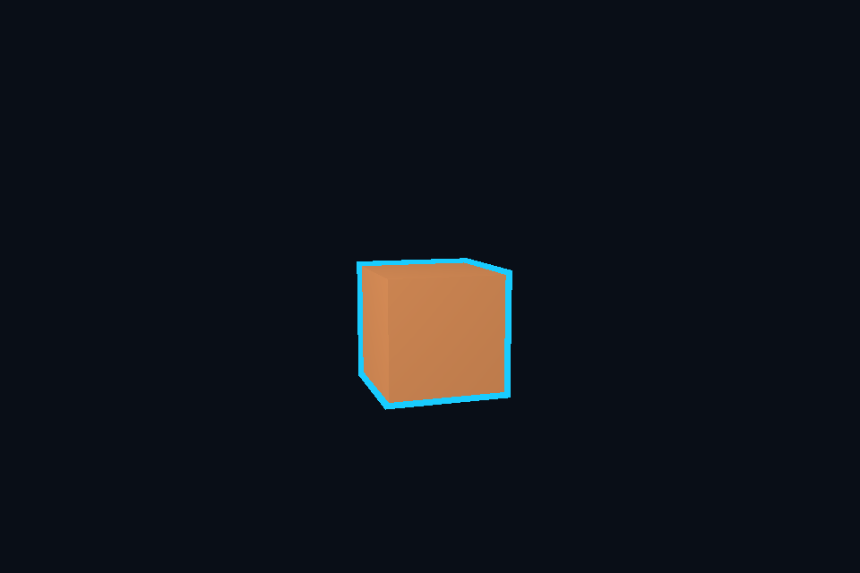

# 第 17 课：模板测试与描边

## 本课独立工程与关键注释

[main.cpp](main.cpp) · [本地辅助实现](support/) · [本课着色器](shaders/) · [CMakeLists.txt](CMakeLists.txt)

本目录拥有完整课程源码、资源与依赖配方。关键步骤含中文注释，不链接其他课的课程实现。可将整个目录复制到其他位置，用以下命令单独构建和检查；第三方依赖首次配置需要联网或提供缓存。

```powershell
cmake -S . -B build -A x64
cmake --build build --config Debug --parallel 4
ctest --test-dir build -C Debug --output-on-failure
```

[课程首页](../../README.md) · [上一课](../16_blending/README.md) · [下一课](../18_cubemap/README.md)

## 目标与运行

```powershell
cmake --preset opengl
cmake --build --preset opengl-debug --target 17_stencil --parallel 4
.\OpenGL\build\bin\Debug\17_stencil.exe
```

预期画面：旋转立方体外侧有清晰蓝色描边。

相机：W/A/S/D 移动，Q/E 升降，按住右键转向，Esc 退出。

## 代码阅读顺序

main.cpp 的两遍对象绘制 → RenderTarget 的 DEPTH24_STENCIL8

从本课 [main.cpp](main.cpp) 进入；公共工具在 [common](../../common)，GLSL 在 [shaders](../../shaders)。先画出每一遍读什么、写什么，再逐个展开辅助类。

## 原理与实现

模板缓冲存每像素整数标记。第一遍普通绘制时 glStencilFunc(GL_ALWAYS,1,0xFF)，模板操作 GL_KEEP,GL_KEEP,GL_REPLACE：只有深度通过的片段写标记 1。深度失败时不能替换，否则遮挡物后面的形状也可能留下标记。

第二遍将模型放大 1.08 倍，用纯色绘制，glStencilFunc(GL_NOTEQUAL,1,0xFF) 只保留原模型覆盖区之外的像素。glStencilMask(0) 禁止覆盖已有标记，暂时关闭深度测试让轮廓不被原模型挡住。本例单物体适合入门；复杂遮挡和固定屏幕宽度轮廓需要更仔细设计。

默认窗口不一定提供模板附件，所以本课显式创建含深度/模板附件的离屏 FBO，最后再呈现颜色。每帧恢复模板写掩码 0xFF 后清除 stencil；清除操作受 mask 影响，前一帧 mask=0 而忘恢复会导致残留。

模型膨胀法的轮廓宽度随距离和曲率变化，并非像素恒定的描边。法线挤出、屏幕深度/法线边缘检测是不同方案，不要把这一课的技巧当成万能轮廓系统。

## 修改练习

改变膨胀倍数；增加第二个互相遮挡的物体；试着保留深度测试，比较轮廓。

修改后重新执行 `cmake --build --preset opengl-debug --target 17_stencil --parallel 4`。GLSL、模型、图片会复制到程序旁的 shaders/assets 目录。源文件应修改教程根目录下的版本，运行目录的副本会被下一次构建覆盖。

## 自测与参考答案

为什么需要清除模板而且恢复写掩码？

旧帧的标记不再对应新帧位置；mask 为 0 时清除也可能无效。

## 检查与排错

运行 `17_stencil.exe --smoke` 可执行确定时间的四帧渲染检查。重要技术开关还可用 `--smoke --variant --capture` 与默认抓图对比。共享工具会检查 GL 错误、非背景像素和图像动态范围，但这不能代替人工核对技术含义。参见 [进阶排错](../../docs/11_进阶排错与性能.md)。


## 参考截图

以下为课程自带素材、固定时间 1 秒时的实际渲染；你的相机与操作改变后画面会不同。




## 深入学习：数据、接口与执行

第一遍给模型覆盖处写 stencil，第二遍画放大模型并排除已经标记的像素。颜色、深度、stencil 的写掩码与比较函数分别生效，必须逐项记录。

配套精讲：[三 API 对照 · 目标、深度与 MSAA](../../../docs/compare/07_targets_depth_msaa.md)。先读概念与参数选择，再返回本课实现核对，不必一次展开所有公共类。

### 本课的真实源码切片

来自 [OpenGL/lessons/17_stencil/main.cpp](main.cpp#L7)，第 7—32 行；这是现有实现的局部摘录，末尾可能处于函数中间，不是可单独编译的完整程序。

```cpp
int main(int argc, char** argv) try {
    // 先创建上下文；它必须比 shader、纹理和网格活得更久。
    App app(argc, argv, "17_stencil - OpenGL Course");
    Shader solid(app, "advanced.vert", "surface.frag"), outline(app, "advanced.vert", "solid.frag");
    // CPU 顶点数据上传后，由 VAO 保存属性布局；布局必须匹配顶点 shader。
    Mesh mesh(cube());
    Camera camera;
    RenderTarget target(1, false);
    Shader screen(app, "screen.vert", "screen.frag");
    Mesh plane(quad(), quadIndices());
    // 每帧处理输入并绘制；GPU 对象在退出循环后按 C++ 作用域逆序释放。
    while (app.begin()) {
        if (app.width < 1 || app.height < 1) {
            app.end();
            continue;
        }
        camera.update(app);
        target.resize(app.width, app.height);
        target.bind();
        glEnable(GL_DEPTH_TEST);
        glEnable(GL_STENCIL_TEST);
        glStencilMask(0xFF);
        app.clear();
        glClear(GL_STENCIL_BUFFER_BIT);
        auto model = glm::rotate(glm::mat4(1), app.time() * .3f, glm::vec3(0, 1, 0));
        glStencilFunc(GL_ALWAYS, 1, 0xFF);
```

### 同主题跨 API 导航

以下是同主题参考；场景、功能完成度和版本基线可能不同，具体边界见对照章节。

| 路线 | 可运行参照 / 当前范围 |
| --- | --- |
| OpenGL | [17_stencil](README.md) |
| Vulkan 原生 | [vk10_offscreen](../../../Vulkan/native/lessons/vk10_offscreen/README.md) |
| Vulkan / nvpro_core2 | [nv02_application](../../../Vulkan/nvpro/lessons/nv02_application/README.md) |
| DirectX 12 | [dx10_offscreen](../../../DirectX12/lessons/dx10_offscreen/README.md) |

### 先预测，再验证

描边穿过遮挡物时应该检查哪一层？

参考推导：检查第二遍的深度测试策略与 stencil 条件；放大模型本身正确并不能决定描边应否被前景遮挡。

在一次实验中只改一个因素，记录预测、实际画面/日志和原因。检查已有 smoke 是否仍通过；图形调试器里再核对本次 draw 的实际输入/输出，不能仅凭进程正常退出下结论。
