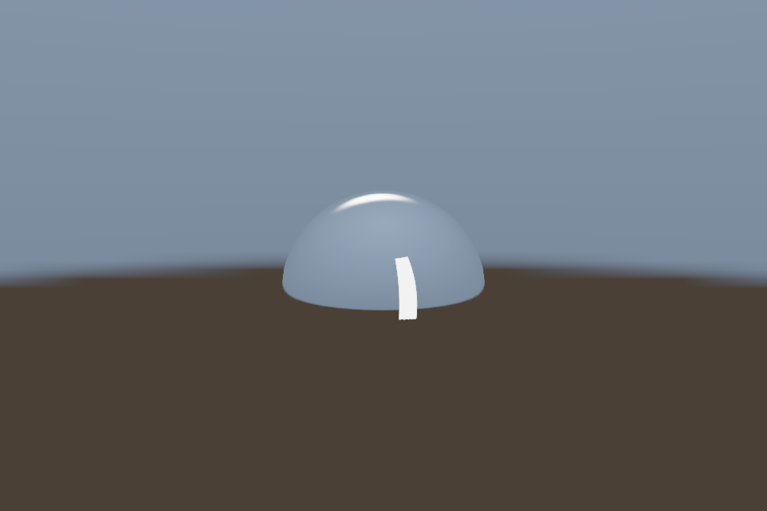

# 第 18 课：天空盒与环境反射

[课程首页](../../README.md) · [上一课](../17_stencil/README.md) · [下一课](../19_normal_mapping/README.md)

## 目标与运行

```powershell
cmake --preset opengl
cmake --build --preset opengl-debug --target 18_cubemap --parallel 4
.\OpenGL\build\bin\Debug\18_cubemap.exe
```

预期画面：反射球与 HDR 环境天空盒；转动相机能观察反射移动。

相机：W/A/S/D 移动，Q/E 升降，按住右键转向，Esc 退出。

## 代码阅读顺序

common/environment.hpp 的 environment capture → sky.vert → reflect.frag

从本课 [main.cpp](main.cpp) 进入；公共工具在 [common](../../common)，GLSL 在 [shaders](../../shaders)。先画出每一遍读什么、写什么，再逐个展开辅助类。

## 原理与实现

Cubemap 由 +X/-X/+Y/-Y/+Z/-Z 六个面组成，使用方向向量而非 UV 采样。Environment 先从真实 studio.hdr 文件读取线性 HDR 像素，再通过六个 90° 相机把等距柱状图投影到 cubemap，所有面的 up 向量必须匹配 OpenGL cubemap 约定。

天空盒移除 view 的平移，只保留旋转，因此看起来无限远。sky.vert 使用 p.xyww 让深度落到最远端，天空绘制时 GL_LEQUAL、DepthMask(false)，随后恢复 GL_LESS 与写掩码。本例先画物体再画天空，只填背景。

反射方向 R=reflect(normalize(worldPos-eye),N)。这是从眼睛指向表面的入射方向，符号写反会让倒影错误。镜面球直接采样环境，再做显示映射；它不是完整 PBR，无法表达粗糙度卷积，也不包含场景本地物体的动态反射。

开启 GL_TEXTURE_CUBE_MAP_SEAMLESS 可改善跨面过滤。数据源是课程自制 HDR，亮灯区域超过 1；不是把普通 PNG 当作 HDR。第 25 课在同一输入上计算真实的漫反射和镜面 IBL 预计算纹理。

## 修改练习

改变 HDR 贴图中的光源方向；把反射改为 refract 并处理全反射；比较 sky view 保留平移时的错误。

修改后重新执行 `cmake --build --preset opengl-debug --target 18_cubemap --parallel 4`。GLSL、模型、图片会复制到程序旁的 shaders/assets 目录。源文件应修改教程根目录下的版本，运行目录的副本会被下一次构建覆盖。

## 自测与参考答案

环境反射为何看不到场景里的其他物体？

Cubemap 是预先给定的环境内容，没有包含每帧的局部场景。

## 检查与排错

运行 `18_cubemap.exe --smoke` 可执行确定时间的四帧渲染检查。重要技术开关还可用 `--smoke --variant --capture` 与默认抓图对比。共享工具会检查 GL 错误、非背景像素和图像动态范围，但这不能代替人工核对技术含义。参见 [进阶排错](../../docs/11_进阶排错与性能.md)。


## 参考截图

以下为课程自带素材、固定时间 1 秒时的实际渲染；你的相机与操作改变后画面会不同。




## 深入学习：数据、接口与执行

cubemap 以三维方向而不是二维 UV 采样。反射方向来自视线和表面法线；天空盒去掉相机平移，只保留旋转，避免像普通房间那样随相机穿过。

配套精讲：[三 API 对照 · 纹理、Mip 与颜色空间](../../../docs/compare/06_textures_color.md)。先读概念与参数选择，再返回本课实现核对，不必一次展开所有公共类。

### 本课的真实源码切片

来自 [OpenGL/lessons/18_cubemap/main.cpp](main.cpp#L5)，第 5—26 行；这是现有实现的局部摘录，末尾可能处于函数中间，不是可单独编译的完整程序。

```cpp
int main(int argc, char** argv) try {
    App app(argc, argv, "18_cubemap - OpenGL Course");
    Environment env(app, false);
    Shader shader(app, "advanced.vert", "reflect.frag"), sky(app, "sky.vert", "sky.frag");
    Mesh ball(sphere()), box(cube());
    Camera camera;
    while (app.begin()) {
        camera.update(app);
        app.clear();
        shader.use();
        cameraUniforms(shader, app, camera);
        shader.set("environmentMap", 0);
        bindCube(env.environment, 0);
        shader.set("model", glm::mat4(1));
        ball.draw();
        env.sky(sky, box, app, camera);
        app.end();
    }
    return 0;
} catch (const std::exception& e) {
    return failure(e);
}
```

### 同主题跨 API 导航

以下是同主题参考；场景、功能完成度和版本基线可能不同，具体边界见对照章节。

| 路线 | 可运行参照 / 当前范围 |
| --- | --- |
| OpenGL | [18_cubemap](README.md) |
| Vulkan 原生 | [vk06_texture_descriptor](../../../Vulkan/native/lessons/vk06_texture_descriptor/README.md) |
| Vulkan / nvpro_core2 | [nv04_vma_staging_texture](../../../Vulkan/nvpro/lessons/nv04_vma_staging_texture/README.md) |
| DirectX 12 | [dx06_texture_srv](../../../DirectX12/lessons/dx06_texture_srv/README.md) |

### 先预测，再验证

环境左右颠倒能否通过调 roughness 修复？

参考推导：不能。核对六面方向、up 向量和反射向量约定；材质参数不能纠正 cubemap 坐标。

在一次实验中只改一个因素，记录预测、实际画面/日志和原因。检查已有 smoke 是否仍通过；图形调试器里再核对本次 draw 的实际输入/输出，不能仅凭进程正常退出下结论。
