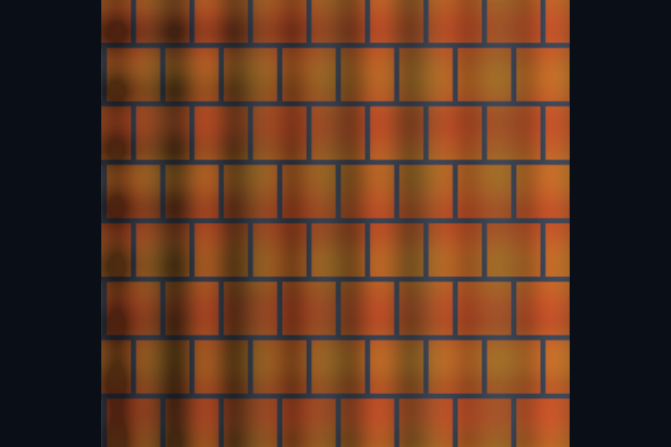

# 第 19 课：法线贴图与 TBN

[课程首页](../../README.md) · [上一课](../18_cubemap/README.md) · [下一课](../20_parallax/README.md)

## 目标与运行

```powershell
cmake --preset opengl
cmake --build --preset opengl-debug --target 19_normal_mapping --parallel 4
.\OpenGL\build\bin\Debug\19_normal_mapping.exe
```

预期画面：平面上的橙色纹理产生细小明暗凹凸；按住空格关闭法线贴图。

相机：W/A/S/D 移动，Q/E 升降，按住右键转向，Esc 退出。

## 代码阅读顺序

shaders/surface.frag 的 tangentFrame → normalMap 解码

从本课 [main.cpp](main.cpp) 进入；公共工具在 [common](../../common)，GLSL 在 [shaders](../../shaders)。先画出每一遍读什么、写什么，再逐个展开辅助类。

## 原理与实现

法线贴图不改变位置和轮廓，只替换光照使用的表面法线。图片 RGB 存切线空间方向，采样后乘 2 再减 1。中性法线接近 (0.5,0.5,1)，表示朝表面外侧。它是方向数据，必须按线性纹理读取，不能用 sRGB 解码。

TBN 的三列分别是 tangent、bitangent、normal，把切线空间方向转到世界空间。此课通过 dFdx/dFdy 的位置和 UV 梯度计算切线，并正交化 T。B 的符号根据原始 bitangent 与 cross(N,T) 的点积恢复，不能只用屏幕 UV 行列式的符号，否则换观察方向时可能翻转。

UV 退化时导数无法形成有效基，代码给出垂直 N 的备用基；它只能避免数值崩溃，不能恢复错误 UV 的正确外观。更通用的产品模型可以导入预计算切线，保留 tangent.w 的手性，并保证与烘焙工具的切线基一致。

GL 约定的法线贴图通常把 +Y 编到绿色增加方向，其他工具可能使用相反约定。凹凸颠倒时先检查绿色通道，而不是随意反转整个法线。基底方向与纹理内容必须匹配。

## 修改练习

把法线图换成纯中性蓝；反转绿色通道；让平面绕 Y 旋转并观察凹凸是否稳定。

修改后重新执行 `cmake --build --preset opengl-debug --target 19_normal_mapping --parallel 4`。GLSL、模型、图片会复制到程序旁的 shaders/assets 目录。源文件应修改教程根目录下的版本，运行目录的副本会被下一次构建覆盖。

## 自测与参考答案

法线贴图能让侧面轮廓变成锯齿吗？

不能，它没有增加几何或改变顶点位置。

## 检查与排错

运行 `19_normal_mapping.exe --smoke` 可执行确定时间的四帧渲染检查。重要技术开关还可用 `--smoke --variant --capture` 与默认抓图对比。共享工具会检查 GL 错误、非背景像素和图像动态范围，但这不能代替人工核对技术含义。参见 [进阶排错](../../docs/11_进阶排错与性能.md)。


## 参考截图

以下为课程自带素材、固定时间 1 秒时的实际渲染；你的相机与操作改变后画面会不同。



[查看按住空格时的对照图](../../docs/previews/19_normal_mapping_off.png)


## 深入学习：数据、接口与执行

法线贴图保存切线空间方向，先从 0..1 解码到 -1..1，再经 TBN 转入光照空间。它是线性数据；粗糙网格法线与贴图法线的空间不能直接混合。

配套精讲：[三 API 对照 · 直接光 PBR 与 IBL](../../../docs/compare/12_lighting_pbr_ibl.md)。先读概念与参数选择，再返回本课实现核对，不必一次展开所有公共类。

### 本课的真实源码切片

来自 [OpenGL/lessons/19_normal_mapping/main.cpp](main.cpp#L5)，第 5—30 行；这是现有实现的局部摘录，末尾可能处于函数中间，不是可单独编译的完整程序。

```cpp
int main(int argc, char** argv) try {
    App app(argc, argv, "19_normal_mapping - OpenGL Course");
    Shader shader(app, "advanced.vert", "surface.frag");
    Mesh plane(quad(), quadIndices());
    Camera camera;
    camera.pos = {0, 0, 3};
    camera.pitch = 0;
    ImageTexture albedo(asset(app, "textures/albedo.png"), true),
        normal(asset(app, "textures/normal.png")), height(asset(app, "textures/height.png"));
    glEnable(GL_DEPTH_TEST);
    while (app.begin()) {
        camera.update(app);
        app.clear();
        shader.use();
        surfaceDefaults(shader);
        cameraUniforms(shader, app, camera);
        albedo.bind(0);
        normal.bind(1);
        height.bind(2);
        shader.set("useTexture", 1);
        shader.set("baseColor", glm::vec3(1));
        shader.set("useNormal", app.key(GLFW_KEY_SPACE) != GLFW_PRESS);
        shader.set("useParallax", 0);
        shader.set("model", glm::scale(glm::mat4(1), glm::vec3(2)));
        plane.draw();
        app.end();
```

### 同主题跨 API 导航

以下是同主题参考；场景、功能完成度和版本基线可能不同，具体边界见对照章节。

| 路线 | 可运行参照 / 当前范围 |
| --- | --- |
| OpenGL | [19_normal_mapping](README.md) |
| Vulkan 原生 | [vk09_pbr](../../../Vulkan/native/lessons/vk09_pbr/README.md) |
| Vulkan / nvpro_core2 | [nv06_pbr_viewport](../../../Vulkan/nvpro/lessons/nv06_pbr_viewport/README.md) |
| DirectX 12 | [dx09_pbr](../../../DirectX12/lessons/dx09_pbr/README.md) |

### 先预测，再验证

使用 sRGB 解码法线纹理会产生什么问题？

参考推导：方向分量被非线性改写，归一化也无法恢复原方向。应先修正格式，再检查切线基和 handedness。

在一次实验中只改一个因素，记录预测、实际画面/日志和原因。检查已有 smoke 是否仍通过；图形调试器里再核对本次 draw 的实际输入/输出，不能仅凭进程正常退出下结论。
