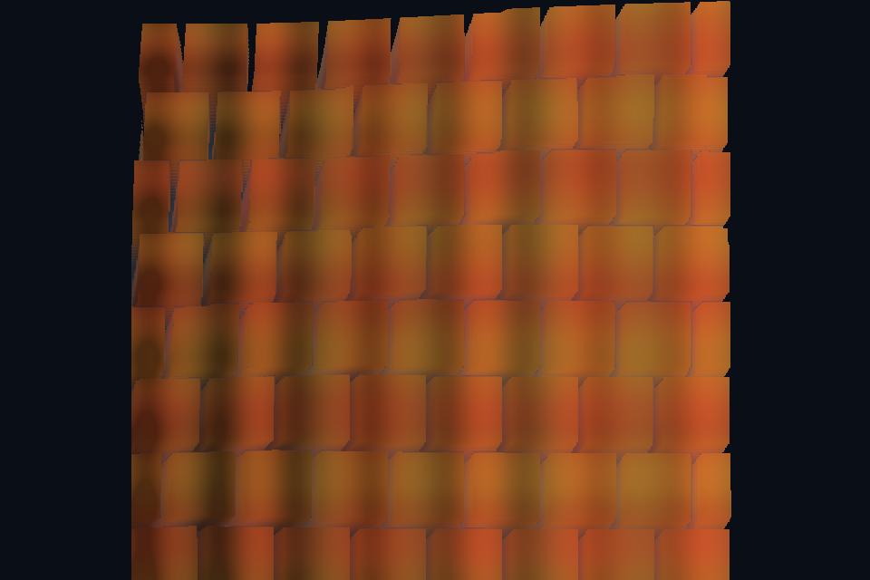

# 第 20 课：视差遮蔽映射

## 本课独立工程与关键注释

[main.cpp](main.cpp) · [本地辅助实现](support/) · [本课着色器](shaders/) · [CMakeLists.txt](CMakeLists.txt)

本目录拥有完整课程源码、资源与依赖配方。关键步骤含中文注释，不链接其他课的课程实现。可将整个目录复制到其他位置，用以下命令单独构建和检查；第三方依赖首次配置需要联网或提供缓存。

```powershell
cmake -S . -B build -A x64
cmake --build build --config Debug --parallel 4
ctest --test-dir build -C Debug --output-on-failure
```

[课程首页](../../README.md) · [上一课](../19_normal_mapping/README.md) · [下一课](../21_hdr/README.md)

## 目标与运行

```powershell
cmake --preset opengl
cmake --build --preset opengl-debug --target 20_parallax --parallel 4
.\OpenGL\build\bin\Debug\20_parallax.exe
```

预期画面：平面纹理有视角相关的深度感，空格关闭 POM 和法线贴图。

相机：W/A/S/D 移动，Q/E 升降，按住右键转向，Esc 退出。

## 代码阅读顺序

surface.frag 的 parallax → height.png → main.cpp 的 heightScale

从本课 [main.cpp](main.cpp) 进入；公共工具在 [common](../../common)，GLSL 在 [shaders](../../shaders)。先画出每一遍读什么、写什么，再逐个展开辅助类。

## 原理与实现

视差遮蔽映射 POM 沿切线空间视线穿过高度场，寻找第一处交点，用该点偏移后的 UV 采样表面。它改变纹理取样位置，仍不增加真实几何；轮廓、投影和碰撞不会自动改变。

本例高度图白色表示高处，采样深度写成 1-height。视线转到切线空间后，偏移与 V.xy/V.z 有关；V.z 太小会放大数值，所以限制分母并按视角选择 12–40 层。掠射角需要更多层，但本例上限以可读和性能为主。

步进到采样深度之后，使用当前点与前一点做线性细化，减轻层状跳变。UV 超出 [0,1] 时 discard，避免重复边缘；如果想做平铺材质，应明确保留重复并保证高度图边界连续。heightScale 控制近似深度，过大可能产生穿帮。

示例的 normal 与 height 都是教学生成素材，不是同一真实高度场严格求导的完整材质包。用于独立观察两种技术；产品素材应保持它们一致。POM 的自阴影与真实阴影贴图联动未在本课实现。

## 修改练习

将相机移到斜侧面；把高度缩放从 0.02 调到 0.12；把层数固定为 8 比较误差。

修改后重新执行 `cmake --build --preset opengl-debug --target 20_parallax --parallel 4`。GLSL、模型、图片会复制到程序旁的 shaders/assets 目录。源文件应修改教程根目录下的版本，运行目录的副本会被下一次构建覆盖。

## 自测与参考答案

为何 POM 能看起来有深度却没有改变阴影？

它只改变片段的 UV；阴影深度遍仍然渲染原来的平面几何。

## 检查与排错

运行 `20_parallax.exe --smoke` 可执行确定时间的四帧渲染检查。重要技术开关还可用 `--smoke --variant --capture` 与默认抓图对比。共享工具会检查 GL 错误、非背景像素和图像动态范围，但这不能代替人工核对技术含义。参见 [进阶排错](../../docs/11_进阶排错与性能.md)。


## 参考截图

以下为课程自带素材、固定时间 1 秒时的实际渲染；你的相机与操作改变后画面会不同。



[查看按住空格时的对照图](../../docs/previews/20_parallax_off.png)


## 深入学习：数据、接口与执行

视差贴图根据切线空间视线与高度偏移 UV，随后才读取颜色/法线。它不真正移动轮廓几何，掠射角和 UV 越界尤其容易暴露近似。

配套精讲：[三 API 对照 · 纹理、Mip 与颜色空间](../../../docs/compare/06_textures_color.md)。先读概念与参数选择，再返回本课实现核对，不必一次展开所有公共类。

### 本课的真实源码切片

来自 [OpenGL/lessons/20_parallax/main.cpp](main.cpp#L7)，第 7—32 行；这是现有实现的局部摘录，末尾可能处于函数中间，不是可单独编译的完整程序。

```cpp
int main(int argc, char** argv) try {
    // 先创建上下文；它必须比 shader、纹理和网格活得更久。
    App app(argc, argv, "20_parallax - OpenGL Course");
    // shader 路径指向本课自己的文件；属性、uniform 与下方 C++ 设置对应。
    Shader shader(app, "advanced.vert", "surface.frag");
    Mesh plane(quad(), quadIndices());
    Camera camera;
    camera.pos = {0, 0, 3};
    camera.pitch = 0;
    ImageTexture albedo(asset(app, "textures/albedo.png"), true),
        normal(asset(app, "textures/normal.png")), height(asset(app, "textures/height.png"));
    glEnable(GL_DEPTH_TEST);
    // 每帧处理输入并绘制；GPU 对象在退出循环后按 C++ 作用域逆序释放。
    while (app.begin()) {
        camera.update(app);
        app.clear();
        shader.use();
        surfaceDefaults(shader);
        cameraUniforms(shader, app, camera);
        albedo.bind(0);
        normal.bind(1);
        height.bind(2);
        shader.set("useTexture", 1);
        shader.set("baseColor", glm::vec3(1));
        shader.set("useNormal", app.key(GLFW_KEY_SPACE) != GLFW_PRESS);
        shader.set("useParallax", app.key(GLFW_KEY_SPACE) != GLFW_PRESS);
```

### 同主题跨 API 导航

以下是同主题参考；场景、功能完成度和版本基线可能不同，具体边界见对照章节。

| 路线 | 可运行参照 / 当前范围 |
| --- | --- |
| OpenGL | [20_parallax](README.md) |
| Vulkan 原生 | [vk06_texture_descriptor](../../../Vulkan/native/lessons/vk06_texture_descriptor/README.md) |
| Vulkan / nvpro_core2 | [nv04_vma_staging_texture](../../../Vulkan/nvpro/lessons/nv04_vma_staging_texture/README.md) |
| DirectX 12 | [dx06_texture_srv](../../../DirectX12/lessons/dx06_texture_srv/README.md) |

### 先预测，再验证

为什么侧面轮廓仍然是平的？

参考推导：本方法只修改采样坐标，没有增加几何。若要改变真实轮廓，需其他几何或位移方案，而非无限提高 heightScale。

在一次实验中只改一个因素，记录预测、实际画面/日志和原因。检查已有 smoke 是否仍通过；图形调试器里再核对本次 draw 的实际输入/输出，不能仅凭进程正常退出下结论。
