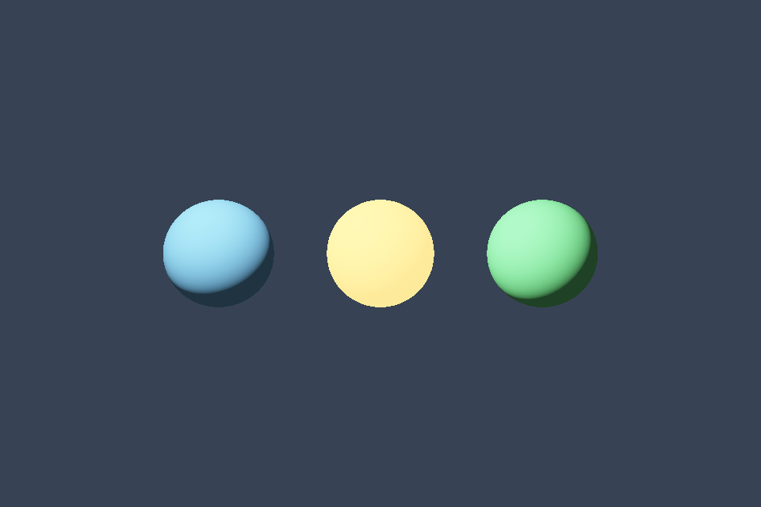

# 第 21 课：线性颜色与 HDR

[课程首页](../../README.md) · [上一课](../20_parallax/README.md) · [下一课](../22_bloom/README.md)

## 目标与运行

```powershell
cmake --preset opengl
cmake --build --preset opengl-debug --target 21_hdr --parallel 4
.\OpenGL\build\bin\Debug\21_hdr.exe
```

预期画面：三颗高亮球；上下箭头调整曝光，空格暂时关闭 tone mapping。

相机：W/A/S/D 移动，Q/E 升降，按住右键转向，Esc 退出。

## 代码阅读顺序

RenderTarget 的 RGBA16F → hdr_scene.frag → tone.frag

从本课 [main.cpp](main.cpp) 进入；公共工具在 [common](../../common)，GLSL 在 [shaders](../../shaders)。先画出每一遍读什么、写什么，再逐个展开辅助类。

## 原理与实现

光照叠加可超过 1，归一化 RGB8 会在写入时截断这些信息。RGBA16F 保留更大范围的浮点亮度，使曝光、Bloom 与色调映射能够在显示前处理高亮。

线性工作流分三步：颜色贴图按 sRGB 解码，在线性空间进行光照与叠加，显示前再编码。数值贴图、法线、HDR 文件保持线性。本课用指数映射 LDR=1-exp(-HDR*exposure)，然后以 pow(color,1/2.2) 做简化 Gamma 编码；最后这一步近似 sRGB 曲线，而不是精确分段传递函数。

示例没有启用 GL_FRAMEBUFFER_SRGB，因为 tone shader 已经手动编码。如果再启用自动编码会造成双重 Gamma。若改成自动 sRGB，应申请支持 sRGB 的窗口并移除手工编码，且确认所有中间纹理的格式。

曝光改变传感器/显示对场景的响应，不应修改材质 baseColor 去抵消过曝。空格关闭 tone mapping 后仍进行显示编码，超过 1 的结果在最终缓冲裁剪，高亮细节因此丢失。

## 修改练习

分别调高灯强和曝光，解释区别；加入 Reinhard 映射并对比；把附件换 RGB8 看高光信息丢失。

修改后重新执行 `cmake --build --preset opengl-debug --target 21_hdr --parallel 4`。GLSL、模型、图片会复制到程序旁的 shaders/assets 目录。源文件应修改教程根目录下的版本，运行目录的副本会被下一次构建覆盖。

## 自测与参考答案

HDR 是否意味着最终显示一定支持 HDR 显示器？

不是。这里是内部高动态范围渲染，最终仍映射到普通窗口显示范围。

## 检查与排错

运行 `21_hdr.exe --smoke` 可执行确定时间的四帧渲染检查。重要技术开关还可用 `--smoke --variant --capture` 与默认抓图对比。共享工具会检查 GL 错误、非背景像素和图像动态范围，但这不能代替人工核对技术含义。参见 [进阶排错](../../docs/11_进阶排错与性能.md)。


## 参考截图

以下为课程自带素材、固定时间 1 秒时的实际渲染；你的相机与操作改变后画面会不同。



[查看按住空格时的对照图](../../docs/previews/21_hdr_off.png)


## 深入学习：数据、接口与执行

HDR 先用浮点颜色保留超过一的光强，再通过曝光与 tone mapping 映射显示。直接写普通低精度目标会先截断能量，之后降低曝光也找不回来。

配套精讲：[三 API 对照 · 纹理、Mip 与颜色空间](../../../docs/compare/06_textures_color.md)。先读概念与参数选择，再返回本课实现核对，不必一次展开所有公共类。

### 本课的真实源码切片

来自 [OpenGL/lessons/21_hdr/main.cpp](main.cpp#L5)，第 5—30 行；这是现有实现的局部摘录，末尾可能处于函数中间，不是可单独编译的完整程序。

```cpp
int main(int argc, char** argv) try {
    App app(argc, argv, "21_hdr - OpenGL Course");
    RenderTarget scene(2), ping, pong;
    Shader shader(app, "advanced.vert", "hdr_scene.frag"), tone(app, "screen.vert", "tone.frag"),
        blur(app, "screen.vert", "blur.frag");
    Mesh ball(sphere()), plane(quad(), quadIndices());
    Camera camera;
    camera.pos = {0, 0, 8};
    camera.pitch = 0;
    float exposure = 1;
    while (app.begin()) {
        if (app.width < 1 || app.height < 1) {
            app.end();
            continue;
        }
        camera.update(app);
        if (glfwGetKey(app.window, GLFW_KEY_UP) == GLFW_PRESS)
            exposure += app.dt;
        if (glfwGetKey(app.window, GLFW_KEY_DOWN) == GLFW_PRESS)
            exposure = std::max(.05f, exposure - app.dt);
        scene.resize(app.width, app.height);
        ping.resize(app.width, app.height);
        pong.resize(app.width, app.height);
        scene.bind();
        glEnable(GL_DEPTH_TEST);
        app.clear();
```

### 同主题跨 API 导航

以下是同主题参考；场景、功能完成度和版本基线可能不同，具体边界见对照章节。

| 路线 | 可运行参照 / 当前范围 |
| --- | --- |
| OpenGL | [21_hdr](README.md) |
| Vulkan 原生 | [vk06_texture_descriptor](../../../Vulkan/native/lessons/vk06_texture_descriptor/README.md) |
| Vulkan / nvpro_core2 | [nv04_vma_staging_texture](../../../Vulkan/nvpro/lessons/nv04_vma_staging_texture/README.md) |
| DirectX 12 | [dx06_texture_srv](../../../DirectX12/lessons/dx06_texture_srv/README.md) |

### 先预测，再验证

曝光变低后高亮细节仍不存在，先看哪里？

参考推导：检查场景目标是否真为浮点、光照是否已提前 clamp 或编码。最终公式无法恢复早已丢失的信息。

在一次实验中只改一个因素，记录预测、实际画面/日志和原因。检查已有 smoke 是否仍通过；图形调试器里再核对本次 draw 的实际输入/输出，不能仅凭进程正常退出下结论。
