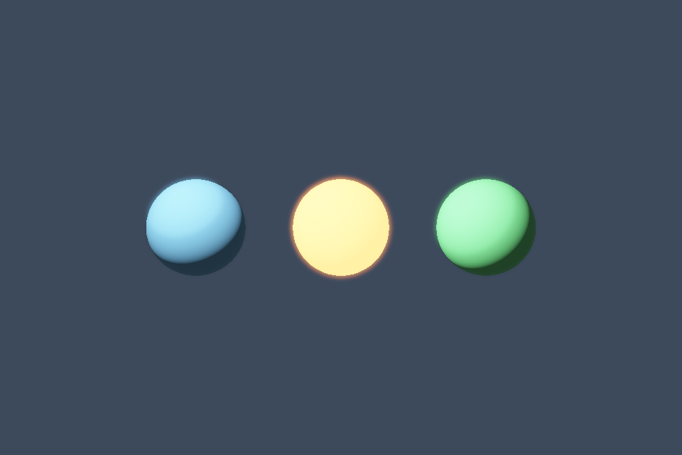

# 第 22 课：Bloom 与高斯模糊

[课程首页](../../README.md) · [上一课](../21_hdr/README.md) · [下一课](../23_pbr/README.md)

## 目标与运行

```powershell
cmake --preset opengl
cmake --build --preset opengl-debug --target 22_bloom --parallel 4
.\OpenGL\build\bin\Debug\22_bloom.exe
```

预期画面：高亮球周围出现柔和光晕；空格关闭 Bloom。

相机：W/A/S/D 移动，Q/E 升降，按住右键转向，Esc 退出。

## 代码阅读顺序

hdr_scene.frag 的 bright 输出 → ping/pong → blur.frag → tone.frag

从本课 [main.cpp](main.cpp) 进入；公共工具在 [common](../../common)，GLSL 在 [shaders](../../shaders)。先画出每一遍读什么、写什么，再逐个展开辅助类。

## 原理与实现

Bloom 模拟强亮区域对周围像素的扩散。场景 pass 用 MRT 同时写正常 HDR 颜色和亮度阈值图，阈值依据线性亮度 dot(rgb,weights)>1，不能先把 HDR 压到 [0,1] 再筛高亮。

二维高斯滤波可分离为横向与纵向。本例使用中心加左右四个采样的对称核，交替执行八次。ping 与 pong 两个 FBO 交替读写，每次输出纹理都不同于输入纹理，避免同一纹理反馈。重复多次会增大有效模糊半径。

把模糊结果以 0.25 权重加回线性 HDR 场景，然后统一 tone mapping 与 Gamma。Bloom 不是让基础颜色更白，也不是在最终 sRGB 图片上直接做透明叠加。

示例用全分辨率贴图方便检查，窗口放大时成本会增加。产品实现通常用降采样/上采样金字塔，或不同 mip 的能量分布；极强亮点还可能需要 soft threshold 和 firefly 抑制。

## 修改练习

修改 bright threshold、合成权重和 pass 数；将 ping/pong 改半分辨率并正确设置 viewport。

修改后重新执行 `cmake --build --preset opengl-debug --target 22_bloom --parallel 4`。GLSL、模型、图片会复制到程序旁的 shaders/assets 目录。源文件应修改教程根目录下的版本，运行目录的副本会被下一次构建覆盖。

## 自测与参考答案

为什么必须用两张模糊目标？

同一 pass 同时采样并写同一纹理会形成未定义反馈，不能保证读到上一遍结果。

## 检查与排错

运行 `22_bloom.exe --smoke` 可执行确定时间的四帧渲染检查。重要技术开关还可用 `--smoke --variant --capture` 与默认抓图对比。共享工具会检查 GL 错误、非背景像素和图像动态范围，但这不能代替人工核对技术含义。参见 [进阶排错](../../docs/11_进阶排错与性能.md)。


## 参考截图

以下为课程自带素材、固定时间 1 秒时的实际渲染；你的相机与操作改变后画面会不同。



[查看按住空格时的对照图](../../docs/previews/22_bloom_off.png)


## 深入学习：数据、接口与执行

高亮提取、水平/垂直模糊和合成各读写不同目标，ping-pong 避免同一遍采样自己正在写的图。合成应在线性 HDR 空间，最后才显示编码。

配套精讲：[三 API 对照 · 阴影、SSAO 与后处理](../../../docs/compare/13_multipass_effects.md)。先读概念与参数选择，再返回本课实现核对，不必一次展开所有公共类。

### 本课的真实源码切片

来自 [OpenGL/lessons/22_bloom/main.cpp](main.cpp#L5)，第 5—30 行；这是现有实现的局部摘录，末尾可能处于函数中间，不是可单独编译的完整程序。

```cpp
int main(int argc, char** argv) try {
    App app(argc, argv, "22_bloom - OpenGL Course");
    RenderTarget scene(2), ping, pong;
    Shader shader(app, "advanced.vert", "hdr_scene.frag"), tone(app, "screen.vert", "tone.frag"),
        blur(app, "screen.vert", "blur.frag");
    Mesh ball(sphere()), plane(quad(), quadIndices());
    Camera camera;
    camera.pos = {0, 0, 8};
    camera.pitch = 0;
    float exposure = 1;

    // 每帧依次完成 HDR 场景、高亮提取、交替模糊与最终合成。
    while (app.begin()) {
        if (app.width < 1 || app.height < 1) {
            app.end();
            continue;
        }
        camera.update(app);
        if (glfwGetKey(app.window, GLFW_KEY_UP) == GLFW_PRESS)
            exposure += app.dt;
        if (glfwGetKey(app.window, GLFW_KEY_DOWN) == GLFW_PRESS)
            exposure = std::max(.05f, exposure - app.dt);
        scene.resize(app.width, app.height);
        ping.resize(app.width, app.height);
        pong.resize(app.width, app.height);
        scene.bind();
```

### 同主题跨 API 导航

以下是同主题参考；场景、功能完成度和版本基线可能不同，具体边界见对照章节。

| 路线 | 可运行参照 / 当前范围 |
| --- | --- |
| OpenGL | [22_bloom](README.md) |
| Vulkan 原生 | 迁移设计：vk10 已有离屏/blit；完整 Bloom/SSAO 仍需资源、采样管线及逐遍依赖。 |
| Vulkan / nvpro_core2 | 迁移设计：RenderTarget 与 ImGui 仅是接入点；新增多遍效果仍要自己描述写后读。 |
| DirectX 12 | 迁移设计：dx10 是 CopyResource，迁移后处理需新增可采样目标和全屏像素管线。 |

### 先预测，再验证

只把 blur 次数增加很多为何可能不只是更好看？

参考推导：成本随遍数增长，还可能过度扩散。先检查阈值、尺寸和中间纹理，避免用更多遍掩盖上传或合成错误。

在一次实验中只改一个因素，记录预测、实际画面/日志和原因。检查已有 smoke 是否仍通过；图形调试器里再核对本次 draw 的实际输入/输出，不能仅凭进程正常退出下结论。
