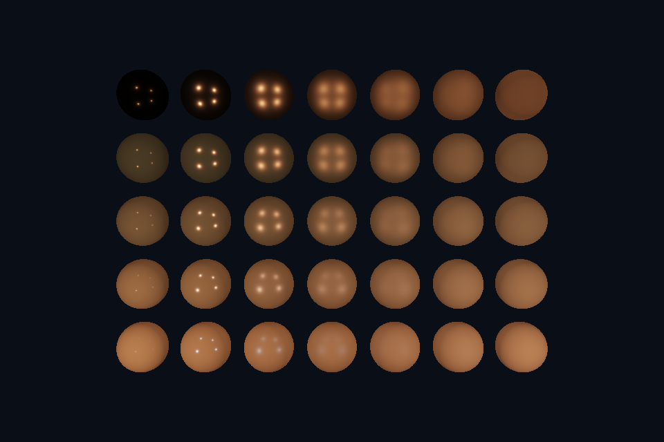

# 第 23 课：Cook-Torrance PBR

[课程首页](../../README.md) · [上一课](../22_bloom/README.md) · [下一课](../24_pbr_textures/README.md)

## 目标与运行

```powershell
cd OpenGL
.\scripts\run.ps1 -Lesson 23_pbr
```

预期画面：35 颗球：横轴粗糙度从低到高，纵轴金属度从低到高。

相机：W/A/S/D 移动，Q/E 升降，按住右键转向，Esc 退出。

## 代码阅读顺序

pbr.frag 的 directBRDF、distributionGGX、geometrySchlick、fresnel

从本课 [main.cpp](main.cpp) 进入；公共工具在 [common](../../common)，GLSL 在 [shaders](../../shaders)。先画出每一遍读什么、写什么，再逐个展开辅助类。

## 原理与实现

PBR 是以一致的材质与光照约定组织着色，不是某个 OpenGL 专属 API。本课采用金属度/粗糙度工作流的 Cook-Torrance 微表面模型：镜面 BRDF 为 D*G*F/(4*NdotV*NdotL)，再与入射辐射度和 NdotL 相乘。

D 使用 GGX 法线分布，粗糙度 r 先转换 alpha=r²，再使用 alpha² 进入分布公式；不要无意识重复平方。G 使用 Smith 思路的 Schlick-GGX 近似，直接光中的 k=(r+1)²/8。F 使用 Schlick 近似，介电材质 F0=0.04，金属的 F0 由基础颜色决定。

漫反射使用 Lambert albedo/π，比例 kD=(1-F)*(1-metallic)，避免镜面与漫反射同时消耗全部能量。金属度=1 时漫反射关闭。这是单次散射的教学模型，高粗糙度金属会损失部分多次散射能量，不等同于完整生产 PBR。

四个点光源按距离平方衰减，所有计算在线性空间。roughness 最小限制为 0.045，避免分布过尖引发数值问题；分母也设保护值。最后 Reinhard 映射与简化 Gamma 编码统一输出。本课小环境项只是背景补光，真实 IBL 在第 25 课实现。理论延伸参见 [Filament 的材质与光照设计](https://google.github.io/filament/Filament.md.html)。

## 修改练习

把金属度固定为 0 和 1；取消 kD 中 (1-metal) 看不守恒效果；比较 GGX 与旧 Phong 的粗糙度控制。

修改后重新执行 `cmake --build build --config Debug --target 23_pbr --parallel`。GLSL、模型、图片会复制到程序旁的 shaders/assets 目录。源文件应修改教程根目录下的版本，运行目录的副本会被下一次构建覆盖。

## 自测与参考答案

金色金属的黄色主要属于漫反射还是镜面反射？

在该模型中金属漫反射为零，黄色主要体现在镜面反射 F0。

## 检查与排错

运行 `23_pbr.exe --smoke` 可执行确定时间的四帧渲染检查。重要技术开关还可用 `--smoke --variant --capture` 与默认抓图对比。共享工具会检查 GL 错误、非背景像素和图像动态范围，但这不能代替人工核对技术含义。参见 [进阶排错](../../docs/11_进阶排错与性能.md)。


## 参考截图

以下为课程自带素材、固定时间 1 秒时的实际渲染；你的相机与操作改变后画面会不同。


