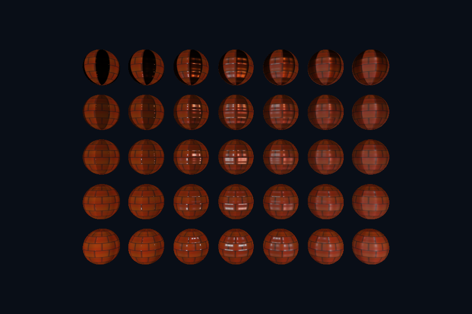

# 第 24 课：PBR 贴图工作流

[课程首页](../../README.md) · [上一课](../23_pbr/README.md) · [下一课](../25_ibl/README.md)

## 目标与运行

```powershell
cd OpenGL
.\scripts\run.ps1 -Lesson 24_pbr_textures
```

预期画面：35 颗带纹理球，不同金属度/粗糙度因子下有空间变化的材质，空格关闭法线。

相机：W/A/S/D 移动，Q/E 升降，按住右键转向，Esc 退出。

## 代码阅读顺序

albedo.png / normal.png / metalrough.png / ao.png → pbr.frag useMaps 分支

从本课 [main.cpp](main.cpp) 进入；公共工具在 [common](../../common)，GLSL 在 [shaders](../../shaders)。先画出每一遍读什么、写什么，再逐个展开辅助类。

## 原理与实现

PBR 材质的各张图有不同语义：albedo 是没有烘焙直接光的基础颜色；normal 是切线空间法线；metallic 和 roughness 是标量；AO 描述小尺度环境遮蔽，不应无条件乘到直接光上。

本例遵循 glTF 的金属粗糙度通道：G 存粗糙度、B 存金属度，R 此处未参与计算；AO 独立读取 R。packed ORM 常见布局为 R=AO/G=roughness/B=metallic，但是否打包必须看素材约定，不能仅凭文件名猜。课程模型材质导入与此布局一致。

基础颜色贴图上传为 GL_SRGB8_ALPHA8，其他图为 GL_RGBA8；读取时只有颜色图自动解码。颜色 factor×贴图、粗糙度 factor×G、金属度 factor×B 允许同一组纹理复用于不同对象。法线图需要 TBN，且应该在片段内归一化。

本课的示例图是自制变化图，目的是看清每个通道对结果的影响，不是扫描得到的真实材质。导入外部材质包时首先确认 OpenGL/DirectX 法线绿色方向、粗糙度还是光滑度、色彩空间与通道打包规则。

## 修改练习

把 G 和 B 交换看错误；将 roughness 当成 1-glossiness 接入；用纯白 AO 对照。

修改后重新执行 `cmake --build build --config Debug --target 24_pbr_textures --parallel`。GLSL、模型、图片会复制到程序旁的 shaders/assets 目录。源文件应修改教程根目录下的版本，运行目录的副本会被下一次构建覆盖。

## 自测与参考答案

AO 应直接让灯照到的表面也同样变黑吗？

本例只让 AO 调制环境项，直接光仍按几何与光源计算；具体分离策略取决于渲染模型。

## 检查与排错

运行 `24_pbr_textures.exe --smoke` 可执行确定时间的四帧渲染检查。重要技术开关还可用 `--smoke --variant --capture` 与默认抓图对比。共享工具会检查 GL 错误、非背景像素和图像动态范围，但这不能代替人工核对技术含义。参见 [进阶排错](../../docs/11_进阶排错与性能.md)。


## 参考截图

以下为课程自带素材、固定时间 1 秒时的实际渲染；你的相机与操作改变后画面会不同。



[查看按住空格时的对照图](../../docs/previews/24_pbr_textures_off.png)
