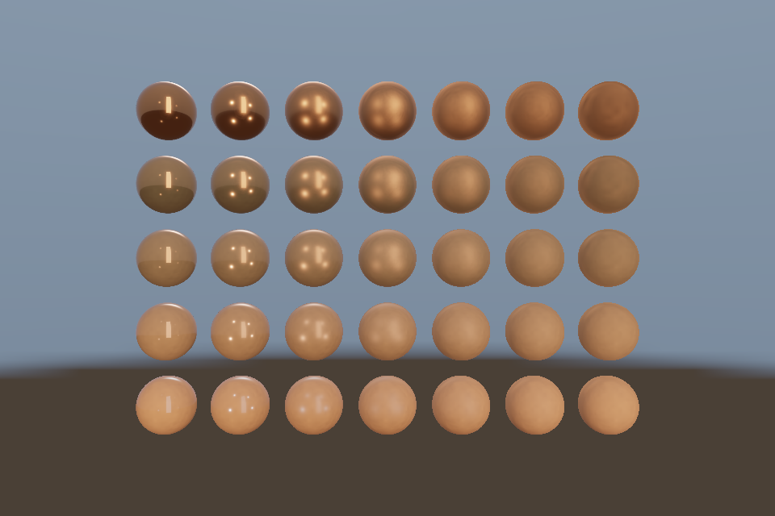

# 第 25 课：IBL 与 Split Sum

## 本课独立工程与关键注释

[main.cpp](main.cpp) · [本地辅助实现](support/) · [本课着色器](shaders/) · [CMakeLists.txt](CMakeLists.txt)

本目录拥有完整课程源码、资源与依赖配方。关键步骤含中文注释，不链接其他课的课程实现。可将整个目录复制到其他位置，用以下命令单独构建和检查；第三方依赖首次配置需要联网或提供缓存。

```powershell
cmake -S . -B build -A x64
cmake --build build --config Debug --parallel 4
ctest --test-dir build -C Debug --output-on-failure
```

[课程首页](../../README.md) · [上一课](../24_pbr_textures/README.md) · [下一课](../26_deferred/README.md)

## 目标与运行

```powershell
cmake --preset opengl
cmake --build --preset opengl-debug --target 25_ibl --parallel 4
.\OpenGL\build\bin\Debug\25_ibl.exe
```

预期画面：环境照明下的 35 球矩阵与天空，空格关闭 IBL 作对照。

相机：W/A/S/D 移动，Q/E 升降，按住右键转向，Esc 退出。

## 代码阅读顺序

Environment → equirect/irradiance/prefilter/brdf.frag → pbr.frag 的 useIBL

从本课 [main.cpp](main.cpp) 进入；公共工具在 [common](../../common)，GLSL 在 [shaders](../../shaders)。先画出每一遍读什么、写什么，再逐个展开辅助类。

## 原理与实现

直接光只计算明确的灯，IBL 把环境图当作来自各方向的入射光。它不是给金属球随便采一张模糊图。此课从线性 HDR 文件生成环境 cubemap，再计算三类实际预计算资源。

漫反射 irradiance：对法线半球进行余弦重要性采样，128 个 Hammersley 样本估计辐照度。因为样本 PDF 已含 cosθ/π，结果为 π*平均环境值；着色时再乘 Lambert albedo/π，不能重复漏乘或多乘 π。

镜面 prefilter：对 GGX 半程向量重要性采样，假定 V=N，分别计算五级不同粗糙度的 cubemap。每级的内容是独立 GGX 积分，不是对原图 glGenerateMipmap 后就宣称完成粗糙反射。运行时 roughness*4 选择 LOD。此教学实现源环境固定采样 LOD0，低样本数与小分辨率可能让极亮点有噪声。

BRDF LUT：在 128×128 的 RG16F 纹理中积分 NdotV 和 roughness 对应的分离系数 A/B。运行时环境镜面近似为 prefilteredColor*(F0*A+B)。此处 IBL 几何函数使用 k=r²/2，和直接光的近似参数区分。

这就是 split-sum 近似的两部分：预过滤环境与 BRDF 查表，不是精确求解渲染方程。资源分辨率低、每项只用 128 样本，优先保证学习和启动速度。更高品质需要更多采样、源 mip/PDF 选择、多次散射补偿和更完整的局部探针策略。

## 修改练习

将采样数同时在 hammersley 和循环改为 512；增加预过滤分辨率；只显示 irradiance 或 prefilter 的某级作为调试。

修改后重新执行 `cmake --build --preset opengl-debug --target 25_ibl --parallel 4`。GLSL、模型、图片会复制到程序旁的 shaders/assets 目录。源文件应修改教程根目录下的版本，运行目录的副本会被下一次构建覆盖。

## 自测与参考答案

普通 mipmap 为什么不能代替 GGX 预过滤？

普通 mipmap 按图像空间过滤，GGX 预过滤按反射分布与方向半球积分，二者权重和几何意义不同。

## 检查与排错

运行 `25_ibl.exe --smoke` 可执行确定时间的四帧渲染检查。重要技术开关还可用 `--smoke --variant --capture` 与默认抓图对比。共享工具会检查 GL 错误、非背景像素和图像动态范围，但这不能代替人工核对技术含义。参见 [进阶排错](../../docs/11_进阶排错与性能.md)。


## 参考截图

以下为课程自带素材、固定时间 1 秒时的实际渲染；你的相机与操作改变后画面会不同。



[查看按住空格时的对照图](../../docs/previews/25_ibl_off.png)


## 深入学习：数据、接口与执行

Environment 的三种产物各服务不同积分：irradiance、roughness-prefilter、BRDF LUT。逐项查看面方向和 mip，最终球图才能说明组合是否正确。

配套精讲：[三 API 对照 · 直接光 PBR 与 IBL](../../../docs/compare/12_lighting_pbr_ibl.md)。先读概念与参数选择，再返回本课实现核对，不必一次展开所有公共类。

### 本课的真实源码切片

来自 [OpenGL/lessons/25_ibl/main.cpp](main.cpp#L7)，第 7—32 行；这是现有实现的局部摘录，末尾可能处于函数中间，不是可单独编译的完整程序。

```cpp
int main(int argc, char** argv) try {
    // 先创建上下文；它必须比 shader、纹理和网格活得更久。
    App app(argc, argv, "25_ibl - OpenGL Course");
    Environment env(app);
    // shader 路径指向本课自己的文件；属性、uniform 与下方 C++ 设置对应。
    Shader shader(app, "advanced.vert", "pbr.frag"), sky(app, "sky.vert", "sky.frag");
    Mesh ball(sphere()), box(cube());
    Camera camera;
    camera.pos = {0, 0, 14};
    camera.pitch = 0;
    // 每帧处理输入并绘制；GPU 对象在退出循环后按 C++ 作用域逆序释放。
    while (app.begin()) {
        camera.update(app);
        app.clear();
        shader.use();
        pbrDefaults(shader);
        cameraUniforms(shader, app, camera);
        env.bindIBL();
        shader.set("useIBL", app.key(GLFW_KEY_SPACE) != GLFW_PRESS);
        for (int y = 0; y < 5; ++y)
            for (int x = 0; x < 7; ++x) {
                shader.set("metallic", float(y) / 4);
                shader.set("roughness", std::max(.05f, float(x) / 6));
                auto model =
                    glm::translate(glm::mat4(1), glm::vec3((x - 3) * 1.65f, (y - 2) * 1.65f, 0));
                shader.set("model", glm::scale(model, glm::vec3(.65f)));
```

### 同主题跨 API 导航

以下是同主题参考；场景、功能完成度和版本基线可能不同，具体边界见对照章节。

| 路线 | 可运行参照 / 当前范围 |
| --- | --- |
| OpenGL | [25_ibl](README.md) |
| Vulkan 原生 | [vk09_pbr](../../../Vulkan/native/lessons/vk09_pbr/README.md) |
| Vulkan / nvpro_core2 | [nv06_pbr_viewport](../../../Vulkan/nvpro/lessons/nv06_pbr_viewport/README.md) |
| DirectX 12 | [dx09_pbr](../../../DirectX12/lessons/dx09_pbr/README.md) |

### 先预测，再验证

为什么预过滤 mip 不能随意当成普通自动缩小链？

参考推导：此处各级代表不同粗糙度积分；普通 glGenerateMipmap 的盒式缩小并不等于 GGX 预过滤。

在一次实验中只改一个因素，记录预测、实际画面/日志和原因。检查已有 smoke 是否仍通过；图形调试器里再核对本次 draw 的实际输入/输出，不能仅凭进程正常退出下结论。
