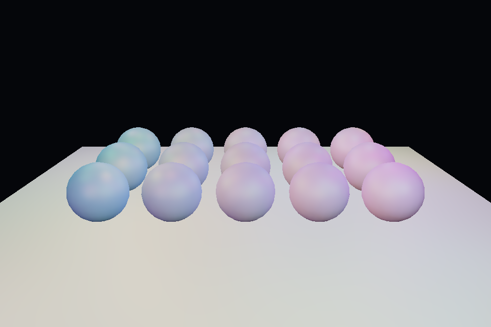

# 第 26 课：延迟渲染与 G-buffer

## 本课独立工程与关键注释

[main.cpp](main.cpp) · [本地辅助实现](support/) · [本课着色器](shaders/) · [CMakeLists.txt](CMakeLists.txt)

本目录拥有完整课程源码、资源与依赖配方。关键步骤含中文注释，不链接其他课的课程实现。可将整个目录复制到其他位置，用以下命令单独构建和检查；第三方依赖首次配置需要联网或提供缓存。

```powershell
cmake -S . -B build -A x64
cmake --build build --config Debug --parallel 4
ctest --test-dir build -C Debug --output-on-failure
```

[课程首页](../../README.md) · [上一课](../25_ibl/README.md) · [下一课](../27_ssao/README.md)

## 目标与运行

```powershell
cmake --preset opengl
cmake --build --preset opengl-debug --target 26_deferred --parallel 4
.\OpenGL\build\bin\Debug\26_deferred.exe
```

预期画面：一组球和地面被 32 盏彩灯照亮；按 2 查看法线。

相机：W/A/S/D 移动，Q/E 升降，按住右键转向，Esc 退出。

## 代码阅读顺序

geometry pass → gbuffer.frag → deferred.frag 全屏 lighting pass

从本课 [main.cpp](main.cpp) 进入；公共工具在 [common](../../common)，GLSL 在 [shaders](../../shaders)。先画出每一遍读什么、写什么，再逐个展开辅助类。

## 原理与实现

前向渲染对每个物体直接计算光照；延迟渲染先记录可见表面的属性，再在屏幕空间统一计算光。G-buffer 保存观察空间 position、normal、albedo/roughness。每个片段通过 layout(location=...) 写入不同颜色附件，glDrawBuffers 开启 MRT。

本课用三个 RGBA16F 附件统一实现，便于阅读；真实产品会为不同属性选择更紧凑格式、用深度重建位置、对法线编码。960×640 下三张 RGBA16F 颜色图约 14 MiB，尚不含深度和其他目标，带宽很快成为成本。

位置和法线都在观察空间，所以光源也乘 view 后再计算。背景位置的 alpha 清为 0，无几何时跳过光照。相机移动之后若只更新灯却没更新 G-buffer，空间将不一致。

32 盏灯在全屏逐一计算只是在教学上展示结构，并非高效的 clustered/tiled 实现。延迟渲染也不能天然处理所有半透明层，需要混合前向透明 pass；与 MSAA 配合通常更复杂。

## 修改练习

增加/减少光源数量；显示位置和 albedo 附件；用深度重建位置替代 position 附件。

修改后重新执行 `cmake --build --preset opengl-debug --target 26_deferred --parallel 4`。GLSL、模型、图片会复制到程序旁的 shaders/assets 目录。源文件应修改教程根目录下的版本，运行目录的副本会被下一次构建覆盖。

## 自测与参考答案

延迟渲染为什么不意味着光源越多成本越低？

本例每个可见像素仍循环全部光源，成本随像素数和灯数增长，只是减少不可见表面的重复着色。

## 检查与排错

运行 `26_deferred.exe --smoke` 可执行确定时间的四帧渲染检查。重要技术开关还可用 `--smoke --variant --capture` 与默认抓图对比。共享工具会检查 GL 错误、非背景像素和图像动态范围，但这不能代替人工核对技术含义。参见 [进阶排错](../../docs/11_进阶排错与性能.md)。


## 参考截图

以下为课程自带素材、固定时间 1 秒时的实际渲染；你的相机与操作改变后画面会不同。




## 深入学习：数据、接口与执行

几何遍写 view-space 位置/法线和材质，全屏遍据此计算光照。应先用调试视图确认三个附件，再检查光源转换；透明材质通常需要另一条处理路径。

配套精讲：[三 API 对照 · 阴影、SSAO 与后处理](../../../docs/compare/13_multipass_effects.md)。先读概念与参数选择，再返回本课实现核对，不必一次展开所有公共类。

### 本课的真实源码切片

来自 [OpenGL/lessons/26_deferred/main.cpp](main.cpp#L7)，第 7—32 行；这是现有实现的局部摘录，末尾可能处于函数中间，不是可单独编译的完整程序。

```cpp
int main(int argc, char** argv) try {
    // 先创建上下文；它必须比 shader、纹理和网格活得更久。
    App app(argc, argv, "26_deferred - OpenGL Course");
    RenderTarget gbuffer(3), occlusion, filtered;
    Shader geometry(app, "advanced.vert", "gbuffer.frag"),
        lighting(app, "screen.vert", "deferred.frag"), ao(app, "screen.vert", "ssao.frag"),
        blur(app, "screen.vert", "ao_blur.frag");
    Mesh box(cube()), ball(sphere(24, 12)), plane(quad(), quadIndices());
    Camera camera;
    camera.pos = {0, 3, 8};
    camera.pitch = -18;
    std::mt19937 random(42);
    std::uniform_real_distribution<float> unit(0, 1);
    std::vector<glm::vec3> kernel, noise;
    for (int k = 0; k < 32; ++k) {
        auto p =
            glm::normalize(glm::vec3(unit(random) * 2 - 1, unit(random) * 2 - 1, unit(random)));
        p *= unit(random);
        float f = float(k) / 31;
        p *= .1f + .9f * f * f;
        kernel.push_back(p);
    }
    for (int k = 0; k < 16; ++k)
        noise.emplace_back(unit(random) * 2 - 1, unit(random) * 2 - 1, 0);
    GLuint noiseTexture;
    glGenTextures(1, &noiseTexture);
```

### 同主题跨 API 导航

以下是同主题参考；场景、功能完成度和版本基线可能不同，具体边界见对照章节。

| 路线 | 可运行参照 / 当前范围 |
| --- | --- |
| OpenGL | [26_deferred](README.md) |
| Vulkan 原生 | 迁移设计：vk10 已有离屏/blit；完整 Bloom/SSAO 仍需资源、采样管线及逐遍依赖。 |
| Vulkan / nvpro_core2 | 迁移设计：RenderTarget 与 ImGui 仅是接入点；新增多遍效果仍要自己描述写后读。 |
| DirectX 12 | 迁移设计：dx10 是 CopyResource，迁移后处理需新增可采样目标和全屏像素管线。 |

### 先预测，再验证

把 world-space 光源直接和 view-space 位置相减会怎样？

参考推导：空间混用使光照随相机错误变化。先把两者统一到同一空间，而不是调衰减参数补偿。

在一次实验中只改一个因素，记录预测、实际画面/日志和原因。检查已有 smoke 是否仍通过；图形调试器里再核对本次 draw 的实际输入/输出，不能仅凭进程正常退出下结论。
