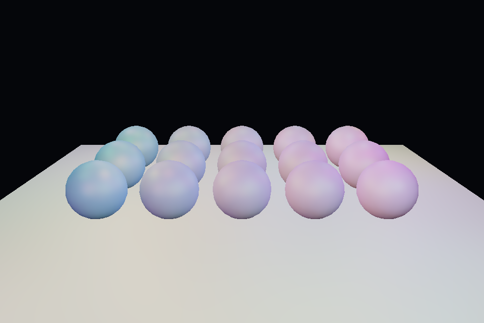

# 第 27 课：SSAO 与降噪

[课程首页](../../README.md) · [上一课](../26_deferred/README.md) · [下一课](../28_ubo/README.md)

## 目标与运行

```powershell
cd OpenGL
.\scripts\run.ps1 -Lesson 27_ssao
```

预期画面：球与地面接触附近有环境遮蔽；空格关闭，按 1 查看 AO，按 2 查看法线。

相机：W/A/S/D 移动，Q/E 升降，按住右键转向，Esc 退出。

## 代码阅读顺序

ssao.frag → ao_blur.frag → deferred.frag 的环境项

从本课 [main.cpp](main.cpp) 进入；公共工具在 [common](../../common)，GLSL 在 [shaders](../../shaders)。先画出每一遍读什么、写什么，再逐个展开辅助类。

## 原理与实现

SSAO 从屏幕空间近似表面附近的遮挡。对每个观察空间位置，在法线半球取 32 个样本；样本转到观察空间后投影到屏幕，读取附近已渲染的位置深度，判断是否存在更靠近相机的表面阻挡。

观察空间相机朝 -Z，看得见的表面 z 通常为负；比较方向不能套用普通正距离直觉。此例当 neighbor.z >= samplePos.z+bias 时认为阻挡，并用 range smoothstep 降低深度差太大导致的假遮挡。采样超屏和无几何处跳过。

4×4 的随机旋转噪声减少固定采样方向条纹；kernel 用确定种子构造，并偏向近处。随后进行空间、法线、深度共同决定权重的双边滤波，减轻噪声而尽量不跨物体边界糊开。最终只调制环境项，保留直接灯光。

SSAO 不知道屏幕外和被遮住的几何，边缘漏光、相机相关变化与大尺度失真都属于近似的局限。没有时域累积、半分辨率重建、GTAO/HBAO 等改进。本例只实现可读的基础版本。

## 修改练习

改变半径 .8 与 bias .03；暂时关闭降噪；扩大 kernel，观察质量和 GPU 成本。

修改后重新执行 `cmake --build build --config Debug --target 27_ssao --parallel`。GLSL、模型、图片会复制到程序旁的 shaders/assets 目录。源文件应修改教程根目录下的版本，运行目录的副本会被下一次构建覆盖。

## 自测与参考答案

为什么环境遮蔽不应把所有直接光一起压暗？

屏幕 AO 近似环境方向遮挡，明确灯光的可见性通常应由阴影来决定。

## 检查与排错

运行 `27_ssao.exe --smoke` 可执行确定时间的四帧渲染检查。重要技术开关还可用 `--smoke --variant --capture` 与默认抓图对比。共享工具会检查 GL 错误、非背景像素和图像动态范围，但这不能代替人工核对技术含义。参见 [进阶排错](../../docs/11_进阶排错与性能.md)。


## 参考截图

以下为课程自带素材、固定时间 1 秒时的实际渲染；你的相机与操作改变后画面会不同。



[查看按住空格时的对照图](../../docs/previews/27_ssao_off.png)
