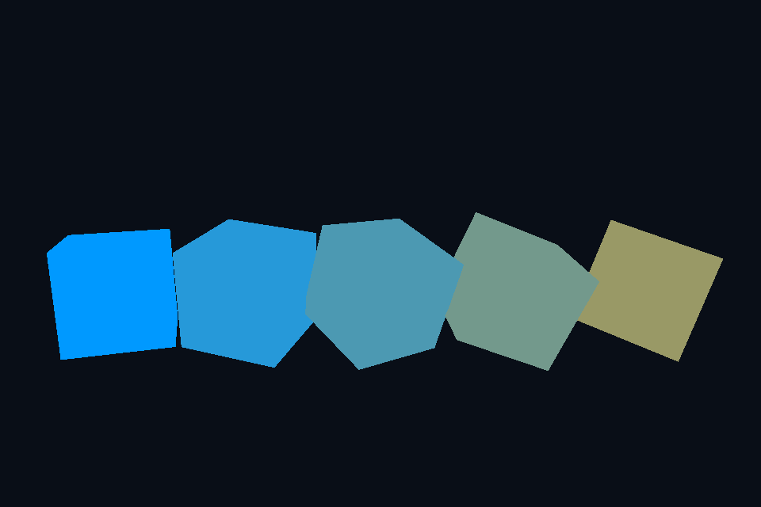

# 第 28 课：UBO 与 std140

[课程首页](../../README.md) · [上一课](../27_ssao/README.md) · [下一课](../29_msaa/README.md)

## 目标与运行

```powershell
cd OpenGL
.\scripts\run.ps1 -Lesson 28_ubo
```

预期画面：五个旋转方块共享相机矩阵，并各自使用不同颜色和模型矩阵。

相机：W/A/S/D 移动，Q/E 升降，按住右键转向，Esc 退出。

## 代码阅读顺序

ubo.vert 的 CameraBlock → main.cpp 的 glUniformBlockBinding/BufferSubData

从本课 [main.cpp](main.cpp) 进入；公共工具在 [common](../../common)，GLSL 在 [shaders](../../shaders)。先画出每一遍读什么、写什么，再逐个展开辅助类。

## 原理与实现

多个 shader 常共享相机矩阵。UBO 把这些数据放进一个缓冲，以 binding point 让多个程序引用，不再对每个程序逐个上传相同 mat4。本课为了突出数据路径只使用一个程序、五个物体；可扩展第二程序验证共享。

GLSL 330 用 layout(std140) uniform CameraBlock 声明布局，然后 CPU 查 block index，glUniformBlockBinding 将其映射到 binding=0，glBindBufferBase 把缓冲接到这个 binding。不要把 program 的 block index 当成全局 binding point；二者不是同一个编号。

std140 下两个 mat4 各占 64 字节，projection 在偏移 0，view 在偏移 64，总计 128。vec3、数组和结构体有额外对齐规则，不能直接拿随意的 C++ struct memcpy。更通用代码应按规范对齐或查询 offset/stride。

本课先分配一次 GL_DYNAMIC_DRAW，再每帧 glBufferSubData 更新相机数据。model 仍按对象作为普通 uniform 上传，因为它不在共享相机块内。UBO 数量和块大小有设备上限，可查询 GL_MAX_UNIFORM_BUFFER_BINDINGS 与 GL_MAX_UNIFORM_BLOCK_SIZE。

## 修改练习

加一个不同片段 shader，共享 binding=0；在 block 中加入眼睛位置并明确 16 字节对齐。

修改后重新执行 `cmake --build build --config Debug --target 28_ubo --parallel`。GLSL、模型、图片会复制到程序旁的 shaders/assets 目录。源文件应修改教程根目录下的版本，运行目录的副本会被下一次构建覆盖。

## 自测与参考答案

glUniformBlockBinding 和 glBindBufferBase 分别连接什么？

前者连接程序内的块与绑定点，后者连接绑定点与实际缓冲对象。

## 检查与排错

运行 `28_ubo.exe --smoke` 可执行确定时间的四帧渲染检查。重要技术开关还可用 `--smoke --variant --capture` 与默认抓图对比。共享工具会检查 GL 错误、非背景像素和图像动态范围，但这不能代替人工核对技术含义。参见 [进阶排错](../../docs/11_进阶排错与性能.md)。


## 参考截图

以下为课程自带素材、固定时间 1 秒时的实际渲染；你的相机与操作改变后画面会不同。


