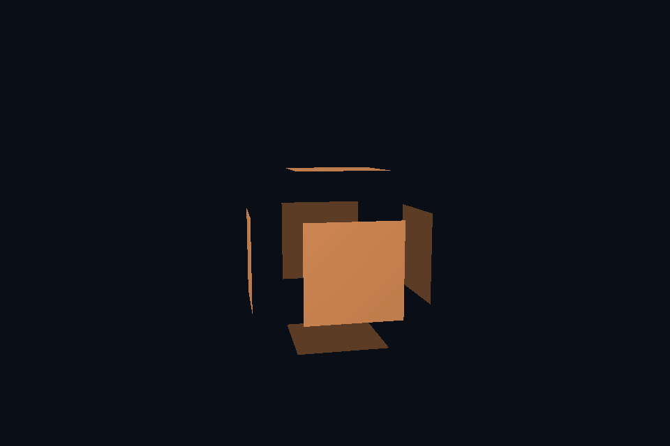

# 第 30 课：几何着色器

[课程首页](../../README.md) · [上一课](../29_msaa/README.md) · [下一课](../31_skeletal/README.md)

## 目标与运行

```powershell
cd OpenGL
.\scripts\run.ps1 -Lesson 30_geometry
```

预期画面：立方体的各三角形沿面方向周期性向外分离。

相机：W/A/S/D 移动，Q/E 升降，按住右键转向，Esc 退出。

## 代码阅读顺序

explode.vert → explode.geom → surface.frag

从本课 [main.cpp](main.cpp) 进入；公共工具在 [common](../../common)，GLSL 在 [shaders](../../shaders)。先画出每一遍读什么、写什么，再逐个展开辅助类。

## 原理与实现

几何着色器位于顶点之后、光栅化之前，按图元接收数据。本课 layout(triangles) in，每次接收三个顶点；输出 triangle_strip，max_vertices=3，逐个 EmitVertex，再 EndPrimitive。

顶点阶段暂时把局部位置放在 gl_Position。几何阶段根据三点叉乘得到面方向，沿方向平移顶点，再应用 model/view/projection。这样在局部或世界空间计算几何方向，避免错误地在透视裁剪空间直接求法线。

原顶点法线用于光照，面方向用于分离位移，二者用途不同。对于带平滑法线的模型，分离会出现接缝，这是本课故意展示的效果。geometryStage 将几何 shader 加入程序重新链接，并检查链接日志。

几何 shader 能做教学上的法线可视化、简单图元扩展等，但不保证比其他方案快。大量放大图元可能触发严重吞吐瓶颈。粒子 billboard 的常见实现是顶点 shader 加实例化，第 32 课采用该方式。

## 修改练习

把位移改成恒定；输出线段可视化每个面的法线；比较 face normal 与 interpolated normal。

修改后重新执行 `cmake --build build --config Debug --target 30_geometry --parallel`。GLSL、模型、图片会复制到程序旁的 shaders/assets 目录。源文件应修改教程根目录下的版本，运行目录的副本会被下一次构建覆盖。

## 自测与参考答案

为什么不直接对 gl_Position.xyz 的透视后数据做世界方向计算？

它们已经不在统一欧氏坐标空间，透视和 w 会扭曲长度与角度。

## 检查与排错

运行 `30_geometry.exe --smoke` 可执行确定时间的四帧渲染检查。重要技术开关还可用 `--smoke --variant --capture` 与默认抓图对比。共享工具会检查 GL 错误、非背景像素和图像动态范围，但这不能代替人工核对技术含义。参见 [进阶排错](../../docs/11_进阶排错与性能.md)。


## 参考截图

以下为课程自带素材、固定时间 1 秒时的实际渲染；你的相机与操作改变后画面会不同。


