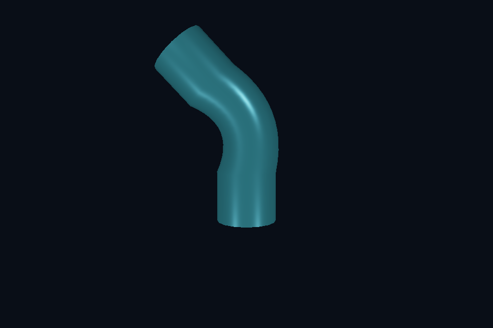

# 第 31 课：骨骼动画与蒙皮

[课程首页](../../README.md) · [上一课](../30_geometry/README.md) · [下一课](../32_particles/README.md)

## 目标与运行

```powershell
cd OpenGL
.\scripts\run.ps1 -Lesson 31_skeletal
```

预期画面：一根带两根骨骼的软柱随时间弯曲；空格显示 bind pose。

相机：W/A/S/D 移动，Q/E 升降，按住右键转向，Esc 退出。

## 代码阅读顺序

bending.gltf/animations/skins → Model::update/visit → ImportedMesh 权重 → model.vert

从本课 [main.cpp](main.cpp) 进入；公共工具在 [common](../../common)，GLSL 在 [shaders](../../shaders)。先画出每一遍读什么、写什么，再逐个展开辅助类。

## 原理与实现

骨骼动画分为动画时间采样、层级变换、蒙皮矩阵与顶点混合。课程读取真实 glTF 的 skin、关节索引、权重、inverse bind matrices 和旋转关键帧，不是在 shader 中按顶点高度临时套一个波浪函数。

动画通道按节点名称匹配。位置和缩放线性插值，旋转用 quaternion slerp，按父子顺序计算 nodeGlobal。时间用 ticksPerSecond 转换并对 duration 取模。本简化播放器只播放第一条动画，并将通道按线性/slerp 处理；STEP/CUBICSPLINE、动画混合与根运动不在支持范围内。

mesh 局部的 bone matrix=inverse(meshGlobal)*boneGlobal*inverseBind。顶点按权重加权 bone matrix 后，外面再乘 rootTransform*meshGlobal。这样明确剥离网格节点变换，避免重复乘一遍模型变换。权重取最大的四个并归一化，无权重顶点保持原始姿态。

骨骼 ID 使用整数属性 glVertexAttribIPointer，对应 ivec4，不能像普通 float 属性一样解释。此课每网格上限 48 骨骼，在 shader 中使用 mat4 数组；更大骨架需要 UBO/纹理缓冲等方案并检查设备限制。线性混合蒙皮会出现糖纸扭转与体积损失，双四元数蒙皮是后续方向。

## 修改练习

修改 glTF 的旋转关键帧；延长动画时长；给模型加第三根骨骼与权重；在 bind pose 对比蒙皮矩阵。

修改后重新执行 `cmake --build build --config Debug --target 31_skeletal --parallel`。GLSL、模型、图片会复制到程序旁的 shaders/assets 目录。源文件应修改教程根目录下的版本，运行目录的副本会被下一次构建覆盖。

## 自测与参考答案

为何要乘 inverseBind？

它把原始模型顶点从绑定姿态对应的网格空间转换到关节的参考空间，之后再应用当前关节姿态。

## 检查与排错

运行 `31_skeletal.exe --smoke` 可执行确定时间的四帧渲染检查。重要技术开关还可用 `--smoke --variant --capture` 与默认抓图对比。共享工具会检查 GL 错误、非背景像素和图像动态范围，但这不能代替人工核对技术含义。参见 [进阶排错](../../docs/11_进阶排错与性能.md)。


## 参考截图

以下为课程自带素材、固定时间 1 秒时的实际渲染；你的相机与操作改变后画面会不同。



[查看按住空格时的对照图](../../docs/previews/31_skeletal_off.png)
