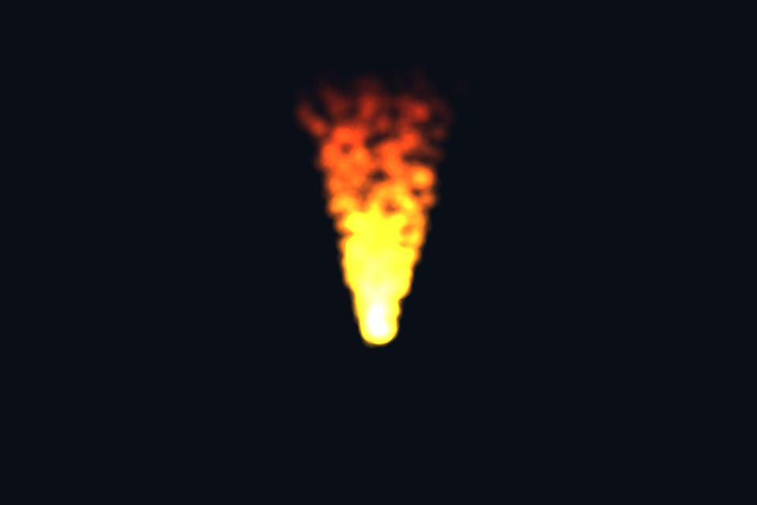

# 第 32 课：实例化粒子

## 本课独立工程与关键注释

[main.cpp](main.cpp) · [本地辅助实现](support/) · [本课着色器](shaders/) · [CMakeLists.txt](CMakeLists.txt)

本目录拥有完整课程源码、资源与依赖配方。关键步骤含中文注释，不链接其他课的课程实现。可将整个目录复制到其他位置，用以下命令单独构建和检查；第三方依赖首次配置需要联网或提供缓存。

```powershell
cmake -S . -B build -A x64
cmake --build build --config Debug --parallel 4
ctest --test-dir build -C Debug --output-on-failure
```

[课程首页](../../README.md) · [上一课](../31_skeletal/README.md) · [下一课](../33_point_shadows/README.md)

## 目标与运行

```powershell
cmake --preset opengl
cmake --build --preset opengl-debug --target 32_particles --parallel 4
.\OpenGL\build\bin\Debug\32_particles.exe
```

预期画面：600 个橙黄色粒子组成向上飘散的火焰状光束。

相机：W/A/S/D 移动，Q/E 升降，按住右键转向，Esc 退出。

## 代码阅读顺序

main.cpp 更新实例数据 → particle.vert 的 right/up billboard → particle.frag

从本课 [main.cpp](main.cpp) 进入；公共工具在 [common](../../common)，GLSL 在 [shaders](../../shaders)。先画出每一遍读什么、写什么，再逐个展开辅助类。

## 原理与实现

粒子系统包含生成、寿命、运动和外观。此课用确定性的编号与周期 age 计算位置，目的是复现稳定画面；不是完整物理粒子模拟器。每实例 vec4 存 xyz 与 normalized age，CPU 每帧更新缓冲，GPU 实例化绘制同一个矩形。

Billboard 通过相机的 right/up 构造朝向眼睛的平面：particlePos+right*x+up*y。这样无需几何 shader 扩展点。片段阶段根据到圆心的距离生成柔边 Alpha，寿命结束时逐渐消失。

火焰使用 GL_SRC_ALPHA,GL_ONE 加法混合，通常不用从远到近排序；如果改为烟雾的标准 Alpha 混合，就需要按深度排序。保留深度测试、关闭深度写入，让不透明场景能挡住粒子。本课背景只有粒子，后续可放一个遮挡立方体测试。

注意清屏顺序：每帧先恢复 glDepthMask(GL_TRUE)，清除深度，再设为 false 绘制粒子。否则 glClear 无法更新深度，可能导致所有粒子都被旧深度挡住。此问题也说明“程序无 GL 错误”不等于“画面正确”。

本示例直接向普通颜色窗口混合，用于看清实例数据；实际发光粒子应加入线性 HDR pass，再经 Bloom/曝光/最终编码。大系统还要考虑缓冲流送、粒子排序成本和填充率。

## 修改练习

改成烟雾颜色并实现排序；加入地面和遮挡物；把粒子放进第 34 课的 HDR 场景。

修改后重新执行 `cmake --build --preset opengl-debug --target 32_particles --parallel 4`。GLSL、模型、图片会复制到程序旁的 shaders/assets 目录。源文件应修改教程根目录下的版本，运行目录的副本会被下一次构建覆盖。

## 自测与参考答案

加法混合为什么往往可以不排序？

颜色累加近似满足交换性，但深度、精度和 Alpha 处理仍需一致，不能推广到普通透明混合。

## 检查与排错

运行 `32_particles.exe --smoke` 可执行确定时间的四帧渲染检查。重要技术开关还可用 `--smoke --variant --capture` 与默认抓图对比。共享工具会检查 GL 错误、非背景像素和图像动态范围，但这不能代替人工核对技术含义。参见 [进阶排错](../../docs/11_进阶排错与性能.md)。


## 参考截图

以下为课程自带素材、固定时间 1 秒时的实际渲染；你的相机与操作改变后画面会不同。




## 深入学习：数据、接口与执行

当前粒子由实例化图形路径绘制，属性/时间决定位置与外观，透明边缘配合混合。它不是 compute 粒子模拟，应与 vk08/dx08 的实际计算路径区分。

配套精讲：[三 API 对照 · 顶点、索引与内存](../../../docs/compare/03_geometry_memory.md)。先读概念与参数选择，再返回本课实现核对，不必一次展开所有公共类。

### 本课的真实源码切片

来自 [OpenGL/lessons/32_particles/main.cpp](main.cpp#L7)，第 7—32 行；这是现有实现的局部摘录，末尾可能处于函数中间，不是可单独编译的完整程序。

```cpp
int main(int argc, char** argv) try {
    // 先创建上下文；它必须比 shader、纹理和网格活得更久。
    App app(argc, argv, "32_particles - OpenGL Course");
    // shader 路径指向本课自己的文件；属性、uniform 与下方 C++ 设置对应。
    Shader shader(app, "particle.vert", "particle.frag");
    Mesh plane(quad(), quadIndices());
    Camera camera;
    camera.pos = {0, 2, 7};
    camera.pitch = -8;
    std::mt19937 random(7);
    std::uniform_real_distribution<float> unit(0, 1);
    std::vector<glm::vec3> seeds;
    for (int n = 0; n < 600; ++n)
        seeds.emplace_back(unit(random), unit(random), unit(random));
    GLuint instance;
    glGenBuffers(1, &instance);
    glBindVertexArray(plane.vao);
    glBindBuffer(GL_ARRAY_BUFFER, instance);
    glBufferData(GL_ARRAY_BUFFER, 600 * sizeof(glm::vec4), nullptr, GL_STREAM_DRAW);
    glEnableVertexAttribArray(3);
    glVertexAttribPointer(3, 4, GL_FLOAT, GL_FALSE, sizeof(glm::vec4), nullptr);
    glVertexAttribDivisor(3, 1);
    glEnable(GL_DEPTH_TEST);
    glEnable(GL_BLEND);
    glBlendFunc(GL_SRC_ALPHA, GL_ONE);
    glDepthMask(GL_FALSE);
```

### 同主题跨 API 导航

以下是同主题参考；场景、功能完成度和版本基线可能不同，具体边界见对照章节。

| 路线 | 可运行参照 / 当前范围 |
| --- | --- |
| OpenGL | [32_particles](README.md) |
| Vulkan 原生 | [vk04_vertex_buffer](../../../Vulkan/native/lessons/vk04_vertex_buffer/README.md) |
| Vulkan / nvpro_core2 | [nv04_vma_staging_texture](../../../Vulkan/nvpro/lessons/nv04_vma_staging_texture/README.md) |
| DirectX 12 | [dx04_vertex_buffer](../../../DirectX12/lessons/dx04_vertex_buffer/README.md) |

### 先预测，再验证

为什么大量透明粒子即使一次 draw 也可能很慢？

参考推导：屏幕 overdraw 和混合带宽可能成为瓶颈。draw 数减少并不保证像素成本减少。

在一次实验中只改一个因素，记录预测、实际画面/日志和原因。检查已有 smoke 是否仍通过；图形调试器里再核对本次 draw 的实际输入/输出，不能仅凭进程正常退出下结论。
