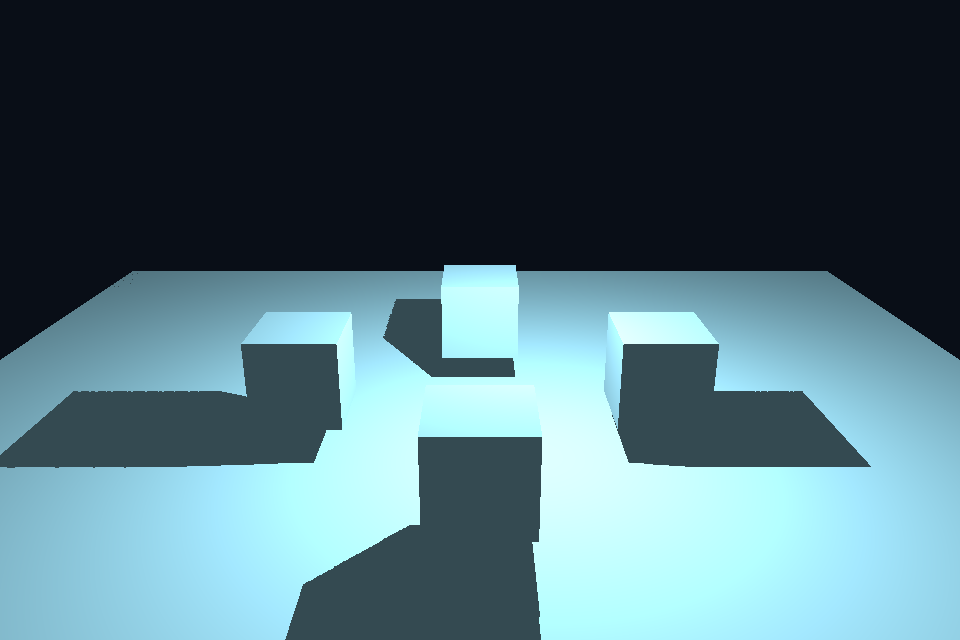

# 第 33 课：点光源全方向阴影

## 本课独立工程与关键注释

[main.cpp](main.cpp) · [本地辅助实现](support/) · [本课着色器](shaders/) · [CMakeLists.txt](CMakeLists.txt)

本目录拥有完整课程源码、资源与依赖配方。关键步骤含中文注释，不链接其他课的课程实现。可将整个目录复制到其他位置，用以下命令单独构建和检查；第三方依赖首次配置需要联网或提供缓存。

```powershell
cmake -S . -B build -A x64
cmake --build build --config Debug --parallel 4
ctest --test-dir build -C Debug --output-on-failure
```

[课程首页](../../README.md) · [上一课](../32_particles/README.md) · [下一课](../34_gallery/README.md)

## 目标与运行

```powershell
cmake --preset opengl
cmake --build --preset opengl-debug --target 33_point_shadows --parallel 4
.\OpenGL\build\bin\Debug\33_point_shadows.exe
```

预期画面：移动点光源照亮四个立方体，地面阴影向各方向延伸；空格关闭阴影。

相机：W/A/S/D 移动，Q/E 升降，按住右键转向，Esc 退出。

## 代码阅读顺序

point_depth.vert/frag → 六个 cubemap 面 → point_shadow.frag

从本课 [main.cpp](main.cpp) 进入；公共工具在 [common](../../common)，GLSL 在 [shaders](../../shaders)。先画出每一遍读什么、写什么，再逐个展开辅助类。

## 原理与实现

第 13 课只有一个有限正交视锥，不能覆盖点光源全方向。本课从光源位置向六个轴向各渲染一次 90° 透视深度，形成 depth cubemap。使用六次 draw pass，未采用几何 shader 分层输出，方便逐面检查。

片段深度写成 length(worldPos-light)/farPlane，因此 cubemap 存的是线性径向距离，而不是默认透视 z。正常着色时用 worldPos-light 的方向采样，乘 farPlane 恢复距离，再与当前点距离比较。若写的是透视 z，却按径向距离读取，结果不会正确。

每面使用正确的 up 向量，并切换 GL_DEPTH_ATTACHMENT。颜色输出关闭；每个方向都清深度。恢复默认 FBO 和窗口 viewport 后再画正常场景。点光源运动时六面都需要更新，成本明显高于一张方向光阴影。

本课用 512² 深度、最近采样和固定 bias=.05，故边缘有锯齿，偏置也可能产生 acne/peter panning。扩展时可在球面方向上多次采样进行 PCF、使用角度与距离相关偏置。更大的分辨率并非唯一质量因素。

## 修改练习

依次显示六面深度；增大分辨率；实现多个方向的 PCF；调整光源高度。

修改后重新执行 `cmake --build --preset opengl-debug --target 33_point_shadows --parallel 4`。GLSL、模型、图片会复制到程序旁的 shaders/assets 目录。源文件应修改教程根目录下的版本，运行目录的副本会被下一次构建覆盖。

## 自测与参考答案

为什么点阴影用方向采样而不需为每个片段手选 cubemap 面？

Cubemap 采样器根据方向的最大绝对分量自动选面并计算面内坐标。

## 检查与排错

运行 `33_point_shadows.exe --smoke` 可执行确定时间的四帧渲染检查。重要技术开关还可用 `--smoke --variant --capture` 与默认抓图对比。共享工具会检查 GL 错误、非背景像素和图像动态范围，但这不能代替人工核对技术含义。参见 [进阶排错](../../docs/11_进阶排错与性能.md)。


## 参考截图

以下为课程自带素材、固定时间 1 秒时的实际渲染；你的相机与操作改变后画面会不同。



[查看按住空格时的对照图](../../docs/previews/33_point_shadows_off.png)


## 深入学习：数据、接口与执行

点光六个方向分别写深度 cubemap，保存 light 到表面的距离并用相同 farPlane 归一化。采样端和输出端的距离定义必须一致。

配套精讲：[三 API 对照 · 阴影、SSAO 与后处理](../../../docs/compare/13_multipass_effects.md)。先读概念与参数选择，再返回本课实现核对，不必一次展开所有公共类。

### 本课的真实源码切片

来自 [OpenGL/lessons/33_point_shadows/main.cpp](main.cpp#L7)，第 7—32 行；这是现有实现的局部摘录，末尾可能处于函数中间，不是可单独编译的完整程序。

```cpp
int main(int argc, char** argv) try {
    // 先创建上下文；它必须比 shader、纹理和网格活得更久。
    App app(argc, argv, "33_point_shadows - OpenGL Course");
    GLuint fbo, depthCube;
    glGenFramebuffers(1, &fbo);
    glGenTextures(1, &depthCube);
    bindCube(depthCube, 0);
    for (int f = 0; f < 6; ++f)
        glTexImage2D(GL_TEXTURE_CUBE_MAP_POSITIVE_X + f,
                     0,
                     GL_DEPTH_COMPONENT24,
                     512,
                     512,
                     0,
                     GL_DEPTH_COMPONENT,
                     GL_FLOAT,
                     nullptr);
    glTexParameteri(GL_TEXTURE_CUBE_MAP, GL_TEXTURE_MIN_FILTER, GL_NEAREST);
    glTexParameteri(GL_TEXTURE_CUBE_MAP, GL_TEXTURE_MAG_FILTER, GL_NEAREST);
    for (GLenum axis : {GL_TEXTURE_WRAP_S, GL_TEXTURE_WRAP_T, GL_TEXTURE_WRAP_R})
        glTexParameteri(GL_TEXTURE_CUBE_MAP, axis, GL_CLAMP_TO_EDGE);
    glBindFramebuffer(GL_FRAMEBUFFER, fbo);
    // 绘制使用当前程序、VAO 和附件；属性布局必须匹配顶点着色器。
    glDrawBuffer(GL_NONE);
    glReadBuffer(GL_NONE);
    glFramebufferTexture2D(
```

### 同主题跨 API 导航

以下是同主题参考；场景、功能完成度和版本基线可能不同，具体边界见对照章节。

| 路线 | 可运行参照 / 当前范围 |
| --- | --- |
| OpenGL | [33_point_shadows](README.md) |
| Vulkan 原生 | 迁移设计：vk10 已有离屏/blit；完整 Bloom/SSAO 仍需资源、采样管线及逐遍依赖。 |
| Vulkan / nvpro_core2 | 迁移设计：RenderTarget 与 ImGui 仅是接入点；新增多遍效果仍要自己描述写后读。 |
| DirectX 12 | 迁移设计：dx10 是 CopyResource，迁移后处理需新增可采样目标和全屏像素管线。 |

### 先预测，再验证

只改一端的 farPlane 会怎样？

参考推导：保存值与比较值不再处于同一尺度，阴影边界整体错误。先统一距离定义再调 bias/PCF。

在一次实验中只改一个因素，记录预测、实际画面/日志和原因。检查已有 smoke 是否仍通过；图形调试器里再核对本次 draw 的实际输入/输出，不能仅凭进程正常退出下结论。
