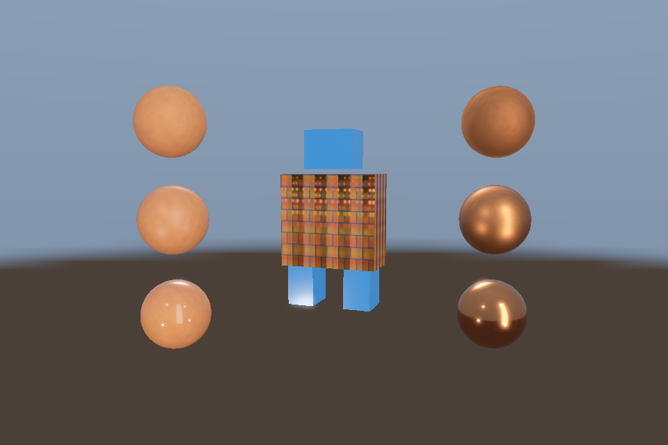

# 第 34 课：综合实战：PBR 模型展厅

## 本课独立工程与关键注释

[main.cpp](main.cpp) · [本地辅助实现](support/) · [本课着色器](shaders/) · [CMakeLists.txt](CMakeLists.txt)

本目录拥有完整课程源码、资源与依赖配方。关键步骤含中文注释，不链接其他课的课程实现。可将整个目录复制到其他位置，用以下命令单独构建和检查；第三方依赖首次配置需要联网或提供缓存。

```powershell
cmake -S . -B build -A x64
cmake --build build --config Debug --parallel 4
ctest --test-dir build -C Debug --output-on-failure
```

[课程首页](../../README.md) · [上一课](../33_point_shadows/README.md) · [下一课](../../docs/12_后续专题与边界.md)

## 目标与运行

```powershell
cmake --preset opengl
cmake --build --preset opengl-debug --target 34_gallery --parallel 4
.\OpenGL\build\bin\Debug\34_gallery.exe
```

预期画面：机器人模型和两列 PBR 球置于 HDR 环境中，带 Bloom；空格关闭 Bloom。

相机：W/A/S/D 移动，Q/E 升降，按住右键转向，Esc 退出。

## 代码阅读顺序

Model + Environment → scene HDR → bright extraction → ping/pong blur → tone output

从本课 [main.cpp](main.cpp) 进入；公共工具在 [common](../../common)，GLSL 在 [shaders](../../shaders)。先画出每一遍读什么、写什么，再逐个展开辅助类。

## 原理与实现

前面的独立示例可以分别看懂技术，综合场景则检验它们的数据约定是否一致。本课用实际 glTF 模型、材质贴图、PBR、完整 IBL、自由相机、HDR、亮度提取和 Bloom 串成一条可运行管线。

初始化阶段只做一次资产导入与 IBL 预计算。每帧先更新相机与目标尺寸，在线性 RGBA16F 场景目标中绘制模型与球，天空同样输出线性 HDR。与第 25 课不同，这里 PBR 的 displayEncode=0，不能在对象 shader 内提前 tone map/Gamma。

接着在独立 FBO 从 HDR 场景提取亮区，交替横纵模糊，再与原场景相加，最后只在 tone pass 统一曝光映射和编码。这与第 22 课的 MRT 亮区输出是两种等效组织：此处复用单颜色输出的 PBR 程序，所以增加一次全屏亮区提取。

本课不把所有高级效果硬塞到同一 shader：它没有同时集成 SSAO、透明物体、点光阴影和骨骼动画。它是一条已实现的完整模型展示管线；后续练习要求你按清晰的 pass 约定继续合并，而不是靠遗留绑定状态碰巧显示。

每一遍都明确输入纹理、目标附件、viewport、深度状态和色彩空间。若画面突然过亮，先检查是否重复 Gamma，再检查曝光和光源，不要先通过改 baseColor 掩盖流程错误。

## 修改练习

将机器人换成自己的 glTF；接入骨骼动画；把粒子加入 HDR 场景；选择一种阴影与 PBR 的直接光可见性结合。

修改后重新执行 `cmake --build --preset opengl-debug --target 34_gallery --parallel 4`。GLSL、模型、图片会复制到程序旁的 shaders/assets 目录。源文件应修改教程根目录下的版本，运行目录的副本会被下一次构建覆盖。

## 自测与参考答案

为什么单课 PBR 看起来正常，接入 HDR 展厅却可能变灰或过亮？

最常见原因是对象阶段已经做了显示映射，又在最终 pass 重复映射/编码，必须统一整条管线的输出约定。

## 检查与排错

运行 `34_gallery.exe --smoke` 可执行确定时间的四帧渲染检查。重要技术开关还可用 `--smoke --variant --capture` 与默认抓图对比。共享工具会检查 GL 错误、非背景像素和图像动态范围，但这不能代替人工核对技术含义。参见 [进阶排错](../../docs/11_进阶排错与性能.md)。


## 参考截图

以下为课程自带素材、固定时间 1 秒时的实际渲染；你的相机与操作改变后画面会不同。



[查看按住空格时的对照图](../../docs/previews/34_gallery_off.png)


## 深入学习：数据、接口与执行

综合场景适合追踪依赖，不适合初次定位所有问题。先分别验证模型、材质、IBL 与动画，再观察组合时资源绑定和状态恢复是否相互覆盖。

配套精讲：[三 API 对照 · 框架与多后端架构](../../../docs/compare/15_framework_architecture.md)。先读概念与参数选择，再返回本课实现核对，不必一次展开所有公共类。

### 本课的真实源码切片

来自 [OpenGL/lessons/34_gallery/main.cpp](main.cpp#L8)，第 8—33 行；这是现有实现的局部摘录，末尾可能处于函数中间，不是可单独编译的完整程序。

```cpp
int main(int argc, char** argv) try {
    // 先创建上下文；它必须比 shader、纹理和网格活得更久。
    App app(argc, argv, "34_gallery - OpenGL Course");
    Environment env(app);
    Model robot(asset(app, "models/robot.gltf"));
    Mesh ball(sphere()), box(cube()), plane(quad(), quadIndices());
    Camera camera;
    camera.pos = {0, 1, 10};
    camera.pitch = -6;
    Shader model(app, "model.vert", "pbr.frag"), pbr(app, "advanced.vert", "pbr.frag"),
        sky(app, "sky.vert", "sky.frag"), bright(app, "screen.vert", "bright.frag"),
        blur(app, "screen.vert", "blur.frag"), tone(app, "screen.vert", "tone.frag");
    RenderTarget scene, highlights, ping, pong;
    // 每帧处理输入并绘制；GPU 对象在退出循环后按 C++ 作用域逆序释放。
    while (app.begin()) {
        if (app.width < 1 || app.height < 1) {
            app.end();
            continue;
        }
        camera.update(app);
        scene.resize(app.width, app.height);
        highlights.resize(app.width, app.height);
        ping.resize(app.width, app.height);
        pong.resize(app.width, app.height);
        scene.bind();
        glEnable(GL_DEPTH_TEST);
```

### 同主题跨 API 导航

以下是同主题参考；场景、功能完成度和版本基线可能不同，具体边界见对照章节。

| 路线 | 可运行参照 / 当前范围 |
| --- | --- |
| OpenGL | [34_gallery](README.md) |
| Vulkan 原生 | [vk09_pbr](../../../Vulkan/native/lessons/vk09_pbr/README.md) |
| Vulkan / nvpro_core2 | [nv06_pbr_viewport](../../../Vulkan/nvpro/lessons/nv06_pbr_viewport/README.md) |
| DirectX 12 | [dx09_pbr](../../../DirectX12/lessons/dx09_pbr/README.md) |

### 先预测，再验证

组合后出错而单课正常，优先如何缩小范围？

参考推导：逐项关闭 pass 或材质功能，并检查共享状态/单元是否被覆盖；不要同时重写资产解析与渲染器。

在一次实验中只改一个因素，记录预测、实际画面/日志和原因。检查已有 smoke 是否仍通过；图形调试器里再核对本次 draw 的实际输入/输出，不能仅凭进程正常退出下结论。
