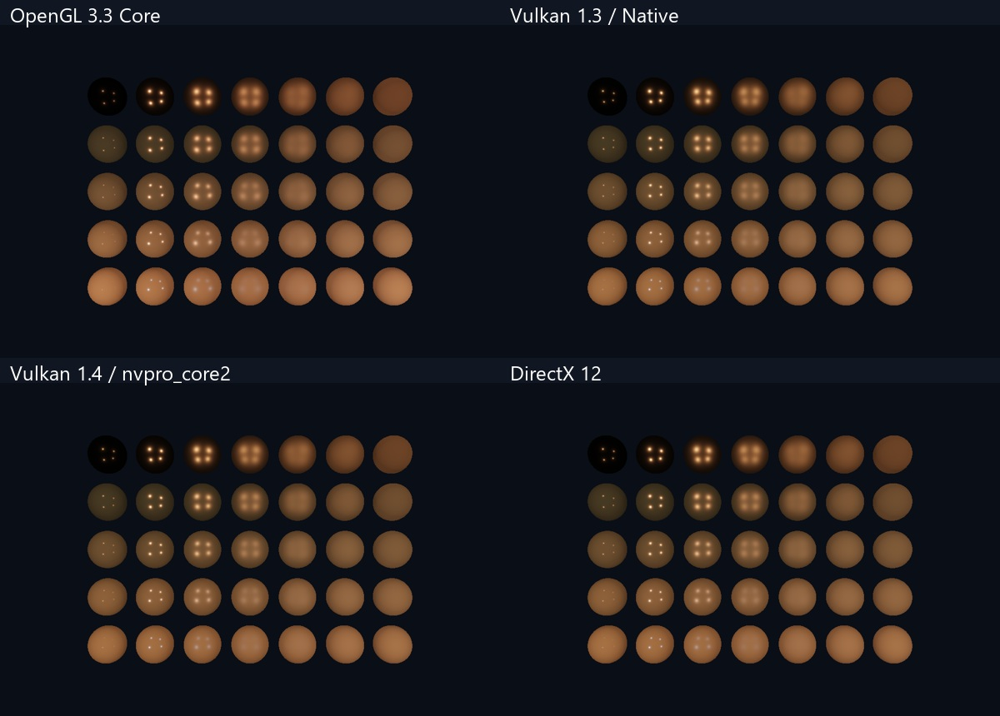

# Graphics API Tutorials · C++ / CMake

中文图形 API 学习工程：**OpenGL、原生 Vulkan、nvpro_core2 Vulkan、DirectX 12**。三种 API 分目录，Vulkan 下保留两套路线。共 **60 个可执行课程**：OpenGL 34、原生 Vulkan 10、nvpro_core2 6、DX12 10。



## 目录与路线

| API | 目录 | 内容 |
| --- | --- | --- |
| OpenGL | [OpenGL/](OpenGL/README.md) | 原有 34 课，含模型、PBR/IBL、HDR/Bloom、SSAO、动画 |
| Vulkan 原生 | [Vulkan/native/](Vulkan/native/README.md) | 实例/队列、交换链、动态渲染、资源/描述符、计算、直接光 PBR、离屏传输 |
| Vulkan / nvpro_core2 | [Vulkan/nvpro/](Vulkan/nvpro/README.md) | Context、nvapp、RenderTarget、VMA/Staging、计算与可交互 PBR 视口 |
| DirectX 12 | [DirectX12/](DirectX12/README.md) | DXGI、命令与 fence、PSO/root signature、CBV/SRV/UAV、深度、计算、PBR |

新路线优先把显式 API 的资源和同步讲清楚。Vulkan/DX12 的 PBR 是直接光实现；OpenGL 的完整 IBL、模型导入等高级功能还没有全部迁移，具体实现范围在各路线 README 说明。

## 快速运行入口

先编译对应路线，再通过本地阅读器点击下表按钮。

| 路线 | 示例 |
| --- | --- |
| OpenGL | [彩色三角形](OpenGL/lessons/02_triangle/README.md) |
| OpenGL | [PBR / IBL](OpenGL/lessons/25_ibl/README.md) |
| Vulkan 原生 | [彩色三角形](Vulkan/native/lessons/vk03_triangle/README.md) |
| Vulkan 原生 | [直接光 PBR](Vulkan/native/lessons/vk09_pbr/README.md) |
| Vulkan nvpro_core2 | [三角形视口](Vulkan/nvpro/lessons/nv03_triangle/README.md) |
| Vulkan nvpro_core2 | [PBR 视口](Vulkan/nvpro/lessons/nv06_pbr_viewport/README.md) |
| DirectX 12 | [彩色三角形](DirectX12/lessons/dx03_triangle/README.md) |
| DirectX 12 | [直接光 PBR](DirectX12/lessons/dx09_pbr/README.md) |

## 本机要求

- Windows 10/11 x64；Visual Studio 2022 的“使用 C++ 的桌面开发”和 Windows SDK；CMake 3.24+；Git。
- OpenGL：支持 3.3 Core 的驱动，C++17。
- 原生 Vulkan：Vulkan SDK 1.3+，驱动支持 1.3 的 dynamic rendering 和 synchronization2，C++20。
- nvpro_core2：驱动支持 Vulkan 1.4。固定 `71ab4212aa3dd8e3b6cb659ed691b59062dc5f11`；项目下载并固定 1.4.341 头文件/辅助头文件，搭配子模块 Volk。本机以 SDK 1.4.335 的库/工具完成验证，不改全局 SDK；新安装建议选择提供 1.4.341+ 的 SDK。
- DX12：Windows 的 D3D12 runtime、feature level 12_0 显卡；也可 `--warp` 运行软件设备。HLSL 使用系统 D3DCompiler/SM5.1，不依赖 DXC。

首次配置需要联网下载固定版本依赖，缓存后可离线增量构建。Python 仅用于重新生成 HTML/检查文档，不是图形程序或启动器的运行依赖。Linux 的原生 Vulkan/nvpro 有源代码适配基础，但本项目当前验收以 Windows 为准；DX12 与原生点击启动器是 Windows 专用。

## 部署和编译

```powershell
git clone --recurse-submodules https://github.com/13536309143/graphics-api-tutorials.git
cd graphics-api-tutorials
powershell -NoProfile -ExecutionPolicy Bypass -File .\scripts\build.ps1 -Track all -Test
```

如果 CMake 下载依赖缓慢，可先运行 `powershell -NoProfile -ExecutionPolicy Bypass -File .\scripts\prepare-dependencies.ps1 -Track all`，它会校验固定的 SHA256 后准备本地缓存，再执行上面的编译命令。详见[部署说明](docs/DEPLOYMENT.md)。

也可仅编译一条路线：

```powershell
cmake --preset vulkan-native
cmake --build --preset vulkan-native-debug --parallel 4
ctest --preset vulkan-native-debug
.\Vulkan\native\build\bin\Debug\vk03_triangle.exe
```

其余 configure preset 为 `opengl`、`vulkan-nvpro`、`dx12`、`launcher`；build/test 名称为 `<路线>-debug` 或 `<路线>-release`。每条路线使用独立 build 目录，避免不同框架的 GLFW/GLM/loader 配置互相污染。根 preset 与子目录独立配置都可用，但不能在同一个缓存目录混用两种 source root。

## 点击运行

双击根目录 **开始学习.cmd**，它会打开本地教程。首页/章节均有运行按钮，支持 Debug/Release、运行状态、错误日志。首次会按需构建启动器，课程本身请先编译。01/08 等控制台课运行后点击“查看运行输出”。直接双击 index.html 可阅读，但点击运行需要通过入口建立本机会话。

OpenGL 旧目录入口也会返回总入口。原来的 E:\OpenGL 独立教程无需移动或删除，本合集是独立工程。

## 学习方式

先 OpenGL 建立管线直觉，再用原生 Vulkan 观察显式资源与提交；然后阅读 nvpro_core2 看框架替你管理了哪些对象，最后对照 DX12。相同场景复用 shared/scene.hpp 与 Vulkan 公共渲染器，避免数学差异掩盖 API 差异。各课 main.cpp 选择不同的真实执行路径，不是重复输出相同画面。

每课提供中文概念、代码阅读路径、练习和验证目标。CPU 数据上传、descriptor、同步和资源状态应能逐项解释，再做多帧重叠等性能优化。本教学版 Vulkan/DX12 主渲染路径按帧等待，不能作为高吞吐引擎模板直接套用。

## 文档

- [部署、离线缓存和可移植打包](docs/DEPLOYMENT.md)
- [Visual Studio / VS Code / RenderDoc / PIX / Nsight 调试](docs/DEBUGGING.md)
- [三种 API 的概念对照与同步](docs/API_COMPARISON.md)
- [依赖、许可证与版本固定](docs/DEPENDENCIES.md)
- [验证记录与已知边界](docs/VALIDATION.md)
- [源码排版、关键注释和一键格式检查](docs/CODE_STYLE.md)

新代码和文档采用 [Apache-2.0](LICENSE)，第三方依赖保留原许可证，自制 OpenGL 素材为 CC0，详情见 [NOTICE](NOTICE)。本工程独立于 NVIDIA、Microsoft 和 Khronos。
