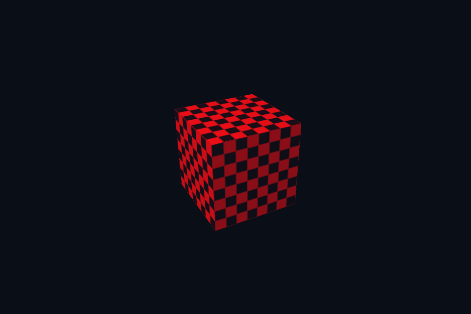

# 第 14 课 · 固定功能、颜色掩码、视口与剔除 · Vulkan 原生

[54 课目录](../../COURSE.md) · [对照精讲](../../../../docs/compare/02_triangle_pipeline.md) · [上一课](../13_shader_modules/README.md) · [下一课](../15_rendering_scope/README.md)

## 本课目标与先修

学习目标：解释“固定功能、颜色掩码、视口与剔除”解决的问题，找到实际对象和参数，运行对应实验并用数据/画面证明。先完成前一课，并能说明它交付的对象与完成条件；本课在该依赖上增加新契约。

## 为什么需要这一层

viewport 把 NDC 映射到像素，scissor 限定允许写入的矩形；两者不是同一个裁剪操作。颜色写掩码可拒绝部分通道，深度/模板和剔除则影响哪些片段进入颜色处理。每次只改一种状态才能解释画面差异。

定义请核对 [Vulkan VkFrontFace](https://docs.vulkan.org/refpages/latest/refpages/source/VkFrontFace.html) 与 [Microsoft D3D12_RASTERIZER_DESC](https://learn.microsoft.com/en-us/windows/win32/api/d3d12/ns-d3d12-d3d12_rasterizer_desc)。绕序与坐标变换一起分析，再用相同模型读回验收。

## Vulkan 原生 的对象、参数与执行推导

分别运行 half-scissor、half-viewport、back-face culling 和 red-only 写掩码实验。viewport/scissor 是管线声明的 dynamic state，cull 与写掩码在本实现中仍是创建时配置。投影 Y 翻转也会影响屏幕绕序判断。 本实验共用外表面逆时针模型：Vulkan 使用 COUNTER_CLOCKWISE，DX12 显式设置 FrontCounterClockwise=TRUE；不可依赖两边零初始化得到同一正面。

## 对照 DirectX 12：相同问题的另一种分工

RSSetViewports 与 RSSetScissorRects 负责动态矩形，RasterizerState.CullMode 和 RenderTargetWriteMask 在 PSO 内。缩窄 viewport 会改变映射比例；缩窄 scissor 则只遮住原画面的一部分。 本例使用 FrontCounterClockwise=TRUE 识别模型外表面；FALSE 会把本应可见的外面剔除，看到立方体内部。

## 关键参数与可检查不变量

| 检查项 | Vulkan 表达 | DX12 表达 | 不变量 / 证据 |
| --- | --- | --- | --- |
| 映射范围 | VkViewport | D3D12_VIEWPORT | 半视口改变 NDC 到像素的映射 |
| 写入限制 | VkRect2D scissor | D3D12_RECT scissor | 半 scissor 不压缩几何 |
| 不可动态配置 | 本例 cull / colorWriteMask | 本例 PSO cull / write mask | 需匹配所创建的管线组合 |
| 正面绕序 | COUNTER_CLOCKWISE（零值） | FrontCounterClockwise=TRUE（显式） | 读回图核对外表面；两边默认零值不等价 |

先为每项指出源码中的创建/绑定位置，以及证明它成立的实际日志、字节或图像。数值中的设备限制以查询为准；固定实验尺寸不当作所有设备的上限。

## nvpro_core2 框架对照

同样由 SceneVk 处理这些状态。把目标放进 ImGui 并不会修复场景管线的 scissor 或 front-face 错误。

这部分是原生 Vulkan 各课的框架对照，框架可运行入口仍为原有六课。如果本节需要新接入工作，会按正文说明；不把原生实验当作已完成的框架实现。

## 运行与实际检查

| 路线 | 实际实验 |
| --- | --- |
| Vulkan 原生 | [vk43_color_write_mask](../../lessons/vk43_color_write_mask/README.md) |
| Vulkan 原生 | [vk34_dynamic_scissor](../../lessons/vk34_dynamic_scissor/README.md) |
| Vulkan 原生 | [vk49_viewport_mapping](../../lessons/vk49_viewport_mapping/README.md) |
| Vulkan 原生 | [vk50_backface_culling](../../lessons/vk50_backface_culling/README.md) |
| DirectX 12 | [dx43_color_write_mask](../../../../DirectX12/lessons/dx43_color_write_mask/README.md) |
| DirectX 12 | [dx34_dynamic_scissor](../../../../DirectX12/lessons/dx34_dynamic_scissor/README.md) |
| DirectX 12 | [dx49_viewport_mapping](../../../../DirectX12/lessons/dx49_viewport_mapping/README.md) |
| DirectX 12 | [dx50_backface_culling](../../../../DirectX12/lessons/dx50_backface_culling/README.md) |

从合集根目录执行；普通图形程序 Esc 退出，设备/计算/诊断程序输出结果后结束。从“开始学习.cmd”进入本页时，表格可直接点击运行。

```powershell
cmake --preset vulkan-native
cmake --build --preset vulkan-native-debug --target vk43_color_write_mask --parallel 4
.\Vulkan\native\build\bin\Debug\vk43_color_write_mask.exe
ctest --preset vulkan-native-debug -R "^vk43_color_write_mask$" --output-on-failure
```

检查三个层次：创建/绑定/提交的接口约束；数据读回或目标画面；资源使用结束后的回收。诊断实验用合法信息或查询证明渠道可用，不故意保留 API 错误。图形 smoke 的像素检查与数值实验的逐项检查不同，具体实现见源码。

## 关键实现：从当前源码定位

来自 [Vulkan/common/scene_vk.hpp](../../../common/scene_vk.hpp#L366)，第 366—409 行。下列是当前仓库的局部切片，可能在函数中间结束；完整上下文请打开文件，切片不作为单独可编译程序。

```cpp
        VkPipelineMultisampleStateCreateInfo ms{
            VK_STRUCTURE_TYPE_PIPELINE_MULTISAMPLE_STATE_CREATE_INFO};
        ms.rasterizationSamples = samples;
        VkPipelineDepthStencilStateCreateInfo depth{
            VK_STRUCTURE_TYPE_PIPELINE_DEPTH_STENCIL_STATE_CREATE_INFO};
        depth.depthTestEnable = depth.depthWriteEnable = mode >= 5;
        depth.depthCompareOp = VK_COMPARE_OP_LESS;
        VkPipelineColorBlendAttachmentState attachment{};
        attachment.colorWriteMask =
            redOnly ? VK_COLOR_COMPONENT_R_BIT | VK_COLOR_COMPONENT_A_BIT : 15;
        VkPipelineColorBlendStateCreateInfo blend{
            VK_STRUCTURE_TYPE_PIPELINE_COLOR_BLEND_STATE_CREATE_INFO};
        blend.attachmentCount = 1;
        blend.pAttachments = &attachment;
        VkDynamicState ds[] = {VK_DYNAMIC_STATE_VIEWPORT, VK_DYNAMIC_STATE_SCISSOR};
        VkPipelineDynamicStateCreateInfo dynamic{
            VK_STRUCTURE_TYPE_PIPELINE_DYNAMIC_STATE_CREATE_INFO};
        dynamic.dynamicStateCount = 2;
        dynamic.pDynamicStates = ds;

        // 动态渲染不创建 render pass，但管线仍需声明颜色和深度附件格式。
        VkPipelineRenderingCreateInfo rendering{VK_STRUCTURE_TYPE_PIPELINE_RENDERING_CREATE_INFO};
        rendering.colorAttachmentCount = 1;
        rendering.pColorAttachmentFormats = &colorFormat;
        rendering.depthAttachmentFormat = VK_FORMAT_D32_SFLOAT;
        VkGraphicsPipelineCreateInfo gp{VK_STRUCTURE_TYPE_GRAPHICS_PIPELINE_CREATE_INFO};
        gp.pNext = &rendering;
        gp.stageCount = 2;
        gp.pStages = stages;
        gp.pVertexInputState = &vi;
        gp.pInputAssemblyState = &ia;
        gp.pViewportState = &viewport;
        gp.pRasterizationState = &raster;
        gp.pMultisampleState = &ms;
        gp.pDepthStencilState = &depth;
        gp.pColorBlendState = &blend;
        gp.pDynamicState = &dynamic;
        gp.layout = pipelineLayout;
        VkResult result = vkCreateGraphicsPipelines(c.device, cache, 1, &gp, nullptr, &pipeline);
        vkDestroyShaderModule(c.device, vs, nullptr);
        vkDestroyShaderModule(c.device, ps, nullptr);
        vkCheck(result, "Graphics pipeline");
    }

```

阅读时按“前置对象 → 参数/布局 → 录制/调用 → 完成/可见性 → 释放”五步标注。共享 helper 减少重复代码，但不会取消每课的 API 契约。

## 受控修改实验

先预测半视口与半裁剪的区别，再分别运行对应实验，检查模型宽高和可见区域。

先记录预测，再只改一个因素；保留基线与修改后的输出。不要同时改变 shader、资源范围和同步，这样即使结果变好也无法归因。

### 参考推导与通过标准

半视口把整幅几何压进较窄映射，半裁剪保留原映射但屏蔽右侧。它们可能显示相同面积，却不是相同几何变换。

## 常见失败与排查顺序

只改窗口大小未更新 viewport；或把线性代数的左右手约定直接当成 front-face 设置，都会造成误判。

先看第一条错误和当前执行路径，再看实际数据/绑定，最后看 shader 与画面。需要 GPU 证据时抓取正常交互帧；仅四帧的 smoke 适合自动检查，不适合手动抓帧。

## 自测与本课交付

能否不看源码回答：先预测半视口与半裁剪的区别，再分别运行对应实验，检查模型宽高和可见区域。

提交一份简短记录：输入与假设、唯一修改、预期、实际证据、原因、是否恢复基线。如果只能复述函数名而说不清何时允许访问/释放，先回到本课的数据流。

## 官方阅读位置与当前工程差异

[指定 Vulkan 教程对应位置](https://docs.vulkan.net.cn/tutorial/latest/03_Drawing_a_triangle/02_Graphics_pipeline_basics/02_Fixed_functions.html)。DX12 路线按同一概念顺序建立映射，其对象与约束以 Microsoft 文档和本后端代码为准。49—54 课包含在基础/compute 之后加入的工程扩展。

[版本与资料说明](../../../../docs/REFERENCES.md) · [调试](../../../../docs/DEBUGGING.md) · [功能完成度](../../../../docs/FEATURE_MATRIX.md)

## 固定输入的实际 GPU 读回


