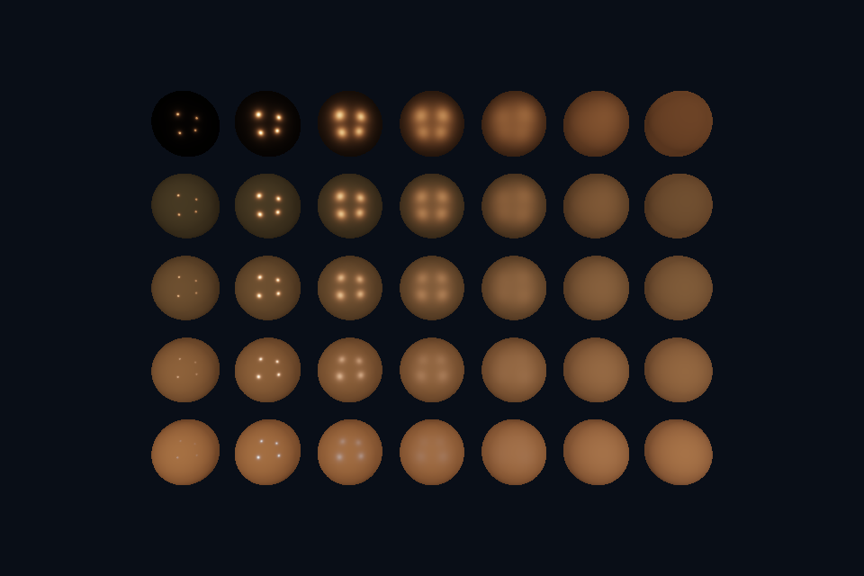

# 第 15 课 · Render Pass、动态渲染与附件契约 · Vulkan 原生

[54 课目录](../../COURSE.md) · [对照精讲](../../../../docs/compare/07_targets_depth_msaa.md) · [上一课](../14_fixed_function/README.md) · [下一课](../16_pipeline_interface/README.md)

## 本课目标与先修

学习目标：解释“Render Pass、动态渲染与附件契约”解决的问题，找到实际对象和参数，运行对应实验并用数据/画面证明。先完成前一课，并能说明它交付的对象与完成条件；本课在该依赖上增加新契约。

## 为什么需要这一层

一段渲染范围需要明确读写哪些附件、以什么格式/样本数访问、开始时清除或保留、结束后是否保留。传统 render pass 与现代直接指定附件的方式不同，但这些问题始终存在。

## Vulkan 原生 的对象、参数与执行推导

参考章节的 RenderPass/Framebuffer 需要理解；当前代码用 vkCmdBeginRendering，PipelineRenderingCreateInfo 声明格式。loadOp=CLEAR 与 storeOp=STORE 的意义分别是初始化和保留；UNDEFINED 旧布局表示不依赖旧内容，不适用于需要保留历史图像的 pass。

## 对照 DirectX 12：相同问题的另一种分工

OMSetRenderTargets 绑定 RTV/DSV，Clear 调用执行清除，resource state 声明合法访问。当前使用 legacy barrier 与普通 command list，不将其写成 D3D12 render-pass API 示例。

## 关键参数与可检查不变量

| 检查项 | Vulkan 表达 | DX12 表达 | 不变量 / 证据 |
| --- | --- | --- | --- |
| 开始策略 | loadOp=CLEAR | 显式 ClearRT/Depth | 保留历史内容时不能随意丢弃 |
| 结束策略 | storeOp 决定保留 | 资源内容与后续命令 | 保存不等于自动连接下一 pass |
| 接口路线 | dynamic rendering | 普通 command list + legacy barriers | 明确区别于参考材料的其他对象模型 |

先为每项指出源码中的创建/绑定位置，以及证明它成立的实际日志、字节或图像。数值中的设备限制以查询为准；固定实验尺寸不当作所有设备的上限。

## nvpro_core2 框架对照

RenderTargetState 可以填附件并开始 dynamic rendering，但调用者仍定义附件用途及后续读依赖。GENERAL layout 不代表无需同步。

这部分是原生 Vulkan 各课的框架对照，框架可运行入口仍为原有六课。如果本节需要新接入工作，会按正文说明；不把原生实验当作已完成的框架实现。

## 运行与实际检查

| 路线 | 实际实验 |
| --- | --- |
| Vulkan 原生 | [vk10_offscreen](../../lessons/vk10_offscreen/README.md) |
| DirectX 12 | [dx10_offscreen](../../../../DirectX12/lessons/dx10_offscreen/README.md) |

从合集根目录执行；普通图形程序 Esc 退出，设备/计算/诊断程序输出结果后结束。从“开始学习.cmd”进入本页时，表格可直接点击运行。

```powershell
cmake --preset vulkan-native
cmake --build --preset vulkan-native-debug --target vk10_offscreen --parallel 4
.\Vulkan\native\build\bin\Debug\vk10_offscreen.exe
ctest --preset vulkan-native-debug -R "^vk10_offscreen$" --output-on-failure
```

检查三个层次：创建/绑定/提交的接口约束；数据读回或目标画面；资源使用结束后的回收。诊断实验用合法信息或查询证明渠道可用，不故意保留 API 错误。图形 smoke 的像素检查与数值实验的逐项检查不同，具体实现见源码。

## 关键实现：从当前源码定位

来自 [Vulkan/native/common/native_app.hpp](../../common/native_app.hpp#L284)，第 284—327 行。下列是当前仓库的局部切片，可能在函数中间结束；完整上下文请打开文件，切片不作为单独可编译程序。

```cpp
        if (mode == 10)
            offscreen.init(device.c,
                           extent,
                           VK_FORMAT_R8G8B8A8_UNORM,
                           VK_IMAGE_USAGE_COLOR_ATTACHMENT_BIT | VK_IMAGE_USAGE_TRANSFER_SRC_BIT,
                           VK_IMAGE_ASPECT_COLOR_BIT);
        if (mode >= 3)
            scene = std::make_unique<SceneVk>(device.c,
                                              mode,
                                              mode == 10 ? VK_FORMAT_R8G8B8A8_UNORM : format,
                                              nativeShaders,
                                              options.mesh,
                                              options.samples,
                                              VK_NULL_HANDLE,
                                              options.cull,
                                              options.redOnly);
        if (scene && options.setup)
            options.setup(*scene);
    }
    ~Swapchain() {
        cleanup();
    }
};
inline int nativeMain(int argc, char** argv, int mode, NativeRenderOptions options = {}) {
    bool smoke = false;
    for (int i = 1; i < argc; ++i)
        smoke |= std::strcmp(argv[i], "--smoke") == 0;
    validationErrors = 0;
    nativeShaders = std::filesystem::absolute(argv[0]).parent_path() / "shaders";

    // 设备探测和计算课不创建窗口，也不需要 surface 或交换链。
    if (mode == 1 || mode == 8) {
        NativeDevice d(nullptr);
        if (mode == 8)
            computeSquares(d.c, nativeShaders);
        return validationErrors ? 1 : 0;
    }
    if (!glfwInit())
        throw std::runtime_error("GLFW initialization failed");
    glfwWindowHint(GLFW_CLIENT_API, GLFW_NO_API);
    if (smoke)
        glfwWindowHint(GLFW_VISIBLE, GLFW_FALSE);
    auto window = glfwCreateWindow(960, 640, "Native Vulkan Course", nullptr, nullptr);
    if (!window)
```

阅读时按“前置对象 → 参数/布局 → 录制/调用 → 完成/可见性 → 释放”五步标注。共享 helper 减少重复代码，但不会取消每课的 API 契约。

## 受控修改实验

若下一个 pass 要采样本遍颜色，指出除“保存颜色”以外还需什么。

先记录预测，再只改一个因素；保留基线与修改后的输出。不要同时改变 shader、资源范围和同步，这样即使结果变好也无法归因。

### 参考推导与通过标准

需要可采样用途/视图、正确绑定，以及颜色写入到 shader 读取的依赖和合适布局/状态。store 只处理保留意图，不完成全部连接。

## 常见失败与排查顺序

把 storeOp=DONT_CARE 的结果当成可靠输入，或把离屏 copy 当成可执行任意 shader 的后处理，会混淆契约。

先看第一条错误和当前执行路径，再看实际数据/绑定，最后看 shader 与画面。需要 GPU 证据时抓取正常交互帧；仅四帧的 smoke 适合自动检查，不适合手动抓帧。

## 自测与本课交付

能否不看源码回答：若下一个 pass 要采样本遍颜色，指出除“保存颜色”以外还需什么。

提交一份简短记录：输入与假设、唯一修改、预期、实际证据、原因、是否恢复基线。如果只能复述函数名而说不清何时允许访问/释放，先回到本课的数据流。

## 官方阅读位置与当前工程差异

[指定 Vulkan 教程对应位置](https://docs.vulkan.net.cn/tutorial/latest/03_Drawing_a_triangle/02_Graphics_pipeline_basics/03_Render_passes.html)。DX12 路线按同一概念顺序建立映射，其对象与约束以 Microsoft 文档和本后端代码为准。49—54 课包含在基础/compute 之后加入的工程扩展。

[版本与资料说明](../../../../docs/REFERENCES.md) · [调试](../../../../docs/DEBUGGING.md) · [功能完成度](../../../../docs/FEATURE_MATRIX.md)

## 固定输入的实际 GPU 读回


