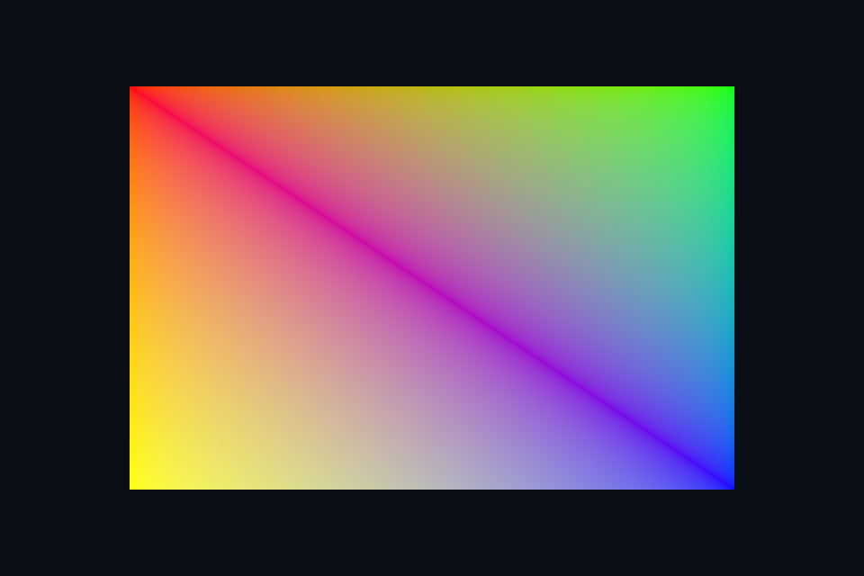

# 第 24 课 · 创建顶点资源与上传最小路径 · Vulkan 原生

[54 课目录](../../COURSE.md) · [对照精讲](../../../../docs/compare/03_geometry_memory.md) · [上一课](../23_vertex_input/README.md) · [下一课](../25_memory/README.md)

## 本课目标与先修

学习目标：解释“创建顶点资源与上传最小路径”解决的问题，找到实际对象和参数，运行对应实验并用数据/画面证明。先完成前一课，并能说明它交付的对象与完成条件；本课在该依赖上增加新契约。

## 为什么需要这一层

先用直接 CPU 可写资源建立最短的数据证据，再引入 device-local staging。确认容量是顶点数乘 stride，draw 的顶点数不是字节数；缓冲必须活过 GPU 的最后读取。

## Vulkan 原生 的对象、参数与执行推导

基础例子用 HOST_VISIBLE|HOST_COHERENT，Map 后 memcpy，再作为 vertex buffer 绑定。coherent 简化缓存操作，不消除 CPU/GPU 执行冲突。buffer 创建和 memory 分配/绑定是分开的 API 步骤。

## 对照 DirectX 12：相同问题的另一种分工

基础 VBV 指向 UPLOAD resource，Map 的空读范围表示 CPU 不读取它。UPLOAD 必须处于 GENERIC_READ；静态几何可以进一步拷贝到 DEFAULT，本章不把教学路径宣称为显卡最佳带宽路径。

## 关键参数与可检查不变量

| 检查项 | Vulkan 表达 | DX12 表达 | 不变量 / 证据 |
| --- | --- | --- | --- |
| 内容容量 | vertex count * stride | VBV SizeInBytes | draw count 不是字节数 |
| 教学内存 | HOST_VISIBLE / COHERENT | UPLOAD / GENERIC_READ | 易追踪不等于最优静态带宽 |
| 更新保护 | GPU 读完前不覆盖 | GPU 读完前不覆盖 | Map 不提供执行同步 |

先为每项指出源码中的创建/绑定位置，以及证明它成立的实际日志、字节或图像。数值中的设备限制以查询为准；固定实验尺寸不当作所有设备的上限。

## nvpro_core2 框架对照

ResourceAllocator/StagingUploader 可以让最终缓冲 device-local。先核对基础例的字节正确，再比较 helper 替代了哪些手动步骤。

这部分是原生 Vulkan 各课的框架对照，框架可运行入口仍为原有六课。如果本节需要新接入工作，会按正文说明；不把原生实验当作已完成的框架实现。

## 运行与实际检查

| 路线 | 实际实验 |
| --- | --- |
| Vulkan 原生 | [vk04_vertex_buffer](../../lessons/vk04_vertex_buffer/README.md) |
| DirectX 12 | [dx04_vertex_buffer](../../../../DirectX12/lessons/dx04_vertex_buffer/README.md) |

从合集根目录执行；普通图形程序 Esc 退出，设备/计算/诊断程序输出结果后结束。从“开始学习.cmd”进入本页时，表格可直接点击运行。

```powershell
cmake --preset vulkan-native
cmake --build --preset vulkan-native-debug --target vk04_vertex_buffer --parallel 4
.\Vulkan\native\build\bin\Debug\vk04_vertex_buffer.exe
ctest --preset vulkan-native-debug -R "^vk04_vertex_buffer$" --output-on-failure
```

检查三个层次：创建/绑定/提交的接口约束；数据读回或目标画面；资源使用结束后的回收。诊断实验用合法信息或查询证明渠道可用，不故意保留 API 错误。图形 smoke 的像素检查与数值实验的逐项检查不同，具体实现见源码。

## 关键实现：从当前源码定位

来自 [Vulkan/common/scene_vk.hpp](../../../common/scene_vk.hpp#L31)，第 31—74 行。下列是当前仓库的局部切片，可能在函数中间结束；完整上下文请打开文件，切片不作为单独可编译程序。

```cpp
struct VkBufferResource {
    VkDevice device{};
    VkBuffer buffer{};
    VkDeviceMemory memory{};
    VkDeviceSize size{};
    VkBufferResource() = default;
    VkBufferResource(const VkBufferResource&) = delete;
    VkBufferResource& operator=(const VkBufferResource&) = delete;
    void init(const VkContextRef& c,
              VkDeviceSize bytes,
              VkBufferUsageFlags usage,
              VkMemoryPropertyFlags flags = VK_MEMORY_PROPERTY_HOST_VISIBLE_BIT |
                                            VK_MEMORY_PROPERTY_HOST_COHERENT_BIT) {
        device = c.device;
        size = bytes;
        VkBufferCreateInfo info{VK_STRUCTURE_TYPE_BUFFER_CREATE_INFO};
        info.size = bytes;
        info.usage = usage;
        info.sharingMode = VK_SHARING_MODE_EXCLUSIVE;
        vkCheck(vkCreateBuffer(device, &info, nullptr, &buffer));
        VkMemoryRequirements req;
        vkGetBufferMemoryRequirements(device, buffer, &req);
        VkMemoryAllocateInfo alloc{VK_STRUCTURE_TYPE_MEMORY_ALLOCATE_INFO};
        alloc.allocationSize = req.size;
        alloc.memoryTypeIndex = memoryType(c, req.memoryTypeBits, flags);
        vkCheck(vkAllocateMemory(device, &alloc, nullptr, &memory));
        vkCheck(vkBindBufferMemory(device, buffer, memory, 0));
    }

    // 此处缓冲使用 HOST_VISIBLE | HOST_COHERENT；非 coherent 内存还需显式 flush。
    void upload(const void* data, size_t bytes) {
        void* p;
        vkCheck(vkMapMemory(device, memory, 0, size, 0, &p));
        std::memcpy(p, data, bytes);
        vkUnmapMemory(device, memory);
    }
    ~VkBufferResource() {
        if (buffer)
            vkDestroyBuffer(device, buffer, nullptr);
        if (memory)
            vkFreeMemory(device, memory, nullptr);
    }
};
struct VkImageResource {
```

阅读时按“前置对象 → 参数/布局 → 录制/调用 → 完成/可见性 → 释放”五步标注。共享 helper 减少重复代码，但不会取消每课的 API 契约。

## 受控修改实验

记录顶点数、stride、总字节数与 draw 参数，并指出哪些可以直接比较、哪些单位不同。

先记录预测，再只改一个因素；保留基线与修改后的输出。不要同时改变 shader、资源范围和同步，这样即使结果变好也无法归因。

### 参考推导与通过标准

容量按字节，stride 按字节，draw count 按顶点或索引。把 sizeof(vector) 当成其元素数据总大小是另一类常见错误。

## 常见失败与排查顺序

上传成功但缓冲绑定到错误 slot，仍会读到错误数据；先看实际 draw 的绑定而不只看创建调用。

先看第一条错误和当前执行路径，再看实际数据/绑定，最后看 shader 与画面。需要 GPU 证据时抓取正常交互帧；仅四帧的 smoke 适合自动检查，不适合手动抓帧。

## 自测与本课交付

能否不看源码回答：记录顶点数、stride、总字节数与 draw 参数，并指出哪些可以直接比较、哪些单位不同。

提交一份简短记录：输入与假设、唯一修改、预期、实际证据、原因、是否恢复基线。如果只能复述函数名而说不清何时允许访问/释放，先回到本课的数据流。

## 官方阅读位置与当前工程差异

[指定 Vulkan 教程对应位置](https://docs.vulkan.net.cn/tutorial/latest/04_Vertex_buffers/01_Vertex_buffer_creation.html)。DX12 路线按同一概念顺序建立映射，其对象与约束以 Microsoft 文档和本后端代码为准。49—54 课包含在基础/compute 之后加入的工程扩展。

[版本与资料说明](../../../../docs/REFERENCES.md) · [调试](../../../../docs/DEBUGGING.md) · [功能完成度](../../../../docs/FEATURE_MATRIX.md)

## 固定输入的实际 GPU 读回


