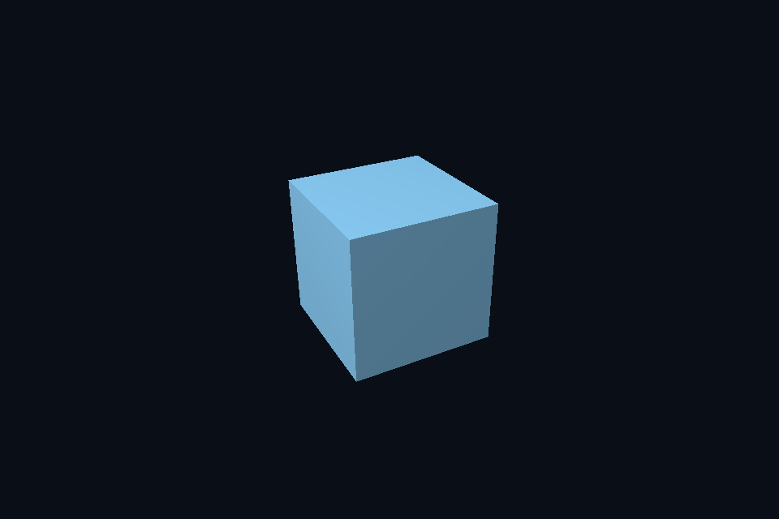

# 第 27 课 · 索引绘制与顶点复用边界 · Vulkan 原生

[54 课目录](../../COURSE.md) · [对照精讲](../../../../docs/compare/03_geometry_memory.md) · [上一课](../26_staging/README.md) · [下一课](../28_uniform_layout/README.md)

## 本课目标与先修

学习目标：解释“索引绘制与顶点复用边界”解决的问题，找到实际对象和参数，运行对应实验并用数据/画面证明。先完成前一课，并能说明它交付的对象与完成条件；本课在该依赖上增加新契约。

## 为什么需要这一层

索引指向整套顶点属性，不是只指向空间位置。立方体八个几何角点在不同面需要不同法线/UV，因此常有 24 个属性顶点和 36 个索引。复用率与 cache locality 影响性能，但首先要正确解释类型和范围。

## Vulkan 原生 的对象、参数与执行推导

绑定 index buffer 时选择 VK_INDEX_TYPE_UINT32，与 CPU 的 uint32_t 元素匹配。DrawIndexed 的 indexCount 是索引个数；vertexOffset 是应用到索引解释后的顶点偏移，不能当成缓冲字节地址。

## 对照 DirectX 12：相同问题的另一种分工

IBV 包含 GPU 地址、字节大小和 DXGI_FORMAT_R32_UINT，DrawIndexedInstanced 分开指定 index count、instance count 与偏移。VBV 和 IBV 不能互相替代。

## 关键参数与可检查不变量

| 检查项 | Vulkan 表达 | DX12 表达 | 不变量 / 证据 |
| --- | --- | --- | --- |
| 属性复用 | 24 顶点 / 36 索引立方体 | 同一共享几何 | 索引指向完整属性集合 |
| 索引类型 | VK_INDEX_TYPE_UINT32 | DXGI_FORMAT_R32_UINT | CPU 元素宽度必须匹配 |
| 索引数量 | DrawIndexed indexCount | DrawIndexedInstanced IndexCount | 不是索引缓冲总字节数 |

先为每项指出源码中的创建/绑定位置，以及证明它成立的实际日志、字节或图像。数值中的设备限制以查询为准；固定实验尺寸不当作所有设备的上限。

## nvpro_core2 框架对照

共用同一 Geometry/SceneVk，框架分配并不改变索引意义。模型合并时要把局部索引加上新增顶点的 base。

这部分是原生 Vulkan 各课的框架对照，框架可运行入口仍为原有六课。如果本节需要新接入工作，会按正文说明；不把原生实验当作已完成的框架实现。

## 本章独立工程与关键注释

[main.cpp](main.cpp) · [本地辅助实现](support/) · [本章着色器](shaders/) · [CMakeLists.txt](CMakeLists.txt)

完整源码就在本目录，关键步骤含中文注释。只复用 GLFW/GLM/Assimp 等第三方库，不包含或链接其他章节的课程实现。单独复制本章文件夹也可配置构建；初始化或纯计算章节不需要图形阶段。

```powershell
cmake -S . -B build -A x64
cmake --build build --config Debug --parallel 4
ctest --test-dir build -C Debug --output-on-failure
```

## 运行与实际检查

| 路线 | 实际实验 |
| --- | --- |
| Vulkan 原生 | [vk05_indexed_uniform](../../lessons/vk05_indexed_uniform/README.md) |
| DirectX 12 | [dx05_indexed_cbv](../../../../DirectX12/lessons/dx05_indexed_cbv/README.md) |

从合集根目录执行；普通图形程序 Esc 退出，设备/计算/诊断程序输出结果后结束。从“开始学习.cmd”进入本页时，表格可直接点击运行。

```powershell
cmake --preset vulkan-native
cmake --build --preset vulkan-native-debug --target vk27_ch_indices --parallel 4
.\Vulkan\native\build\bin\Debug\vk27_ch_indices.exe
ctest --preset vulkan-native-debug -R "^vk27_ch_indices$" --output-on-failure
```

检查三个层次：创建/绑定/提交的接口约束；数据读回或目标画面；资源使用结束后的回收。诊断实验用合法信息或查询证明渠道可用，不故意保留 API 错误。图形 smoke 的像素检查与数值实验的逐项检查不同，具体实现见源码。

## 关键实现：从当前源码定位

来自 [Vulkan/native/chapters/27_indices/main.cpp](main.cpp#L9)，第 9—64 行。下列是当前仓库的局部切片，可能在函数中间结束；完整上下文请打开文件，切片不作为单独可编译程序。

```cpp
int runChapter(int argc, char** argv) {
    NativeRenderOptions options;

    bool smoke = false;
    for (int i = 1; i < argc; ++i)
        smoke |= std::strcmp(argv[i], "--smoke") == 0;
    validationErrors = 0;
    nativeShaders =
        std::filesystem::absolute(argv[0]).parent_path() / COURSE_RUNTIME_NAME / "shaders";
    // 设备探测和计算课不创建窗口，也不需要 surface 或交换链。
    if (!glfwInit())
        throw std::runtime_error("GLFW initialization failed");
    glfwWindowHint(GLFW_CLIENT_API, GLFW_NO_API);
    if (smoke)
        glfwWindowHint(GLFW_VISIBLE, GLFW_FALSE);
    auto window = glfwCreateWindow(960, 640, "Native Vulkan Course", nullptr, nullptr);
    if (!window)
        throw std::runtime_error("Window creation failed");
    {
        NativeDevice d(window);
        Swapchain swap(d, window, 5, options);
        VkCommandPoolCreateInfo pi{VK_STRUCTURE_TYPE_COMMAND_POOL_CREATE_INFO};
        pi.flags = VK_COMMAND_POOL_CREATE_RESET_COMMAND_BUFFER_BIT;
        pi.queueFamilyIndex = d.c.family;
        VkCommandPool pool;
        vkCheck(vkCreateCommandPool(d.c.device, &pi, nullptr, &pool));
        VkCommandBufferAllocateInfo ai{VK_STRUCTURE_TYPE_COMMAND_BUFFER_ALLOCATE_INFO};
        ai.commandPool = pool;
        ai.level = VK_COMMAND_BUFFER_LEVEL_PRIMARY;
        ai.commandBufferCount = 1;
        VkCommandBuffer cmd;
        vkCheck(vkAllocateCommandBuffers(d.c.device, &ai, &cmd));
        VkSemaphoreCreateInfo si{VK_STRUCTURE_TYPE_SEMAPHORE_CREATE_INFO};
        VkSemaphore acquired;
        vkCheck(vkCreateSemaphore(d.c.device, &si, nullptr, &acquired));
        VkFenceCreateInfo fi{VK_STRUCTURE_TYPE_FENCE_CREATE_INFO};
        fi.flags = VK_FENCE_CREATE_SIGNALED_BIT;
        VkFence fence;
        vkCheck(vkCreateFence(d.c.device, &fi, nullptr, &fence));
        int frames = 0;
        while (!glfwWindowShouldClose(window) && (!smoke || frames < 4)) {
            glfwPollEvents();
            if (glfwGetKey(window, GLFW_KEY_ESCAPE) == GLFW_PRESS)
                break;
            int w, h;
            glfwGetFramebufferSize(window, &w, &h);
            if (w < 1 || h < 1) {
                glfwWaitEvents();
                continue;
            }
            if (uint32_t(w) != swap.extent.width || uint32_t(h) != swap.extent.height)
                swap.recreate();
            // 先等待上一轮命令完成，再复用命令缓冲和共享 UBO；本课程采用单帧串行同步。
            vkCheck(vkWaitForFences(d.c.device, 1, &fence, VK_TRUE, UINT64_MAX));
            uint32_t imageIndex;
            // acquire semaphore 告知 GPU 图像可用；遇到 OUT_OF_DATE 时先重建再尝试。
```

阅读时按“前置对象 → 参数/布局 → 录制/调用 → 完成/可见性 → 释放”五步标注。辅助实现与着色器是本章自己的文件；修改不会影响其他章。

## 受控修改实验

合并两个 mesh 的顶点和索引，写出第二个 mesh 索引的修正规则。

先记录预测，再只改一个因素；保留基线与修改后的输出。不要同时改变 shader、资源范围和同步，这样即使结果变好也无法归因。

### 参考推导与通过标准

第二份局部索引加上第一份累计顶点数；若每 mesh 单独绑定或使用 base vertex，则按自己的约定处理，不能重复加两次。

## 常见失败与排查顺序

CPU 存 uint32 却绑定 uint16，或把 count 传成字节数，会导致错连、越界或部分几何消失。

先看第一条错误和当前执行路径，再看实际数据/绑定，最后看 shader 与画面。需要 GPU 证据时抓取正常交互帧；仅四帧的 smoke 适合自动检查，不适合手动抓帧。

## 自测与本课交付

能否不看源码回答：合并两个 mesh 的顶点和索引，写出第二个 mesh 索引的修正规则。

提交一份简短记录：输入与假设、唯一修改、预期、实际证据、原因、是否恢复基线。如果只能复述函数名而说不清何时允许访问/释放，先回到本课的数据流。

## 官方阅读位置与当前工程差异

[指定 Vulkan 教程对应位置](https://docs.vulkan.net.cn/tutorial/latest/04_Vertex_buffers/03_Index_buffer.html)。DX12 路线按同一概念顺序建立映射，其对象与约束以 Microsoft 文档和本后端代码为准。49—54 课包含在基础/compute 之后加入的工程扩展。

[版本与资料说明](../../../../docs/REFERENCES.md) · [调试](../../../../docs/DEBUGGING.md) · [功能完成度](../../../../docs/FEATURE_MATRIX.md)

## 固定输入的实际 GPU 读回


