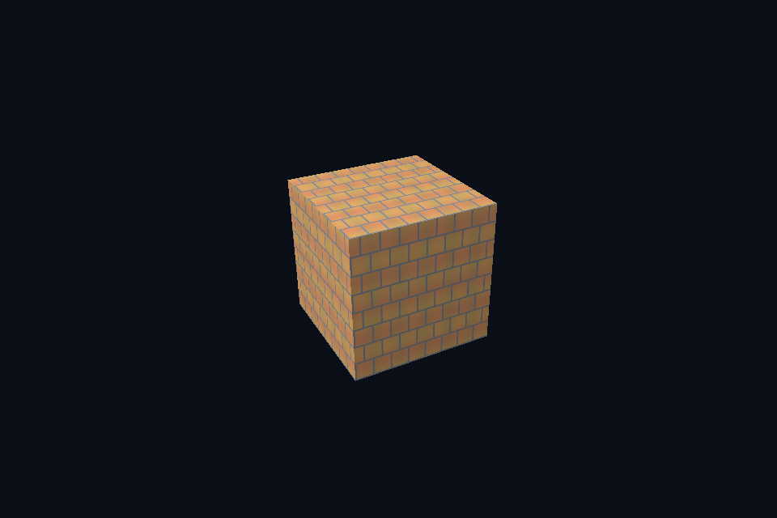

# 第 34 课 · 图像存储、Footprint 与拷贝 · Vulkan 原生

[54 课目录](../../COURSE.md) · [对照精讲](../../../../docs/compare/06_textures_color.md) · [上一课](../33_image_decode/README.md) · [下一课](../35_image_dependencies/README.md)

## 本课目标与先修

学习目标：解释“图像存储、Footprint 与拷贝”解决的问题，找到实际对象和参数，运行对应实验并用数据/画面证明。先完成前一课，并能说明它交付的对象与完成条件；本课在该依赖上增加新契约。

## 为什么需要这一层

图像通常有适合 GPU 的内部布局，CPU 线性像素需要通过合法传输进入它。上传描述包含行、切片、层与 mip，单层例子只是最小情况。临时存储要保持到 copy 完成。

## Vulkan 原生 的对象、参数与执行推导

Image 创建声明 usage/format/extent/mip，MemoryRequirements 决定绑定存储。BufferImageCopy 描述缓冲到子资源的映射；先处于 TRANSFER_DST，再允许采样。创建 view 或更新 descriptor 不会替代 copy。

## 对照 DirectX 12：相同问题的另一种分工

GetCopyableFootprints 返回 Offset、RowPitch 和各行信息，逐行填充后录制 CopyTextureRegion。texture resource 的宽高不是 upload buffer 的紧密内存布局；mip/array 各自是子资源。

## 关键参数与可检查不变量

| 检查项 | Vulkan 表达 | DX12 表达 | 不变量 / 证据 |
| --- | --- | --- | --- |
| 线性中转 | BufferImageCopy | PlacedSubresourceFootprint | CPU 字节与最优图像布局分层 |
| 行定位 | 按拷贝描述解释 | Offset + y*RowPitch | row pitch 可能大于有效行字节 |
| 上传结束 | copy 完成后回收 staging | fence 后回收 UPLOAD | view 创建不代表上传完成 |

先为每项指出源码中的创建/绑定位置，以及证明它成立的实际日志、字节或图像。数值中的设备限制以查询为准；固定实验尺寸不当作所有设备的上限。

## nvpro_core2 框架对照

StagingUploader 简化收集和拷贝录制，但输入数据、用途与完成回收仍要解释。当前 nv04 的 VMA 演示重点是顶点，不能写成已迁移全部图片管线。

这部分是原生 Vulkan 各课的框架对照，框架可运行入口仍为原有六课。如果本节需要新接入工作，会按正文说明；不把原生实验当作已完成的框架实现。

## 运行与实际检查

| 路线 | 实际实验 |
| --- | --- |
| Vulkan 原生 | [vk17_image_file](../../lessons/vk17_image_file/README.md) |
| Vulkan 原生 | [vk13_staging_copy](../../lessons/vk13_staging_copy/README.md) |
| DirectX 12 | [dx17_image_file](../../../../DirectX12/lessons/dx17_image_file/README.md) |
| DirectX 12 | [dx13_staging_copy](../../../../DirectX12/lessons/dx13_staging_copy/README.md) |

从合集根目录执行；普通图形程序 Esc 退出，设备/计算/诊断程序输出结果后结束。从“开始学习.cmd”进入本页时，表格可直接点击运行。

```powershell
cmake --preset vulkan-native
cmake --build --preset vulkan-native-debug --target vk17_image_file --parallel 4
.\Vulkan\native\build\bin\Debug\vk17_image_file.exe
ctest --preset vulkan-native-debug -R "^vk17_image_file$" --output-on-failure
```

检查三个层次：创建/绑定/提交的接口约束；数据读回或目标画面；资源使用结束后的回收。诊断实验用合法信息或查询证明渠道可用，不故意保留 API 错误。图形 smoke 的像素检查与数值实验的逐项检查不同，具体实现见源码。

## 关键实现：从当前源码定位

来自 [Vulkan/native/common/advanced_labs.cpp](../../common/advanced_labs.cpp#L354)，第 354—397 行。下列是当前仓库的局部切片，可能在函数中间结束；完整上下文请打开文件，切片不作为单独可编译程序。

```cpp
struct GpuTexture {
    VkContextRef c;
    VkImageResource image;
    VkSampler sampler{};
    VkImageView selectedView{};
    VkFormat format{};
    std::vector<Pixels> reference;
    explicit GpuTexture(
        VkContextRef context, Pixels pixels, bool mips, bool srgb = false, bool clamp = false)
        : c(context) {
        reference = mips ? mipReference(pixels, srgb) : std::vector<Pixels>{pixels};
        uint32_t levels = uint32_t(reference.size());
        format = srgb ? VK_FORMAT_R8G8B8A8_SRGB : VK_FORMAT_R8G8B8A8_UNORM;
        if (mips) {
            VkFormatProperties properties{};
            vkGetPhysicalDeviceFormatProperties(c.physical, format, &properties);
            VkFormatFeatureFlags required = VK_FORMAT_FEATURE_BLIT_SRC_BIT |
                                            VK_FORMAT_FEATURE_BLIT_DST_BIT |
                                            VK_FORMAT_FEATURE_SAMPLED_IMAGE_FILTER_LINEAR_BIT;
            require((properties.optimalTilingFeatures & required) == required,
                    "Format cannot generate linear-blit mip chain");
        }
        image.init(c,
                   {pixels.width, pixels.height},
                   format,
                   VK_IMAGE_USAGE_SAMPLED_BIT | VK_IMAGE_USAGE_TRANSFER_SRC_BIT |
                       VK_IMAGE_USAGE_TRANSFER_DST_BIT,
                   VK_IMAGE_ASPECT_COLOR_BIT,
                   levels);
        VkBufferResource upload;
        upload.init(c, pixels.rgba.size(), VK_BUFFER_USAGE_TRANSFER_SRC_BIT);
        upload.upload(pixels.rgba.data(), pixels.rgba.size());
        immediate(c, [&](VkCommandBuffer cmd) {
            for (uint32_t i = 0; i < levels; ++i)
                imageDependency(cmd,
                                image.image,
                                i,
                                VK_IMAGE_LAYOUT_UNDEFINED,
                                VK_IMAGE_LAYOUT_TRANSFER_DST_OPTIMAL,
                                VK_PIPELINE_STAGE_2_NONE,
                                0,
                                VK_PIPELINE_STAGE_2_COPY_BIT | VK_PIPELINE_STAGE_2_BLIT_BIT,
                                VK_ACCESS_2_TRANSFER_WRITE_BIT);
            VkBufferImageCopy copy{};
```

阅读时按“前置对象 → 参数/布局 → 录制/调用 → 完成/可见性 → 释放”五步标注。共享 helper 减少重复代码，但不会取消每课的 API 契约。

## 受控修改实验

解释一次 memcpy(width*height*4) 为什么不总能正确填 texture upload。

先记录预测，再只改一个因素；保留基线与修改后的输出。不要同时改变 shader、资源范围和同步，这样即使结果变好也无法归因。

### 参考推导与通过标准

API 可能要求更大的对齐行距或子资源起点。正确内容应逐行写到 footprint 的 Offset+y*RowPitch，再按有效宽度复制。

## 常见失败与排查顺序

只分配有效像素字节数却按对齐 row pitch 写，会越界；分配足够但使用错误 pitch，也会造成图像错行。

先看第一条错误和当前执行路径，再看实际数据/绑定，最后看 shader 与画面。需要 GPU 证据时抓取正常交互帧；仅四帧的 smoke 适合自动检查，不适合手动抓帧。

## 自测与本课交付

能否不看源码回答：解释一次 memcpy(width*height*4) 为什么不总能正确填 texture upload。

提交一份简短记录：输入与假设、唯一修改、预期、实际证据、原因、是否恢复基线。如果只能复述函数名而说不清何时允许访问/释放，先回到本课的数据流。

## 官方阅读位置与当前工程差异

[指定 Vulkan 教程对应位置](https://docs.vulkan.net.cn/tutorial/latest/06_Texture_mapping/00_Images.html)。DX12 路线按同一概念顺序建立映射，其对象与约束以 Microsoft 文档和本后端代码为准。49—54 课包含在基础/compute 之后加入的工程扩展。

[版本与资料说明](../../../../docs/REFERENCES.md) · [调试](../../../../docs/DEBUGGING.md) · [功能完成度](../../../../docs/FEATURE_MATRIX.md)

## 固定输入的实际 GPU 读回


