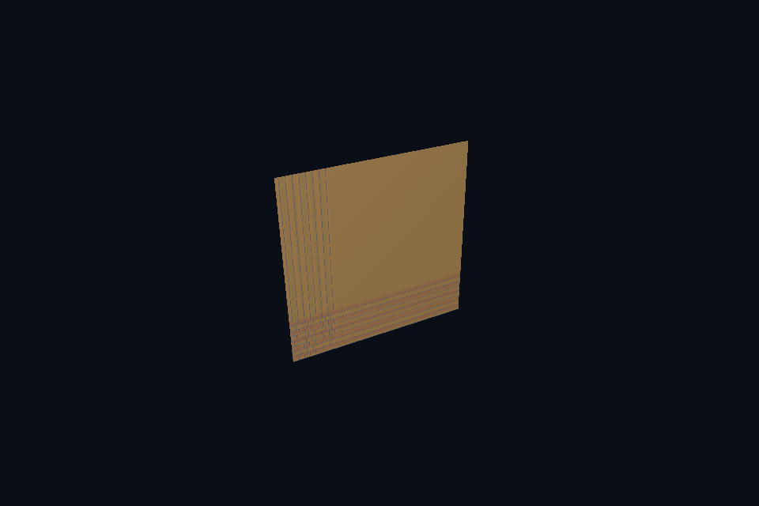

# 第 36 课 · 采样器、过滤、寻址与 UV · Vulkan 原生

[54 课目录](../../COURSE.md) · [对照精讲](../../../../docs/compare/06_textures_color.md) · [上一课](../35_image_dependencies/README.md) · [下一课](../37_texture_binding/README.md)

## 本课目标与先修

学习目标：解释“采样器、过滤、寻址与 UV”解决的问题，找到实际对象和参数，运行对应实验并用数据/画面证明。先完成前一课，并能说明它交付的对象与完成条件；本课在该依赖上增加新契约。

## 为什么需要这一层

图像保存 texel，sampler 决定过滤、寻址和 LOD。repeat/clamp 只影响越界访问，不会修复错误上传；linear/nearest 只改变插值，不会生成 mip。本课将 UV 放大到原范围之外，让寻址差异真正可观察。

## Vulkan 原生 的对象、参数与执行推导

sampler 指定 addressMode、min/magFilter、mipmapMode 和 maxLod；组合 descriptor 同时引用 sampler/image view，但二者仍是独立对象。各向异性另有特性与限制，本例不假装已经启用。

## 对照 DirectX 12：相同问题的另一种分工

当前图形 root signature 使用 static sampler，寻址策略是创建接口的一部分。改变它通常涉及相应 root signature/PSO 组合；若需要频繁变化，可设计独立 sampler heap/table，而不是随意改纹理字节。

## 关键参数与可检查不变量

| 检查项 | Vulkan 表达 | DX12 表达 | 不变量 / 证据 |
| --- | --- | --- | --- |
| UV 范围 | 0..4 激活越界寻址 | 0..4 激活越界寻址 | 测试输入要暴露机制差异 |
| 寻址规则 | REPEAT / CLAMP_TO_EDGE | WRAP / CLAMP | 不修复错误 row pitch |
| 采样器位置 | 独立 VkSampler | 本例 static sampler | 接口变化与数据变化分别管理 |

先为每项指出源码中的创建/绑定位置，以及证明它成立的实际日志、字节或图像。数值中的设备限制以查询为准；固定实验尺寸不当作所有设备的上限。

## nvpro_core2 框架对照

同样受 Vulkan sampler 规则约束。ImGui 显示采样与场景材质采样是不同用途，不能把 UI 的设置当成场景 sampler 已更新。

这部分是原生 Vulkan 各课的框架对照，框架可运行入口仍为原有六课。如果本节需要新接入工作，会按正文说明；不把原生实验当作已完成的框架实现。

## 本章独立工程与关键注释

[main.cpp](main.cpp) · [本地辅助实现](support/) · [本章着色器](shaders/) · [CMakeLists.txt](CMakeLists.txt)

完整源码就在本目录，关键步骤含中文注释。只复用 GLFW/GLM/Assimp 等第三方库，不包含或链接其他章节的课程实现。单独复制本章文件夹也可配置构建；初始化或纯计算章节不需要图形阶段。

```powershell
cmake -S . -B build -A x64
cmake --build build --config Debug --parallel 4
ctest --test-dir build -C Debug --output-on-failure
```

## 运行与实际检查

| 路线 | 实际实验 |
| --- | --- |
| Vulkan 原生 | [vk52_sampler_addressing](../../lessons/vk52_sampler_addressing/README.md) |
| DirectX 12 | [dx52_sampler_addressing](../../../../DirectX12/lessons/dx52_sampler_addressing/README.md) |

从合集根目录执行；普通图形程序 Esc 退出，设备/计算/诊断程序输出结果后结束。从“开始学习.cmd”进入本页时，表格可直接点击运行。

```powershell
cmake --preset vulkan-native
cmake --build --preset vulkan-native-debug --target vk36_ch_samplers --parallel 4
.\Vulkan\native\build\bin\Debug\vk36_ch_samplers.exe
ctest --preset vulkan-native-debug -R "^vk36_ch_samplers$" --output-on-failure
```

检查三个层次：创建/绑定/提交的接口约束；数据读回或目标画面；资源使用结束后的回收。诊断实验用合法信息或查询证明渠道可用，不故意保留 API 错误。图形 smoke 的像素检查与数值实验的逐项检查不同，具体实现见源码。

## 关键实现：从当前源码定位

来自 [Vulkan/native/chapters/36_samplers/main.cpp](main.cpp#L283)，第 283—297 行。下列是当前仓库的局部切片，可能在函数中间结束；完整上下文请打开文件，切片不作为单独可编译程序。

```cpp
int runChapter(int argc, char** argv) {
    auto options = labOptions(argc, argv, 52);
    nativeShaders = options.directory / "shaders";
    {
        return graphicsLab(argc, argv, options);
    }
}
} // namespace course

int main(int argc, char** argv) try {
    return course::runChapter(argc, argv);
} catch (const std::exception& error) {
    std::cerr << "ERROR: " << error.what() << '\n';
    return 1;
}
```

阅读时按“前置对象 → 参数/布局 → 录制/调用 → 完成/可见性 → 释放”五步标注。辅助实现与着色器是本章自己的文件；修改不会影响其他章。

## 受控修改实验

在 UV=0..4 的测试几何上比较 clamp 与 repeat，解释边缘拉伸来自哪里。

先记录预测，再只改一个因素；保留基线与修改后的输出。不要同时改变 shader、资源范围和同步，这样即使结果变好也无法归因。

### 参考推导与通过标准

clamp 将越界坐标限制到边缘 texel，repeat 周期折回。两者都读取同一内容，区别来自寻址规则而非模型解析。

## 常见失败与排查顺序

只有 UV 在 0..1 时，切换寻址可能几乎看不出变化；应选择能激活该状态差异的受控输入。

先看第一条错误和当前执行路径，再看实际数据/绑定，最后看 shader 与画面。需要 GPU 证据时抓取正常交互帧；仅四帧的 smoke 适合自动检查，不适合手动抓帧。

## 自测与本课交付

能否不看源码回答：在 UV=0..4 的测试几何上比较 clamp 与 repeat，解释边缘拉伸来自哪里。

提交一份简短记录：输入与假设、唯一修改、预期、实际证据、原因、是否恢复基线。如果只能复述函数名而说不清何时允许访问/释放，先回到本课的数据流。

## 官方阅读位置与当前工程差异

[指定 Vulkan 教程对应位置](https://docs.vulkan.net.cn/tutorial/latest/06_Texture_mapping/01_Image_view_and_sampler.html)。DX12 路线按同一概念顺序建立映射，其对象与约束以 Microsoft 文档和本后端代码为准。49—54 课包含在基础/compute 之后加入的工程扩展。

[版本与资料说明](../../../../docs/REFERENCES.md) · [调试](../../../../docs/DEBUGGING.md) · [功能完成度](../../../../docs/FEATURE_MATRIX.md)

## 固定输入的实际 GPU 读回


