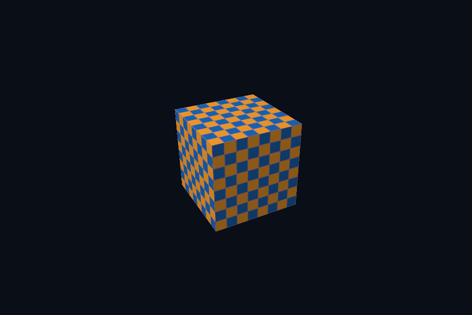

# 第 37 课 · 图像、采样器与 Shader 资源连接 · Vulkan 原生

[54 课目录](../../COURSE.md) · [对照精讲](../../../../docs/compare/06_textures_color.md) · [上一课](../36_samplers/README.md) · [下一课](../38_color_space/README.md)

## 本课目标与先修

学习目标：解释“图像、采样器与 Shader 资源连接”解决的问题，找到实际对象和参数，运行对应实验并用数据/画面证明。先完成前一课，并能说明它交付的对象与完成条件；本课在该依赖上增加新契约。

## 为什么需要这一层

完成上传只是准备了内容，还要把访问方式连接到 shader。核对资源、view、sampler、接口编号、实际绑定与消费者阶段，才能解释一次纹理读取。名称相似不代表它们存放同样的内容。

## Vulkan 原生 的对象、参数与执行推导

组合 image sampler descriptor 引用 imageView、sampler 和约定 imageLayout；layout binding 1 与 GLSL 一致。vkUpdateDescriptorSets 更新引用，不录制布局转换，也不复制 texel。set/pool 和图像各有生命周期。

## 对照 DirectX 12：相同问题的另一种分工

SRV 在 shader-visible heap 中描述纹理，SetDescriptorHeaps 后用 GPU handle 设置 root descriptor table；static sampler 对应 s0。CPU handle 用于写 descriptor，GPU handle 用于绑定，不能互换或按指针算像素地址。

## 关键参数与可检查不变量

| 检查项 | Vulkan 表达 | DX12 表达 | 不变量 / 证据 |
| --- | --- | --- | --- |
| 读取资源 | combined image sampler | SRV table + static sampler | 图像/采样器都与 shader 一致 |
| 绑定编号 | binding 1 | t0 / s0 与 root table | 不同编号系统不可混同 |
| 写入视图 | update set 引用 | CPU handle 写 SRV | 不复制 texel、不建立同步 |

先为每项指出源码中的创建/绑定位置，以及证明它成立的实际日志、字节或图像。数值中的设备限制以查询为准；固定实验尺寸不当作所有设备的上限。

## nvpro_core2 框架对照

SceneVk 管理自定义材质 descriptor，ImTexture 管理 UI 显示引用。两套绑定服务不同 shader，不因指向同一图像就可以任意替换。

这部分是原生 Vulkan 各课的框架对照，框架可运行入口仍为原有六课。如果本节需要新接入工作，会按正文说明；不把原生实验当作已完成的框架实现。

## 运行与实际检查

| 路线 | 实际实验 |
| --- | --- |
| Vulkan 原生 | [vk06_texture_descriptor](../../lessons/vk06_texture_descriptor/README.md) |
| DirectX 12 | [dx06_texture_srv](../../../../DirectX12/lessons/dx06_texture_srv/README.md) |

从合集根目录执行；普通图形程序 Esc 退出，设备/计算/诊断程序输出结果后结束。从“开始学习.cmd”进入本页时，表格可直接点击运行。

```powershell
cmake --preset vulkan-native
cmake --build --preset vulkan-native-debug --target vk06_texture_descriptor --parallel 4
.\Vulkan\native\build\bin\Debug\vk06_texture_descriptor.exe
ctest --preset vulkan-native-debug -R "^vk06_texture_descriptor$" --output-on-failure
```

检查三个层次：创建/绑定/提交的接口约束；数据读回或目标画面；资源使用结束后的回收。诊断实验用合法信息或查询证明渠道可用，不故意保留 API 错误。图形 smoke 的像素检查与数值实验的逐项检查不同，具体实现见源码。

## 关键实现：从当前源码定位

来自 [Vulkan/common/scene_vk.hpp](../../../common/scene_vk.hpp#L241)，第 241—284 行。下列是当前仓库的局部切片，可能在函数中间结束；完整上下文请打开文件，切片不作为单独可编译程序。

```cpp
        auto data = checker();
        VkBufferResource upload;
        upload.init(c, data.size(), VK_BUFFER_USAGE_TRANSFER_SRC_BIT);
        upload.upload(data.data(), data.size());
        texture.init(c,
                     {64, 64},
                     VK_FORMAT_R8G8B8A8_SRGB,
                     VK_IMAGE_USAGE_SAMPLED_BIT | VK_IMAGE_USAGE_TRANSFER_DST_BIT,
                     VK_IMAGE_ASPECT_COLOR_BIT);

        // 纹理先切到传输目标布局，拷贝完成后再切到 shader 只读布局供片元阶段采样。
        immediate(c, [&](VkCommandBuffer cmd) {
            barrier(cmd,
                    texture.image,
                    VK_IMAGE_LAYOUT_UNDEFINED,
                    VK_IMAGE_LAYOUT_TRANSFER_DST_OPTIMAL,
                    VK_PIPELINE_STAGE_2_NONE,
                    0,
                    VK_PIPELINE_STAGE_2_COPY_BIT,
                    VK_ACCESS_2_TRANSFER_WRITE_BIT);
            VkBufferImageCopy copy{};
            copy.imageSubresource = {VK_IMAGE_ASPECT_COLOR_BIT, 0, 0, 1};
            copy.imageExtent = {64, 64, 1};
            vkCmdCopyBufferToImage(
                cmd, upload.buffer, texture.image, VK_IMAGE_LAYOUT_TRANSFER_DST_OPTIMAL, 1, &copy);
            barrier(cmd,
                    texture.image,
                    VK_IMAGE_LAYOUT_TRANSFER_DST_OPTIMAL,
                    VK_IMAGE_LAYOUT_SHADER_READ_ONLY_OPTIMAL,
                    VK_PIPELINE_STAGE_2_COPY_BIT,
                    VK_ACCESS_2_TRANSFER_WRITE_BIT,
                    VK_PIPELINE_STAGE_2_FRAGMENT_SHADER_BIT,
                    VK_ACCESS_2_SHADER_SAMPLED_READ_BIT);
        });
        VkSamplerCreateInfo si{VK_STRUCTURE_TYPE_SAMPLER_CREATE_INFO};
        si.magFilter = si.minFilter = VK_FILTER_LINEAR;
        si.addressModeU = si.addressModeV = si.addressModeW = VK_SAMPLER_ADDRESS_MODE_REPEAT;
        si.maxLod = 0;
        vkCheck(vkCreateSampler(c.device, &si, nullptr, &sampler));

        // binding 0 对应每帧 UBO，binding 1 对应纹理和采样器；编号与 GLSL 保持一致。
        VkDescriptorSetLayoutBinding bindings[2] = {
            {0, VK_DESCRIPTOR_TYPE_UNIFORM_BUFFER, 1, VK_SHADER_STAGE_VERTEX_BIT, nullptr},
            {1,
```

阅读时按“前置对象 → 参数/布局 → 录制/调用 → 完成/可见性 → 释放”五步标注。共享 helper 减少重复代码，但不会取消每课的 API 契约。

## 受控修改实验

为什么 descriptor/SRV 看起来正确，纹理仍然可能全黑？

先记录预测，再只改一个因素；保留基线与修改后的输出。不要同时改变 shader、资源范围和同步，这样即使结果变好也无法归因。

### 参考推导与通过标准

内容未上传、错误子资源、布局/状态或同步错误、UV/颜色空间错误都可能存在。先查看资源 texel，再看绑定与 shader 结果。

## 常见失败与排查顺序

只查 C++ 成员句柄而不查实际 draw 的 GPU 绑定，会错过被后续命令覆盖的 table/set。

先看第一条错误和当前执行路径，再看实际数据/绑定，最后看 shader 与画面。需要 GPU 证据时抓取正常交互帧；仅四帧的 smoke 适合自动检查，不适合手动抓帧。

## 自测与本课交付

能否不看源码回答：为什么 descriptor/SRV 看起来正确，纹理仍然可能全黑？

提交一份简短记录：输入与假设、唯一修改、预期、实际证据、原因、是否恢复基线。如果只能复述函数名而说不清何时允许访问/释放，先回到本课的数据流。

## 官方阅读位置与当前工程差异

[指定 Vulkan 教程对应位置](https://docs.vulkan.net.cn/tutorial/latest/06_Texture_mapping/02_Combined_image_sampler.html)。DX12 路线按同一概念顺序建立映射，其对象与约束以 Microsoft 文档和本后端代码为准。49—54 课包含在基础/compute 之后加入的工程扩展。

[版本与资料说明](../../../../docs/REFERENCES.md) · [调试](../../../../docs/DEBUGGING.md) · [功能完成度](../../../../docs/FEATURE_MATRIX.md)

## 固定输入的实际 GPU 读回


