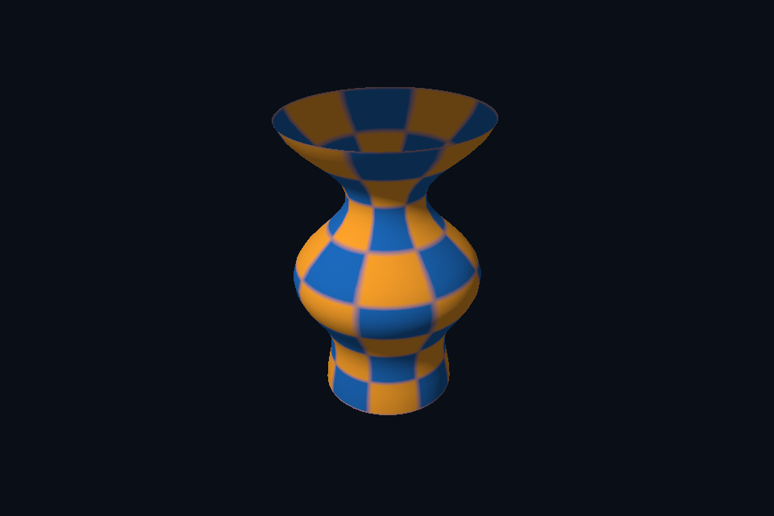

# 第 41 课 · OBJ 导入、索引与几何归一化 · Vulkan 原生

[54 课目录](../../COURSE.md) · [对照精讲](../../../../docs/compare/11_models_animation.md) · [上一课](../40_depth_test/README.md) · [下一课](../42_gltf_nodes/README.md)

## 本课目标与先修

学习目标：解释“OBJ 导入、索引与几何归一化”解决的问题，找到实际对象和参数，运行对应实验并用数据/画面证明。先完成前一课，并能说明它交付的对象与完成条件；本课在该依赖上增加新契约。

## 为什么需要这一层

模型文件解析与 GPU 后端是两层。CPU 解析得到 mesh、indices、normal、UV，后端再上传和绘制。本实验使用课程自制 vase.obj，三角化后合并几何并核对顶点/索引数量。

## Vulkan 原生 的对象、参数与执行推导

staticAsset 将节点变换应用到顶点，以正确法线矩阵变换 normal，再把 Geometry 交给 SceneVk。原生缓冲、布局和索引路径可复用；模型不需要一套全新的绘图 API。

## 对照 DirectX 12：相同问题的另一种分工

同一 Geometry 进入 DxScene 的 VBV/IBV 与 input layout。归一化 bbox 便于固定相机观察，但它改变资产单位，不能在工程中无记录地用于物理、灯光或动画尺度。

## 关键参数与可检查不变量

| 检查项 | Vulkan 表达 | DX12 表达 | 不变量 / 证据 |
| --- | --- | --- | --- |
| 静态导入 | Assimp → Geometry | 同一 CPU Geometry | 文件解析与 GPU 上传分开 |
| 合并索引 | 局部索引 + 顶点 base | 相同规则 | 避免第二 mesh 错连 |
| 尺度处理 | bbox 中心/尺度归一化 | 相同处理 | 记录变更，不能无声改变工程单位 |

先为每项指出源码中的创建/绑定位置，以及证明它成立的实际日志、字节或图像。数值中的设备限制以查询为准；固定实验尺寸不当作所有设备的上限。

## nvpro_core2 框架对照

资产解析、VMA 上传、descriptor 和 scene hierarchy 应分别设计。本轮框架路线保留六个基础例，提供接入点对照，不把原生 Assimp 导入算成已完成的 nvpro 模型播放器。

这部分是原生 Vulkan 各课的框架对照，框架可运行入口仍为原有六课。如果本节需要新接入工作，会按正文说明；不把原生实验当作已完成的框架实现。

## 本章独立工程与关键注释

[main.cpp](main.cpp) · [本地辅助实现](support/) · [本章着色器](shaders/) · [CMakeLists.txt](CMakeLists.txt)

完整源码就在本目录，关键步骤含中文注释。只复用 GLFW/GLM/Assimp 等第三方库，不包含或链接其他章节的课程实现。单独复制本章文件夹也可配置构建；初始化或纯计算章节不需要图形阶段。

```powershell
cmake -S . -B build -A x64
cmake --build build --config Debug --parallel 4
ctest --test-dir build -C Debug --output-on-failure
```

## 运行与实际检查

| 路线 | 实际实验 |
| --- | --- |
| Vulkan 原生 | [vk21_obj_model](../../lessons/vk21_obj_model/README.md) |
| DirectX 12 | [dx21_obj_model](../../../../DirectX12/lessons/dx21_obj_model/README.md) |

从合集根目录执行；普通图形程序 Esc 退出，设备/计算/诊断程序输出结果后结束。从“开始学习.cmd”进入本页时，表格可直接点击运行。

```powershell
cmake --preset vulkan-native
cmake --build --preset vulkan-native-debug --target vk41_ch_obj_models --parallel 4
.\Vulkan\native\build\bin\Debug\vk41_ch_obj_models.exe
ctest --preset vulkan-native-debug -R "^vk41_ch_obj_models$" --output-on-failure
```

检查三个层次：创建/绑定/提交的接口约束；数据读回或目标画面；资源使用结束后的回收。诊断实验用合法信息或查询证明渠道可用，不故意保留 API 错误。图形 smoke 的像素检查与数值实验的逐项检查不同，具体实现见源码。

## 关键实现：从当前源码定位

来自 [Vulkan/native/chapters/41_obj_models/main.cpp](main.cpp#L31)，第 31—45 行。下列是当前仓库的局部切片，可能在函数中间结束；完整上下文请打开文件，切片不作为单独可编译程序。

```cpp
int runChapter(int argc, char** argv) {
    auto options = labOptions(argc, argv, 21);
    nativeShaders = options.directory / "shaders";
    {
        return graphicsLab(argc, argv, options);
    }
}
} // namespace course

int main(int argc, char** argv) try {
    return course::runChapter(argc, argv);
} catch (const std::exception& error) {
    std::cerr << "ERROR: " << error.what() << '\n';
    return 1;
}
```

阅读时按“前置对象 → 参数/布局 → 录制/调用 → 完成/可见性 → 释放”五步标注。辅助实现与着色器是本章自己的文件；修改不会影响其他章。

## 受控修改实验

只加载模型位置并用固定色画出，再分阶段恢复 normal/UV，说明这种顺序的作用。

先记录预测，再只改一个因素；保留基线与修改后的输出。不要同时改变 shader、资源范围和同步，这样即使结果变好也无法归因。

### 参考推导与通过标准

它把解析/索引/相机问题与材质问题分开。轮廓都不正确时，先不要调灯光或寻找缺失贴图。

## 常见失败与排查顺序

只取第一个 mesh、遗漏索引 base 或使用不匹配的 stride，会使模型残缺、错连或重叠。

先看第一条错误和当前执行路径，再看实际数据/绑定，最后看 shader 与画面。需要 GPU 证据时抓取正常交互帧；仅四帧的 smoke 适合自动检查，不适合手动抓帧。

## 自测与本课交付

能否不看源码回答：只加载模型位置并用固定色画出，再分阶段恢复 normal/UV，说明这种顺序的作用。

提交一份简短记录：输入与假设、唯一修改、预期、实际证据、原因、是否恢复基线。如果只能复述函数名而说不清何时允许访问/释放，先回到本课的数据流。

## 官方阅读位置与当前工程差异

[指定 Vulkan 教程对应位置](https://docs.vulkan.net.cn/tutorial/latest/08_Loading_models.html)。DX12 路线按同一概念顺序建立映射，其对象与约束以 Microsoft 文档和本后端代码为准。49—54 课包含在基础/compute 之后加入的工程扩展。

[版本与资料说明](../../../../docs/REFERENCES.md) · [调试](../../../../docs/DEBUGGING.md) · [功能完成度](../../../../docs/FEATURE_MATRIX.md)

## 固定输入的实际 GPU 读回


